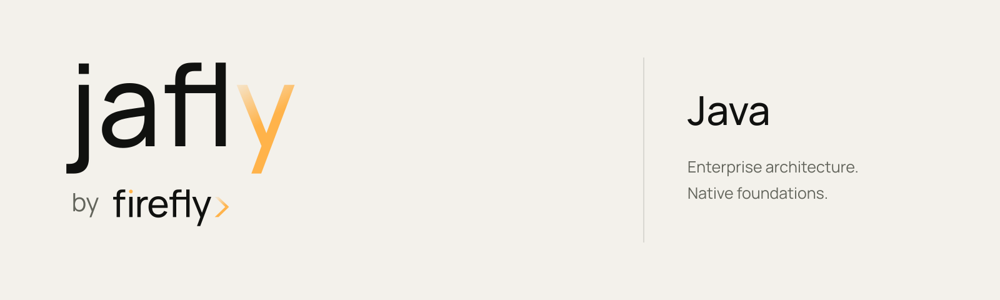
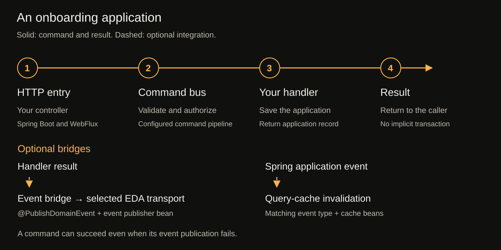

<picture>
  <source media="(prefers-color-scheme: dark)" srcset="docs/site/assets/brand/jafly-banner-dark.svg">
  
</picture>

<p align="center">
  <a href="https://fireflyframework.github.io/fireflyframework-jafly/">Documentation</a> ·
  <a href="docs/site/getting-started.md">Get started</a> ·
  <a href="docs/site/modules/index.md">Module catalog</a> ·
  <a href="https://fireflyframework.org">Framework by Firefly</a>
</p>

<p align="center">
  <a href="https://github.com/fireflyframework/fireflyframework-jafly/actions/workflows/ci.yml"></a>
  <a href="https://github.com/fireflyframework/fireflyframework-jafly/actions/workflows/docs.yml"></a>
  
  
  
  <a href="LICENSE"></a>
</p>

## The layers between Spring Boot and your business rules

Jafly is the Java framework in Framework by Firefly. It brings command and query buses, saga and TCC coordination, event transports, service clients, policy-based security, and observability to applications built with Spring Boot, WebFlux, and Reactor.

Spring continues to host your application, route HTTP requests, manage dependencies, and provide data access. Jafly connects application operations and provider adapters through shared contracts. Your team writes the business rules and chooses authorization, transaction boundaries, and recovery behavior.

Choose the modules your service needs. The parent and independent BOM keep their versions together, while starters assemble dependencies for core, domain, data, or application services. The current platform uses Java 25, Spring Boot 4.1.1, and Spring Cloud 2025.1.3.

The [first service tutorial](docs/site/getting-started.md) follows a customer onboarding application from HTTP input through a command handler, storage, and a query handler. Its source and tests live in this repository. It uses in-memory storage so you can run it without a database or broker; the module guides explain the next infrastructure choices.

## What Jafly adds

The documentation follows the same eight capability areas as [Jafly on Framework by Firefly](https://fireflyframework.org/frameworks/java/).

| Capability | What you can build with it |
| --- | --- |
| [Security and identity](docs/site/modules/index.md#security-and-identity) | Map JWTs to principals, protect methods and routes, and connect identity and policy providers through shared ports. |
| [Business operations](docs/site/modules/index.md#business-operations) | Dispatch commands and queries to typed handlers, apply configured validation and authorization, and evaluate business rules. |
| [External services](docs/site/modules/index.md#external-services) | Call REST, SOAP, and gRPC services, send notifications, manage callbacks, and connect to the separate Agentic runtime. |
| [Event-driven integration](docs/site/modules/index.md#event-driven-integration) | Publish and consume through Spring events, Kafka, RabbitMQ, or PostgreSQL; receive webhooks with provider-specific processing. |
| [Domain and data](docs/site/modules/index.md#domain-and-data) | Use reactive PostgreSQL access, filtering and pagination, query caches, content storage, and optional event sourcing. |
| [Business coordination](docs/site/modules/index.md#business-coordination) | Coordinate saga steps and compensations, try-confirm-cancel participants, and workflows with explicit application recovery policies. |
| [Service operations](docs/site/modules/index.md#service-operations) | Configure metrics, traces, health checks, HTTP conventions, and shared configuration for your services. |
| [Team-wide architecture](docs/site/modules/index.md#team-wide-architecture) | Adopt the parent or BOM, service-layer starters, shared kernel contracts, and plugin interfaces across a team's applications. |

Use the [module catalog](docs/site/modules/index.md) to choose a library and find its configuration and examples. Read the [architecture guide](docs/site/architecture.md) before deciding which responsibilities belong in your handlers or provider adapters.

<picture>
  <source media="(max-width: 600px)" srcset="docs/site/assets/diagrams/request-flow-narrow.svg">
  
</picture>

## Start with the source

Use JDK 25, Python 3, Git, and a running Docker engine for container-backed integration tests. The checked-in wrapper downloads checksum-pinned Maven 3.9.16.

```sh
git clone https://github.com/fireflyframework/fireflyframework-jafly.git
cd fireflyframework-jafly
./mvnw -B -ntp clean verify
```

Build one component together with its prerequisites:

```sh
./mvnw -B -ntp -pl :fireflyframework-cqrs -am verify
```

Install the framework locally before consuming the development train from a separate application:

```sh
./mvnw -B -ntp install
```

Windows users can use `mvnw.cmd`. See [installation](docs/site/installation.md) for prerequisites and setup troubleshooting, or the [first application tutorial](docs/site/getting-started.md) for a complete small application POM.

## Add Jafly to an application

Use the framework parent when you want its build and dependency management:

```xml
<parent>
    <groupId>org.fireflyframework</groupId>
    <artifactId>fireflyframework-parent</artifactId>
    <version>26.10.17-SNAPSHOT</version>
    <relativePath/>
</parent>
```

Or retain your existing parent and import the independent BOM:

```xml
<dependencyManagement>
    <dependencies>
        <dependency>
            <groupId>org.fireflyframework</groupId>
            <artifactId>fireflyframework-bom</artifactId>
            <version>26.10.17-SNAPSHOT</version>
            <type>pom</type>
            <scope>import</scope>
        </dependency>
    </dependencies>
</dependencyManagement>
```

Then declare the libraries you need:

```xml
<dependency>
    <groupId>org.fireflyframework</groupId>
    <artifactId>fireflyframework-cqrs</artifactId>
</dependency>
```

The parent and BOM manage the same framework artifact versions. Your application keeps its own version and declares its runtime dependencies. Choose the parent for build management, or import the BOM to keep your existing parent. See [Maven integration details](docs/site/maven.md).

## Find your way around

```text
pom.xml                    Source aggregation; not a consumer parent
build/parent/              Published fireflyframework-parent
build/bom/                 Published fireflyframework-bom
modules/                   61 component repositories and nested projects
scripts/                   Version, provenance, release, and documentation tools
tests/                     Monorepo and publishing contract tests
docs/site/                 Documentation site and brand assets
docs/migration/            Source history, original commit IDs, migration evidence
```

Components retain their source, tests, examples, resources, and licenses. The standalone complete client example stays outside the default reactor; build it after local framework installation. Agentic bridge samples remain in the reactor for testing and are not published.

Python, PHP, Agentic, Go, Rust, .NET, and frontend implementations retain their own repositories. The Java agentic bridge integrates with the separate Agentic runtime.

## Develop, document, and release

```sh
python3 -m unittest discover -s tests -v
python3 -m unittest discover -s tests/release -v
python3 scripts/release_tools.py check
./mvnw -B -ntp clean verify
```

- [Development workflow](docs/site/development.md): focused builds, tests, and source boundaries.
- [Documentation workflow](docs/site/documentation.md): pinned MkDocs environment, complete artifact coverage, and strict site builds.
- [Versioning](docs/site/versioning.md): one `YY.MM.PATCH` train, with a monthly release counter.
- [Release workflow](docs/site/releases.md): immutable matching tags and independently verified GitHub Packages/Maven Central publication.

Use the workflows at the repository root for Java builds and releases. Workflows retained inside module directories belong to the imported history.

## Preserved history

The [source provenance manifest](docs/migration/source-manifest.json) maps all 63 repositories to destination paths, original source commits, imported branches, and tags. Original main commit IDs remain ancestors of the monorepo. Historical refs use `legacy/<source-repository>/<original-ref>` so identical original release tags do not collide.

Historical GitHub issues, pull requests, and release records retain their original source URLs. See [migration and compatibility](docs/migration/README.md) for import boundaries, cutover, and rollback.

Framework code is [Apache License 2.0](LICENSE). Official Jafly/Firefly artwork and the self-hosted Manrope font retain their separate [brand provenance and notices](docs/site/brand.md).
