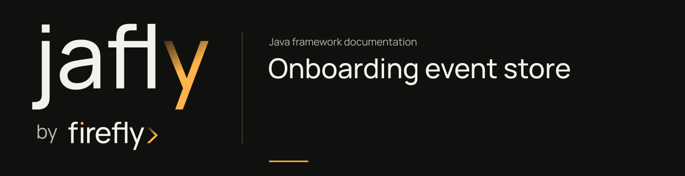

# Customer onboarding event store



Submit a customer application, approve it, and reconstruct its state from PostgreSQL events. The example uses Jafly's `AggregateRoot` and `R2dbcEventStoreImpl`, with an application-owned `OnboardingEventService` connecting them.

Run from the framework checkout after installing its libraries:

```sh
./mvnw -B -ntp -f docs/examples/onboarding-event-store/pom.xml clean verify
```

Use JDK 25 and a running Docker engine. Testcontainers starts a PostgreSQL 15 container and applies `src/test/resources/events.sql`. The four tests check reconstruction, a stale writer, an invalid state transition, and rollback when an event exceeds the schema's 255-character event-type limit. No test skips when Docker is missing.

The project tests the persistence layer directly. It provides no HTTP server, identity integration, projection worker, broker, or outbox publisher. Its transaction proof covers one append operation using the configured R2DBC connection factory and transaction manager.

Read the [event-store tutorial](../../site/guides/onboarding-event-store.md) for the application flow, complete source, and transaction conditions.
