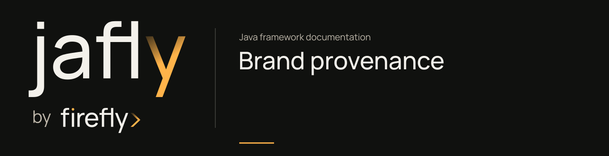

# Brand provenance and licenses



The Jafly documentation uses the official lowercase **jafly** family identity from Framework by Firefly's brand kit. Its wordmark is outlined artwork. The final y retains the canonical amber light-trail stops, and the original Firefly endorsement paths remain intact.

## Artwork and typography

The checked-in assets are generated by `scripts/generate_brand.mjs` from the canonical kit's `familyLogo`, `familyWordmark`, and banner constructors. `assets/brand/ORIGIN.json` records the source kit commit, source hashes, and exported asset hashes. Manrope is self-hosted from the pinned kit dependency rather than loaded from a third-party font service.

The palette uses the canonical brand tokens: charcoal `#10110f`, paper `#f3f1eb`, amber `#ffb34a`, stone `#bfb8ab`, and ink `#272820`. Light-surface links use the kit's darker gold `#855414` for readable text.

## Ownership

The framework's source code is distributed under its repository's Apache License 2.0. Firefly, Framework, jafly names, artwork, and graphic systems retain their separate proprietary ownership by Firefly Software Solutions Inc. The brand kit grants no general trademark license.

Manrope is licensed under SIL Open Font License 1.1. Its complete notice is redistributed with the font. These notices do not change the framework source-code license.

- [Brand notice](assets/brand/NOTICE.txt)
- [Manrope license](assets/brand/OFL.txt)
- [Exact asset provenance](assets/brand/ORIGIN.json)
- [Framework source license](https://github.com/fireflyframework/fireflyframework-jafly/blob/main/LICENSE)

## Regenerate assets

An authorized brand-kit checkout with its pinned Node dependencies is required only for regeneration:

```sh
node scripts/generate_brand.mjs /path/to/brand-kit
python3 scripts/check_docs.py
```

The documentation build uses the already exported assets. It does not require private brand-kit access, modify vendored brand geometry, or recreate the identity using live text.
