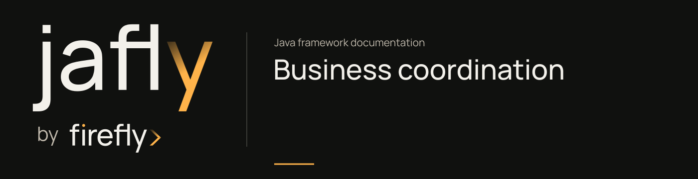

# Business coordination

Customer onboarding can involve recording an application, checking eligibility, reserving reviewer capacity, and collecting documents. Those steps need different responses to failure. Choose a coordination model from the business obligation, rather than applying every engine to the same request.

## Match the model to the work

| Need | Model |
| --- | --- |
| Completed steps need a business undo action if later work fails | Saga with explicit compensations |
| Resources can be reserved before a final decision | Try-confirm-cancel participants |
| Work has dependencies and an execution state to inspect | Workflow with ordered steps |

All three belong to the [orchestration module](../modules/orchestration.md). A local command handler is still the smallest choice when the whole operation fits one service decision.

## Follow the onboarding examples

The [coordination tutorial](../guides/onboarding-coordination.md) runs the framework engines in a Spring context with application-owned, in-memory provider implementations. Each model runs independently:

- The saga records an application and checks eligibility. Its failure path removes the recorded application.
- TCC reserves reviewer and document-check capacity. A failed reservation cancels completed reservations; a successful try phase proceeds to confirmation.
- The workflow validates the applicant, checks documents, and records the review result in dependency order.

Use the tutorial's standalone project and tests at [`docs/examples/onboarding-coordination`](https://github.com/fireflyframework/fireflyframework-jafly/tree/main/docs/examples/onboarding-coordination). The provider state makes the business effects visible without calling an external eligibility or document service.

## Define recovery before connecting providers

A compensation is an application operation. It may need to be repeatable and may itself fail. A TCC participant needs a real reservation contract; naming an ordinary remote call a reservation does not make it reversible.

Set timeouts and retries to fit each operation. Keep an execution ID so operators can inspect a failure. A failed workflow and a suspended workflow have different recovery paths: the tutorial starts a new execution after provider recovery, while resume applies to a suspended execution.

The example demonstrates engine behavior with controlled providers. Before replacing them, test the real provider's duplicate calls, reservation expiry, compensation failure, and recovery after a process restart. Do not infer cross-service transactions or exactly-once work from an engine success result.

## Keep coordination and history separate

The [event-store tutorial](../guides/onboarding-event-store.md) proves a PostgreSQL append/replay boundary for the application aggregate. It does not atomically combine that database with a saga's remote calls. Decide where application state is committed and how incomplete coordination will be reconciled.

Next, use [service operations](service-operations.md) to make those execution outcomes visible to the people running the service.
