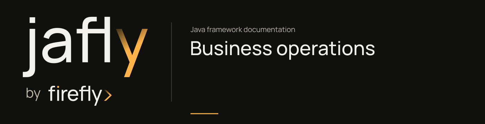

# Business operations

Submitting a customer application and looking up its status are different operations. Give each a typed contract, keep HTTP translation in the controller, and put the application behavior in a handler.

## Start with one command and one query

The smallest demonstrated path uses [CQRS](../modules/cqrs.md), WebFlux, and Jakarta validation. The [first-service POM](https://github.com/fireflyframework/fireflyframework-jafly/blob/main/docs/examples/getting-started/pom.xml) declares those dependencies without adopting a database, message broker, or workflow engine.

Follow the [complete onboarding tutorial](../getting-started.md):

1. Submit `applicantName` and `email` to `POST /applications`.
2. Let `CommandBus` dispatch `SubmitApplication` to the application handler.
3. Return the created record and its `Location` header.
4. Send `GET /applications/{id}` through `QueryBus` and retrieve the same record.

The application repository in that project is an in-memory map. The buses structure execution; they do not make the record durable or a submission idempotent.

## Verify the operation before adding more layers

The runnable tests check the HTTP result, invalid input, missing records, and the real command/query handlers. The authoritative code and tests live together in [`docs/examples/getting-started`](https://github.com/fireflyframework/fireflyframework-jafly/tree/main/docs/examples/getting-started).

The [CQRS reference](../modules/cqrs.md) explains command IDs, execution context, validation and authorization hooks. Keep business permission decisions in the service. `Command.authorize()` permits by default, so a protected operation needs a policy and trusted identity context.

## Choose how business rules will change

| Situation | Choice |
| --- | --- |
| A small rule changes with the application | Keep it in the handler or domain model and test it there |
| Rules are represented in the framework's YAML DSL | Read the [rule-engine core](../modules/rule-engine-core.md) before adopting its evaluator |
| Another service owns rule evaluation | Use the [rule-engine SDK](../modules/rule-engine-sdk.md) against a configured rule-engine HTTP service |
| The operation spans work with compensations or reservations | Follow [business coordination](business-coordination.md) |

The rule-engine family includes separate contracts, storage models, an HTTP application, and a generated client. Select the concrete child artifact for the layer you are adding. A generated SDK does not run the remote service.

Event publishing and query caching are optional integrations. Their annotations and beans must be configured; broker delivery does not automatically invalidate a local query cache. Review the [request flow](../architecture.md#conditional-bridges) before depending on those paths.

Next, choose [domain and data](domain-and-data.md) when the application needs durable state or a reconstructable history.
