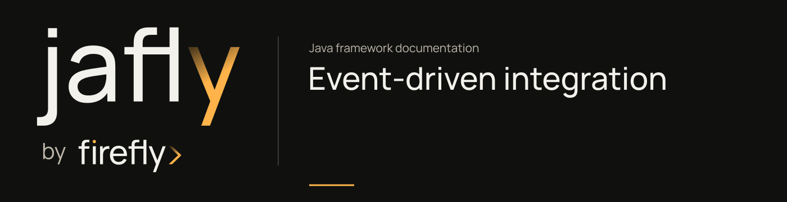

# Event-driven integration

After an application is accepted, another service may need to begin a review or send a confirmation. Define the integration event and its delivery requirements before choosing a transport.

## Choose the communication path

| Requirement | Start with |
| --- | --- |
| Publish or consume events through Jafly contracts | [EDA](../modules/eda.md) |
| Connect those contracts to an existing broker | The [Kafka](../modules/eda-kafka.md) or [RabbitMQ](../modules/eda-rabbitmq.md) adapter |
| Use the PostgreSQL EDA delivery path | [EDA PostgreSQL](../modules/eda-postgres.md), with its database and listener setup |
| Receive a signed provider callback | [Webhooks](../modules/webhooks.md) and the relevant processor |
| Keep the application's own domain history | [Event store tutorial](../guides/onboarding-event-store.md) |

An event store and a broker serve different purposes. The runnable event-store project reconstructs application state from PostgreSQL history; it configures no broker publisher or outbox service.

## Extend the onboarding operation

1. Start from the [tested command handler](../getting-started.md#submit-an-application-with-a-command).
2. Decide what the receiving service needs to know and what personal data can leave the onboarding service.
3. Read the [EDA publisher and transport setup](../modules/eda.md), then configure only the selected adapter.
4. Test publication and consumer failure behavior before connecting it to a business outcome.

The [Spring-event consumer tests](https://github.com/fireflyframework/fireflyframework-jafly/blob/main/modules/eda/src/test/java/org/fireflyframework/eda/consumer/SpringApplicationEventConsumerTest.java) demonstrate the in-process path. Broker adapters need their own infrastructure and integration tests. These library tests do not establish delivery in your deployment.

## Preserve the failure boundaries

The [CQRS/EDA bridge](../architecture.md#conditional-bridges) requires the configured publisher and handler annotation. A command can succeed even when its event publication fails. Define how the application will detect and recover that gap.

Cache invalidation listens for matching Spring application events. A broker event reaches that listener only if your service connects the paths; choosing Kafka or RabbitMQ does not create the connection automatically.

The PostgreSQL EDA publisher uses its own connection outside the caller's business transaction. The event-sourcing module's optional outbox is a different implementation. Do not treat them as interchangeable transaction guarantees.

For incoming verification results, the [webhook processor guide](../modules/webhooks-processor.md) covers provider-specific processing. The application must still choose signature validation, replay protection, and how repeated deliveries affect an existing record.

If a synchronous result is required before the caller can proceed, a direct service call may be the clearer boundary.

Next, read [business coordination](business-coordination.md) when several operations need ordered work, reservations, or compensations.
