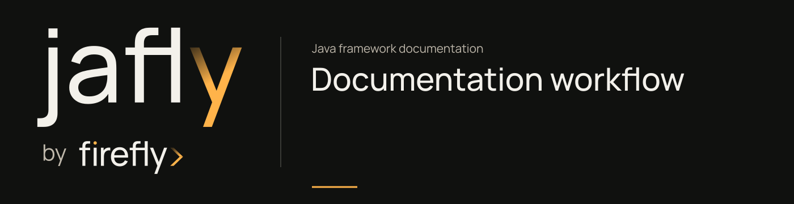

# Build and maintain the documentation



MkDocs Material builds the site from `docs/site`. Install its pinned Python dependencies in a virtual environment in the framework checkout.

## Build locally

```sh
python3 -m venv .venv
. .venv/bin/activate
python -m pip install -r requirements-docs.txt
python scripts/check_docs.py
python scripts/generate_docs_nav.py --check
python -m mkdocs build --strict
python -m mkdocs serve --dev-addr 127.0.0.1:8000
```

Open `http://127.0.0.1:8000/`. The generated site is written to `site/`. The strict build treats broken documentation references and configuration warnings as failures.

The requirements file pins the tested documentation environment. Existing logos, covers, and fonts are checked in, so normal builds need no private brand-kit access or Node installation.

## Keep the module catalog complete

`docs/site/assets/module-catalog.json` maps each actual Maven subproject to its site slug, title, and source path. It includes the management POMs, nested component projects, and standalone/in-reactor samples.

When adding or renaming an artifact:

1. Update the source POM and the parent/BOM catalog where applicable.
2. Update the documentation catalog and create its module guide.
3. Add or update the source README and link the site guide.
4. Generate the guide's cover from the canonical brand kit.
5. Run `python scripts/check_docs.py` and the strict MkDocs build.

Run `python scripts/generate_docs_nav.py` after catalog changes to update the eight capability sections in the sidebar. The check mode rejects stale navigation.

The checker compares the catalog against the POMs and rejects missing guides, covers, READMEs, duplicate slugs, mismatched artifact IDs, and changed brand exports. Review the instructions and examples against the component's current behavior as well.

## Author source-backed guides

Document a component's actual purpose, declared dependencies, source entry points, configuration resources, tests, and examples. Keep method and class names tied to source links. A passing library test does not prove a live cloud provider or client integration was exercised.

Use the customer onboarding service as the learning path. Introduce a capability through a specific requirement, explain the code that meets it, and show what the reader can observe afterward. Keep provider alternatives separate from the runnable application's implemented behavior.

Include tutorial code directly from `docs/examples/getting-started` with the configured snippet extension. After installing the framework, run `./mvnw -B -ntp -f docs/examples/getting-started/pom.xml verify`. Its tests exercise the actual HTTP application and command/query buses. Changes to a route, response, validation rule, or handler must update the example and its tests together.

For shorter module examples, state the required beans, application types, configuration, and external services. Identify code that is only a method body or API fragment. Link a complete tested source example when one exists, and distinguish compilation from an executed provider call.

Use relative links for other site pages. Use repository URLs for source files outside `docs/site`; MkDocs cannot publish arbitrary source paths as documentation pages. Keep credentials, local machine paths, and confidential provider configuration out of examples.

## Brand assets

The [brand guide](brand.md) explains provenance, licensing, canonical colors, and regeneration. The wordmark is original outlined artwork. Text labels are generated using the kit's Manrope constructors; no custom font substitution recreates the logo.

```sh
node scripts/generate_brand.mjs /path/to/brand-kit
python scripts/check_docs.py
python scripts/generate_docs_nav.py --check
```

The generator exports both themes for the README, compact header wordmarks, full family lockups, the canonical Framework icon, the self-hosted font, and labeled guide covers. Asset hash manifests detect manual edits.

## CI and publication

The `Documentation` workflow builds and checks the site on pull requests and pushes to main. A main-branch push or manual main-branch dispatch can deploy the checked site artifact through GitHub Pages. Pull requests build without Pages write permissions.

Set the repository's Pages source to GitHub Actions. After the build passes, check the deploy job and open the published pages at `https://fireflyframework.github.io/fireflyframework-jafly/`.
