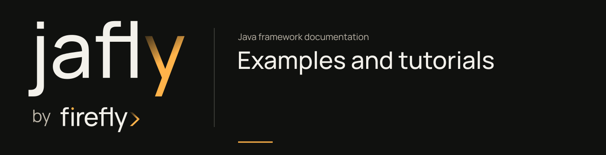

# Examples and tutorials



Start with the HTTP tutorial to learn the command path. For a particular integration, choose the example that uses that provider.

## Continue the onboarding service

The [first service tutorial](getting-started.md) is the main learning project. It begins with a WebFlux route, submits a customer application through a command handler, then reads it through a query handler. Tests cover valid and invalid HTTP requests. Its complete application runs without providers or credentials.

After that, choose a module for the next requirement in your service. The provider examples below are separate projects with their own setup; they are not required by the onboarding application.

## Choose an example

| Goal | Entry point | Build boundary |
| --- | --- | --- |
| Start a small HTTP application | [Getting started](getting-started.md#begin-with-http) | Separate application using a locally installed framework train |
| Explore the complete HTTP client | [Complete client example](modules/client-complete-example.md) | Standalone application outside the root reactor |
| Connect a Java service to Agentic | [Agentic bridge samples](modules/agentic-bridge-samples.md) | Source sample included in the reactor; not published |
| Learn commands and handlers | [CQRS guide](modules/cqrs.md) | Library tests and example source linked from the guide |
| Choose a provider integration | [Module catalog](modules/index.md) | Provider-specific prerequisites and tests |

## Run examples against the current source

Install the framework before building a standalone example:

```sh
./mvnw -B -ntp install
./mvnw -B -ntp -f modules/client/examples/complete-example/pom.xml verify
```

A standalone example can compile successfully while still needing provider configuration to run. Read its README before starting external services or supplying credentials.

## Follow a component guide

Module guides link to the relevant source and examples. Check names and signatures against the version you are using.

For CQRS, `CommandBus.send(Command<R>)` returns `Mono<R>`. Handlers extend `CommandHandler<C, R>`. The command pipeline is reactive; durability and idempotency depend on the persistence implementation and policies you add to the application.

The [Java by example book](https://github.com/fireflyframework/fireflyframework-java-book) remains a separate repository. Match the book's sample dependency train to the framework version used in your checkout.
