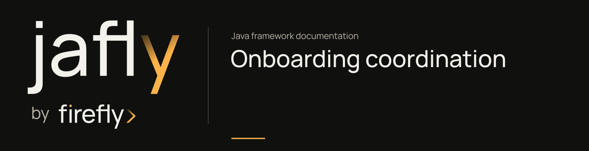

# Coordinate an onboarding application



The [first service](../getting-started.md) accepts a customer's application. Before a reviewer can act on it, the service may need to check eligibility, reserve capacity, and collect documents. Those operations fail in different ways.

This runnable project uses three separate models for that onboarding story. A Saga removes a recorded application when an eligibility check fails. TCC reserves a reviewer slot and document-check capacity before confirming either. A Workflow orders validation, document collection, and the review decision.

They run independently so each failure rule is visible. The example does not automatically chain the three engines together or attach them to the first service's HTTP endpoints.

<picture>
  <source media="(max-width: 600px)" srcset="../../assets/diagrams/onboarding-coordination-narrow.svg">
  
</picture>

The providers belong to the example. They keep records, reservations, decisions, and an operation trace in memory. They make no network calls. The engines, registries, argument binding, compensation, and execution-state storage come from Jafly's actual Spring auto-configuration.

## Run the project

Use JDK 25. The full framework installation runs provider-backed tests and needs Docker, as described in [installation](../installation.md). Once those libraries are installed, this standalone example itself needs no external services. From the Jafly checkout:

```sh
./mvnw -B -ntp install
./mvnw -B -ntp -f docs/examples/onboarding-coordination/pom.xml clean verify
```

The six tests need no database, Docker engine, message broker, or provider credentials. The project inherits the framework parent at `26.10.18` and keeps its own application version at `0.1.0-SNAPSHOT`:

```xml
--8<-- "docs/examples/onboarding-coordination/pom.xml"
```

Spring discovers the application's models and provides the three engine beans:

```java
--8<-- "docs/examples/onboarding-coordination/src/main/java/com/example/onboarding/CoordinationApplication.java"
```

The tests run with a non-web application context. This project has no HTTP endpoint contract; its executable entry point for the scenarios is the test suite.

## Define the application boundary

Each scenario uses a UUID to identify Alex Rivera's application. Tests allocate a fresh UUID for isolation:

```java
--8<-- "docs/examples/onboarding-coordination/src/main/java/com/example/onboarding/OnboardingApplication.java"
```

`OnboardingProviders` is an application-owned port. A deployed service would implement these operations against its chosen records and providers:

```java
--8<-- "docs/examples/onboarding-coordination/src/main/java/com/example/onboarding/OnboardingProviders.java"
```

Its in-memory implementation supports controlled eligibility and document-provider failures. The tests inspect resulting business state as well as operation order:

```java
--8<-- "docs/examples/onboarding-coordination/src/main/java/com/example/onboarding/InMemoryOnboardingProviders.java"
```

These methods use deferred Reactor publishers, so state changes happen when the engine subscribes. A real adapter must also define its concurrency, duplicate-request, and business reversal rules. The example's maps do not establish a distributed transaction or durable customer record.

## Undo a Saga step when a later step fails

`SubmitOnboardingSaga` first records the application, then checks eligibility. `@FromStep("record")` passes the completed record to the eligibility step. The `compensate` attribute connects that record step to its removal method:

```java
--8<-- "docs/examples/onboarding-coordination/src/main/java/com/example/onboarding/SubmitOnboardingSaga.java"
```

With an eligible applicant, the Saga succeeds and the record remains. With an ineligible applicant, the second step fails and the engine invokes `removeRecord`. The test checks that the record is absent and the trace is `record`, `eligibility`, `remove-record`.

This compensation is business logic written by the application. Removing an in-memory record is reversible here. An external action such as sending a message or opening a regulated account would need a different, explicitly supported recovery operation.

## Reserve resources with TCC

`ResourceReservation` identifies one reserved resource for one application:

```java
--8<-- "docs/examples/onboarding-coordination/src/main/java/com/example/onboarding/ResourceReservation.java"
```

`ReserveOnboardingResources` registers a TCC definition with two participants. The builder's handlers close over the injected provider port. Try returns a reservation; Confirm and Cancel receive that Try result:

```java
--8<-- "docs/examples/onboarding-coordination/src/main/java/com/example/onboarding/ReserveOnboardingResources.java"
```

The successful trace is `try:reviewer`, `try:documents`, `confirm:reviewer`, `confirm:documents`. Both reservations end as `CONFIRMED`.

If the document reservation fails, the engine cancels the successful reviewer reservation. Neither resource remains reserved and no Confirm operation runs. The example disables TCC retries so each phase is easy to inspect. A real capacity provider must implement the reservation lifecycle, expiration, repeat calls, and any reversal after a partial Confirm failure.

## Order review work with a Workflow

`ReviewOnboardingWorkflow` declares dependencies between three steps. Document checking starts after validation; the decision is recorded only after document checking succeeds:

```java
--8<-- "docs/examples/onboarding-coordination/src/main/java/com/example/onboarding/ReviewOnboardingWorkflow.java"
```

The success test checks both the engine's `COMPLETED` state and the provider's `READY_FOR_REVIEW` decision. The operation trace verifies dependency order.

When the document provider fails, the engine records `FAILED` and the decision step does not run. The recovery test makes the provider available again and starts a **new execution** with the same application input. The new execution completes with a different correlation ID; the original execution stays failed in storage.

This is an application-directed retry of the review process. The current `resumeWorkflow` API accepts suspended executions, not failed ones. Starting again reruns the earlier validation step, so deployed adapters must decide whether repeated operations are safe. This example does not claim automatic recovery across a process restart. Its execution state and provider data disappear when the context stops.

## Check the outcomes

The integration test uses the engines supplied by Spring, with no mocked bus, engine, or registry:

```java
--8<-- "docs/examples/onboarding-coordination/src/test/java/com/example/onboarding/OnboardingCoordinationTest.java"
```

| Scenario | Business result |
| --- | --- |
| Saga success | The eligible application remains recorded |
| Saga eligibility failure | Compensation removes the previously recorded application |
| TCC success | Both resources are tried before either is confirmed |
| TCC document Try failure | The reviewer reservation is canceled; no resource remains held |
| Workflow success | Validation precedes documents; documents precede the decision |
| Workflow provider failure and recovery | The first execution stays failed; a separate execution completes after recovery |

For the full API reference, continue with the module's [Saga](https://github.com/fireflyframework/fireflyframework-jafly/blob/main/modules/orchestration/docs/saga.md), [TCC](https://github.com/fireflyframework/fireflyframework-jafly/blob/main/modules/orchestration/docs/tcc.md), and [Workflow](https://github.com/fireflyframework/fireflyframework-jafly/blob/main/modules/orchestration/docs/workflow.md) documentation. For persisted application history, run the separate [event-store project](onboarding-event-store.md).
