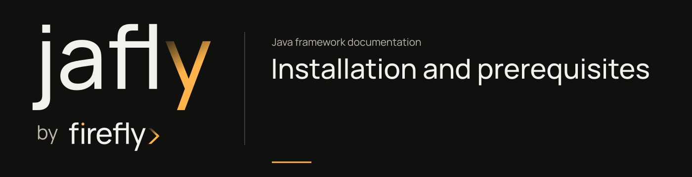

# Installation and prerequisites



Use JDK 25 and Maven 3.9 to build a Jafly application. Choose a verified registry release, or install the current framework source locally before running the tutorial.

| Requirement | Purpose |
| --- | --- |
| JDK 25 | Compile and run the framework and your application |
| Maven 3.9.16 | The checkout provides `./mvnw` and `mvnw.cmd`; a separate Maven install is optional |
| Git | Check out the source and runnable examples |
| Docker engine | Run the full framework's container-backed tests; the first-service application needs no external services |

The tutorial uses `26.10.21-SNAPSHOT`, which you can install from source. Before using a registry, check that the selected release has verified artifacts there. A version in a source POM does not confirm publication.

## Check the toolchain

```sh
java -version
./mvnw -version
```

The Maven wrapper validates its downloaded distribution with the SHA-256 pinned in `.mvn/wrapper/maven-wrapper.properties`. A system Maven installation is optional. If `JAVA_HOME` is set, make sure it points to JDK 25.

## Install from source

For the [first onboarding service](getting-started.md), install CQRS and its prerequisites:

```sh
./mvnw -B -ntp -pl :fireflyframework-cqrs -am install
```

These seven projects run their configured tests without a database, broker, or Docker engine. To install every framework module, including the independent BOM and provider adapters, start Docker and run:

```sh
docker info
./mvnw -B -ntp clean install
```

Maven installs the current version in your local repository. This lets a separate application use an unpublished development snapshot. The root build resolves internal dependencies from the checkout.

To work on a specific component:

```sh
./mvnw -B -ntp -pl :fireflyframework-cache -am verify
```

`-am` includes required reactor projects. Starting inside a module before installing its prerequisites can cause Maven to search a remote registry for the current snapshot.

## Use a published version

Check the GitHub Release for the exact version tag and its verified GitHub Packages and Maven Central inventories. Maven Central uses normal Maven resolution. GitHub Packages also requires package read access and credentials in your local Maven settings.

Keep credentials out of project POMs, source files, and copied documentation examples. The repository's publishing settings use environment variables rather than stored values.

## Common setup issues

Unsupported class-file or compiler release. Check both `java -version` and `./mvnw -version`; Maven may be using a different JDK from your shell.

A framework snapshot cannot be resolved. Build from the repository root with `-am`, or install the full train locally. Use a version verified in your selected registry, or install the current source locally.

Container tests fail to connect. Start the Docker engine and run `docker info`. Do not hide missing infrastructure by disabling all tests.

GitHub Packages returns 401 or 403. Verify package access for the account/repository token. Do not change artifact names or silently fall back to an older train.

A single-module build uses a different framework version. Check the explicit parent reference and `fireflyframework.version` management. All framework modules in a checkout should select the same train.

Continue with [getting started](getting-started.md), [Maven management](maven.md), or the [development workflow](development.md).
