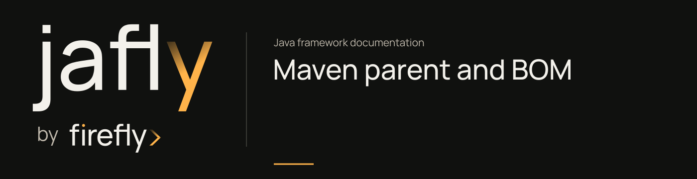

# Maven parent and BOM



Use the framework parent to adopt its build management, or import the BOM while keeping your existing parent. Both manage the same Jafly dependency versions. Your application keeps its own version.

## Choose the management model

| Capability | Framework parent | Framework BOM |
| --- | --- | --- |
| Framework dependency versions | Yes | Yes |
| Spring dependency management from the framework parent | Yes | Keep your existing platform management |
| Java/compiler and Maven plugin management | Yes | Configure in your own parent/build |
| Compatible with another application parent | Maven permits one parent | Yes |
| Adds runtime libraries automatically | No | No |

## Use the framework parent

```xml
<parent>
    <groupId>org.fireflyframework</groupId>
    <artifactId>fireflyframework-parent</artifactId>
    <version>26.10.19</version>
    <relativePath/>
</parent>

<groupId>com.example</groupId>
<artifactId>onboarding-service</artifactId>
<version>0.1.0-SNAPSHOT</version>

<dependencies>
    <dependency>
        <groupId>org.fireflyframework</groupId>
        <artifactId>fireflyframework-cqrs</artifactId>
    </dependency>
</dependencies>
```

The managed CQRS dependency uses the framework's `fireflyframework.version` property. The application version `0.1.0-SNAPSHOT` does not change the CQRS dependency version. An empty `relativePath` tells Maven to resolve the consumer parent from the local/remote repository rather than an unrelated adjacent source file.

The parent manages plugin configuration; a plugin in `pluginManagement` executes only when the build or lifecycle activates it. Likewise, a managed dependency becomes a runtime dependency only when an application declares it or receives it transitively.

## Keep your existing parent

Import the framework BOM into your dependency management:

```xml
<dependencyManagement>
    <dependencies>
        <dependency>
            <groupId>org.fireflyframework</groupId>
            <artifactId>fireflyframework-bom</artifactId>
            <version>26.10.19</version>
            <type>pom</type>
            <scope>import</scope>
        </dependency>
    </dependencies>
</dependencyManagement>
```

Declare the framework dependencies you need without repeating their version. Your existing parent or build must still configure a compatible Spring Boot/Cloud platform and Java 25 compiler. The BOM supplies Jafly's version catalog and its explicit third-party constraints; it does not import Spring Boot's or Spring Cloud's complete platform management.

## Keep security constraints effective

The parent and independent BOM both manage selected security fixes beyond the versions in the platform BOMs. They align the Jackson 2 and Jackson 3 families and constrain affected messaging, cache, database-authentication, template, HTTP, and provider dependencies. A managed constraint adds no runtime library by itself.

Maven precedence still applies. An explicit version in your application can override a managed choice; when importing several BOMs, their order can affect selection. Check `mvn dependency:tree` and `mvn help:effective-pom` in the application after changing its platform. The parent and BOM POMs record the exact constraints for each framework train.

## Resolve the management POMs

Before using the parent or BOM in a separate application, install the source locally or select a verified published version. Use `fireflyframework-parent` or `fireflyframework-bom` for application management. The checkout's root `fireflyframework-jafly` POM aggregates source builds and cannot serve as a consumer parent.

For source builds, follow [installation](installation.md). For application code and tests, continue with [your first service](getting-started.md).

## Read packages from Maven Central or GitHub

Final trains publish to **Maven Central** first in the release job; consumers need no extra repository once `repo1.maven.org` lists the version. Prefer Central for production builds.

When a train is verified on GitHub Packages before Central CDN sync (or for SNAPSHOT trains), resolve from the Jafly repository:

```xml
<repositories>
    <repository>
        <id>firefly-github</id>
        <url>https://maven.pkg.github.com/fireflyframework/fireflyframework-jafly</url>
        <releases>
            <enabled>true</enabled>
        </releases>
        <snapshots>
            <enabled>true</enabled>
        </snapshots>
    </repository>
</repositories>
```

Configure credentials for the same `firefly-github` server ID in your local Maven settings. GitHub requires an authorized token even for public Maven packages. Keep token values out of the POM and source tree. Publication uses the same Jafly repository, with the complete artifact catalog checked before uploading. See [GitHub's Maven registry instructions](https://docs.github.com/en/packages/working-with-a-github-packages-registry/working-with-the-apache-maven-registry) and the [release runbook](releases.md).

## Constructor injection

The examples use Lombok's `@RequiredArgsConstructor` for Spring components with `final` dependencies. Lombok generates one constructor for those fields, and Spring injects its arguments. This keeps required dependencies visible and lets a unit test construct the component directly.

Declare Lombok in an application that uses these annotations:

```xml
<dependency>
    <groupId>org.projectlombok</groupId>
    <artifactId>lombok</artifactId>
    <scope>provided</scope>
</dependency>
```

The Jafly parent manages the Lombok version and compiler annotation processor. If you import only the BOM, your existing build must manage Lombok and enable its annotation processor. The [onboarding application POM](https://github.com/fireflyframework/fireflyframework-jafly/blob/main/docs/examples/getting-started/pom.xml) is a complete parent-based example.

Keep an explicit constructor when it performs initialization, calls a superclass constructor, or carries parameter annotations that the generated constructor would not preserve. Use Spring's `@Autowired` when an explicit constructor choice is needed. The single generated constructor in these examples needs no additional injection annotation.

## Diagnose dependency selection

```sh
mvn dependency:tree
mvn help:effective-pom
```

Inspect effective dependency management when an application imports several BOMs. Maven precedence and explicit application versions still apply; importing a BOM does not override every later application decision.

The examples use the development train. Refer to [installation](installation.md) for local installation and [versioning](versioning.md) for verified final versions.

<p class="jafly-source">Source: <a href="https://github.com/fireflyframework/fireflyframework-jafly/blob/main/build/parent/pom.xml">parent POM</a> and <a href="https://github.com/fireflyframework/fireflyframework-jafly/blob/main/build/bom/pom.xml">BOM</a>. Maven's <a href="https://maven.apache.org/guides/introduction/introduction-to-dependency-mechanism.html">dependency-management reference</a> explains resolution precedence.</p>
