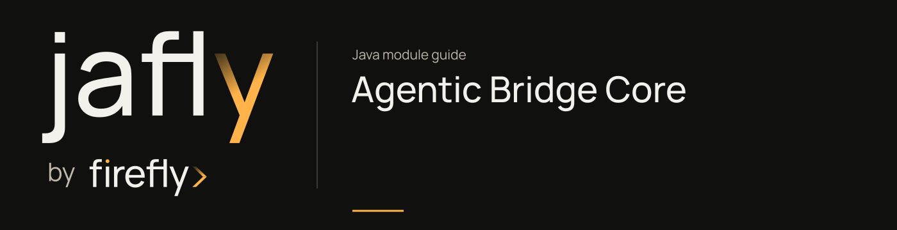

# Agentic Bridge Core

Invoke remote agents over REST, SSE, or WebSocket and publish queue invocations through a typed Java client.

Build AgenticClient with a named client and absolute base URL, then call invoke, stream, or conversations. Reuse and close the client with the application lifecycle. Queue publishers are explicit resources and do not imply that a remote worker has completed the invocation.

| Maven artifact | Packaging | Source project |
| --- | --- | --- |
| `org.fireflyframework:fireflyframework-agentic-bridge-core` | `jar` | [modules/agentic-bridge/fireflyframework-agentic-bridge-core](https://github.com/fireflyframework/fireflyframework-jafly/tree/main/modules/agentic-bridge/fireflyframework-agentic-bridge-core) |

Part of [External services](index.md#external-services).

## In the onboarding service

Call a remote agent from the onboarding service when a configured assistant is needed. Reuse the client through the service lifecycle and treat its response as input to the application's own review behavior.

## Add the component

[Installation and version availability](../installation.md) explains source builds and published releases.

```xml
<dependency>
    <groupId>org.fireflyframework</groupId>
    <artifactId>fireflyframework-agentic-bridge-core</artifactId>
    <version>26.10.18</version>
</dependency>
```

## Quick start

The Java examples in this section are API fragments for application code. Use the stated imports and supply the application-owned collaborators described alongside them.

For explicit client construction, set `AGENTIC_BASE_URL` to the deployed agent service URL. Keep the client alive until the reactive invocation completes and close it when the application shuts down:

```java
AgenticClient client = AgenticClient.builder("orders")
        .baseUrl(System.getenv("AGENTIC_BASE_URL"))
        .build();
Mono<AgentResponse> result = client.invoke(
        "assistant", AgentRequest.of("Summarize the order status"));
```

Here `assistant` is an example remote agent name; use a name present in your remote catalog. `AgenticClient` is in `org.fireflyframework.agentic.bridge`, and request/response types are in its `invocation` package. Return or compose `result` in a reactive application flow. Calling `invoke` constructs a publisher; it does not prove that a configured remote service has answered. Use `stream`/`streamIncremental` for SSE events and `conversations()` for the conversation API.

## Configuration and wiring

This module declares no `@ConfigurationProperties` class of its own. Use the constructor/port contracts above and the configuration of the host or related core module.

## Public API and extension points

| Type | Contract and responsibility |
| --- | --- |
| [`AgenticClient`](https://github.com/fireflyframework/fireflyframework-jafly/blob/main/modules/agentic-bridge/fireflyframework-agentic-bridge-core/src/main/java/org/fireflyframework/agentic/bridge/AgenticClient.java) | Reactive façade for invoking remote agents hosted by `fireflyframework-agentic`. |
| [`AgenticClientBuilder`](https://github.com/fireflyframework/fireflyframework-jafly/blob/main/modules/agentic-bridge/fireflyframework-agentic-bridge-core/src/main/java/org/fireflyframework/agentic/bridge/AgenticClientBuilder.java) | Fluent builder for `AgenticClient` instances. |
| [`AgentRequest`](https://github.com/fireflyframework/fireflyframework-jafly/blob/main/modules/agentic-bridge/fireflyframework-agentic-bridge-core/src/main/java/org/fireflyframework/agentic/bridge/invocation/AgentRequest.java) | Wire-format request body for an agent invocation. |
| [`ConversationManager`](https://github.com/fireflyframework/fireflyframework-jafly/blob/main/modules/agentic-bridge/fireflyframework-agentic-bridge-core/src/main/java/org/fireflyframework/agentic/bridge/conversation/ConversationManager.java) | Reactive client for the `/agents/conversations` CRUD endpoints exposed by the agentic REST layer. |
| [`QueueAgenticPublisher`](https://github.com/fireflyframework/fireflyframework-jafly/blob/main/modules/agentic-bridge/fireflyframework-agentic-bridge-core/src/main/java/org/fireflyframework/agentic/bridge/transport/queue/QueueAgenticPublisher.java) | Reactive contract every queue publisher implementation must satisfy. |

## Related components

| Related component | Why it belongs nearby |
| --- | --- |
| [Agentic Bridge](agentic-bridge.md) | Group the Java client, Spring wiring, starter, and sample for remote agent integration. |
| [Kernel](kernel.md) | Share a consistent exception vocabulary across application, domain, and infrastructure boundaries. |

## Build and test

Use Java 25. From the repository root, build this component with its required dependencies:

```bash
git clone https://github.com/fireflyframework/fireflyframework-jafly.git
cd fireflyframework-jafly
./mvnw -pl :fireflyframework-agentic-bridge-core -am verify
./mvnw -pl :fireflyframework-agentic-bridge-core -am install
```

`verify` runs the selected projects' tests. `install` makes the current build available in your local Maven repository.

Representative test sources:

- [AgenticClientBuilderTest.java](https://github.com/fireflyframework/fireflyframework-jafly/blob/main/modules/agentic-bridge/fireflyframework-agentic-bridge-core/src/test/java/org/fireflyframework/agentic/bridge/AgenticClientBuilderTest.java).
- [RestAgenticTransportTest.java](https://github.com/fireflyframework/fireflyframework-jafly/blob/main/modules/agentic-bridge/fireflyframework-agentic-bridge-core/src/test/java/org/fireflyframework/agentic/bridge/RestAgenticTransportTest.java).
- [AuthStrategyTest.java](https://github.com/fireflyframework/fireflyframework-jafly/blob/main/modules/agentic-bridge/fireflyframework-agentic-bridge-core/src/test/java/org/fireflyframework/agentic/bridge/auth/AuthStrategyTest.java).
- [AgentRequestTest.java](https://github.com/fireflyframework/fireflyframework-jafly/blob/main/modules/agentic-bridge/fireflyframework-agentic-bridge-core/src/test/java/org/fireflyframework/agentic/bridge/invocation/AgentRequestTest.java).
- [SseEventDecoderTest.java](https://github.com/fireflyframework/fireflyframework-jafly/blob/main/modules/agentic-bridge/fireflyframework-agentic-bridge-core/src/test/java/org/fireflyframework/agentic/bridge/transport/rest/SseEventDecoderTest.java).

## Test fixture

The `invokeReturnsTypedResponse` test demonstrates one concrete behavior. Excerpt from [RestAgenticTransportTest.java](https://github.com/fireflyframework/fireflyframework-jafly/blob/main/modules/agentic-bridge/fireflyframework-agentic-bridge-core/src/test/java/org/fireflyframework/agentic/bridge/RestAgenticTransportTest.java). The test class supplies its fixtures and imports.

```java
@Test
void invokeReturnsTypedResponse() {
    wireMock.stubFor(post(urlEqualTo("/agents/summariser/run"))
            .withHeader("Authorization", equalTo("Bearer ci-token"))
            .willReturn(aResponse()
                    .withStatus(200)
                    .withHeader("Content-Type", "application/json")
                    .withBody("{\"agent_name\":\"summariser\",\"output\":\"hi\",\"success\":true}")));

    StepVerifier.create(client.invoke("summariser", AgentRequest.of("hello")))
            .assertNext(response -> {
                assertThat(response.success()).isTrue();
                assertThat(response.agentName()).isEqualTo("summariser");
                assertThat(response.output()).isEqualTo("hi");
            })
            .verifyComplete();
}
```

## Continue the application

Use the [Agentic Bridge Autoconfigure guide](agentic-bridge-autoconfigure.md) for the next part of this integration. The runnable submission/query service is in [Getting started](../getting-started.md).

## Source and further reading

- [Maven project and dependency declarations](https://github.com/fireflyframework/fireflyframework-jafly/blob/main/modules/agentic-bridge/fireflyframework-agentic-bridge-core/pom.xml).
- [Production source](https://github.com/fireflyframework/fireflyframework-jafly/tree/main/modules/agentic-bridge/fireflyframework-agentic-bridge-core/src/main/java).
- [Module catalog](index.md) and [getting started](../getting-started.md).
- [Maven platform](../maven.md) and [architecture](../architecture.md).
