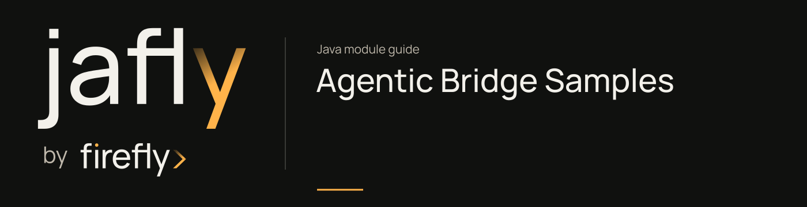

# Agentic Bridge Samples

Run example HTTP endpoints for catalog lookup, agent invocation, streaming, conversation, and queue publishing.

Install the reactor dependencies, set the primary agent service URL, and start this example application. Its /sample endpoints demonstrate the bridge; they are example application routes rather than endpoints installed by the starter in every service.

| Maven artifact | Packaging | Source project |
| --- | --- | --- |
| `org.fireflyframework:fireflyframework-agentic-bridge-samples` | `jar` | [modules/agentic-bridge/fireflyframework-agentic-bridge-samples](https://github.com/fireflyframework/fireflyframework-jafly/tree/main/modules/agentic-bridge/fireflyframework-agentic-bridge-samples) |

Part of [External services](index.md#external-services).

## In the onboarding service

This runnable sample explores transport and conversation calls against a separate agent service. It is a companion integration example for a reviewer assistant, not the onboarding HTTP application itself.

## Add the component

[Installation and version availability](../installation.md) explains source builds and published releases.

This is a runnable example, not a dependency-installation recommendation. Build instructions are provided below.

## Quick start

This is a runnable companion application with its own configuration. Configure the external endpoints/providers used by the selected scenario before running it.

The checked-in sample configuration listens on port `8085` and reads `AGENTIC_BASE_URL` (default `http://localhost:8000`). After installing the required reactor projects, start the sample from the repository root:

```bash
./mvnw -pl :fireflyframework-agentic-bridge-samples -am install
AGENTIC_BASE_URL=http://localhost:8000 ./mvnw -f modules/agentic-bridge/fireflyframework-agentic-bridge-samples/pom.xml spring-boot:run
```

Against a local sample and a deployed agent named `assistant`:

```bash
curl http://localhost:8085/sample/agents
curl -X POST http://localhost:8085/sample/assistant/invoke \
  -H 'Content-Type: application/json' \
  -d '{"prompt":"Summarize the order status"}'
```

`SampleController` also exposes `/{agent}/stream`, `/{agent}/conversation`, and `/{publisher}/{agent}/publish` under `/sample`. Queue routes require a configured publisher; the default `publishers` map is empty. These are sample application routes, not endpoints automatically added to consuming services by the starter.

## Configuration and wiring

This module declares no `@ConfigurationProperties` class of its own. Use the constructor/port contracts above and the configuration of the host or related core module.

## Public API and extension points

| Type | Contract and responsibility |
| --- | --- |
| [`SampleController`](https://github.com/fireflyframework/fireflyframework-jafly/blob/main/modules/agentic-bridge/fireflyframework-agentic-bridge-samples/src/main/java/org/fireflyframework/agentic/bridge/samples/SampleController.java) | Demonstrates every façade exposed by the bridge. |
| [`AgenticBridgeSampleApplication`](https://github.com/fireflyframework/fireflyframework-jafly/blob/main/modules/agentic-bridge/fireflyframework-agentic-bridge-samples/src/main/java/org/fireflyframework/agentic/bridge/samples/AgenticBridgeSampleApplication.java) | Runnable Spring Boot sample exercising the agentic bridge. |

## Related components

| Related component | Why it belongs nearby |
| --- | --- |
| [Agentic Bridge](agentic-bridge.md) | Group the Java client, Spring wiring, starter, and sample for remote agent integration. |
| [Agentic Bridge Starter](agentic-bridge-starter.md) | Bundle the agentic core, auto-configuration, WebFlux, actuator, and reactive resilience dependencies. |

## Build and test

Use Java 25. From the repository root, build this component with its required dependencies:

```bash
git clone https://github.com/fireflyframework/fireflyframework-jafly.git
cd fireflyframework-jafly
./mvnw -pl :fireflyframework-agentic-bridge-samples -am verify
./mvnw -pl :fireflyframework-agentic-bridge-samples -am install
```

`verify` runs the selected projects' tests. `install` makes the current build available in your local Maven repository.

Representative test sources:

- [AgenticBridgeSampleApplicationTest.java](https://github.com/fireflyframework/fireflyframework-jafly/blob/main/modules/agentic-bridge/fireflyframework-agentic-bridge-samples/src/test/java/org/fireflyframework/agentic/bridge/samples/AgenticBridgeSampleApplicationTest.java).

## Test fixture

The `contextWiresClientAndBridge` test demonstrates one concrete behavior. Excerpt from [AgenticBridgeSampleApplicationTest.java](https://github.com/fireflyframework/fireflyframework-jafly/blob/main/modules/agentic-bridge/fireflyframework-agentic-bridge-samples/src/test/java/org/fireflyframework/agentic/bridge/samples/AgenticBridgeSampleApplicationTest.java). The test class supplies its fixtures and imports.

```java
@Test
void contextWiresClientAndBridge() {
    assertThat(client).isNotNull();
    assertThat(bridge).isNotNull();
    assertThat(bridge.client()).isSameAs(client);
}
```

## Continue the application

Use the [Agentic Bridge Core guide](agentic-bridge-core.md) for the next part of this integration. The runnable submission/query service is in [Getting started](../getting-started.md).

## Source and further reading

- [Maven project and dependency declarations](https://github.com/fireflyframework/fireflyframework-jafly/blob/main/modules/agentic-bridge/fireflyframework-agentic-bridge-samples/pom.xml).
- [Production source](https://github.com/fireflyframework/fireflyframework-jafly/tree/main/modules/agentic-bridge/fireflyframework-agentic-bridge-samples/src/main/java).
- [application.yml](https://github.com/fireflyframework/fireflyframework-jafly/blob/main/modules/agentic-bridge/fireflyframework-agentic-bridge-samples/src/main/resources/application.yml).
- [Module catalog](index.md) and [getting started](../getting-started.md).
- [Maven platform](../maven.md) and [architecture](../architecture.md).
