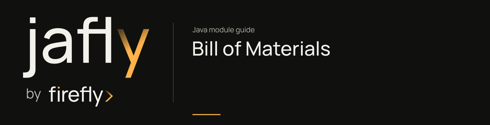

# Bill of Materials

Align the versions of the 82 managed Jafly artifacts without inheriting the build parent.

Import this POM in `dependencyManagement` to align component versions. Add the concrete components your application uses. The BOM also carries selected upstream compatibility and security constraints, including aligned Jackson 2 and Jackson 3 BOMs. These are upstream dependencies, not additional Jafly components. It does not import the complete Spring Boot or Cloud platform.

| Maven artifact | Packaging | Source project |
| --- | --- | --- |
| `org.fireflyframework:fireflyframework-bom` | `pom` | [build/bom](https://github.com/fireflyframework/fireflyframework-jafly/tree/main/build/bom) |

Part of [Team-wide architecture](index.md#team-wide-architecture).

## In the onboarding service

A team that already has a corporate Maven parent can import this BOM into the onboarding service. It selects framework artifact versions while the existing parent continues to manage Spring and build tooling.

## Add the component

[Installation and version availability](../installation.md) explains source builds and published releases.

```xml
<dependencyManagement>
    <dependencies>
        <dependency>
            <groupId>org.fireflyframework</groupId>
            <artifactId>fireflyframework-bom</artifactId>
            <version>26.10.17</version>
            <type>pom</type>
            <scope>import</scope>
        </dependency>
    </dependencies>
</dependencyManagement>
```

## Quick start

The Java examples in this section are API fragments for application code. Use the stated imports and supply the application-owned collaborators described alongside them.

After importing the BOM (or inheriting the parent), declare framework modules without versions. They are resolved from the BOM:

```xml
<dependencies>
    <!-- Opinionated Spring Boot starter for a core-tier microservice -->
    <dependency>
        <groupId>org.fireflyframework</groupId>
        <artifactId>fireflyframework-starter-core</artifactId>
    </dependency>

    <!-- WebFlux server scaffolding -->
    <dependency>
        <groupId>org.fireflyframework</groupId>
        <artifactId>fireflyframework-web</artifactId>
    </dependency>

    <!-- Event-driven architecture: core SPI ... -->
    <dependency>
        <groupId>org.fireflyframework</groupId>
        <artifactId>fireflyframework-eda</artifactId>
    </dependency>

    <!-- ... plus the Kafka transport adapter (added only when needed) -->
    <dependency>
        <groupId>org.fireflyframework</groupId>
        <artifactId>fireflyframework-eda-kafka</artifactId>
    </dependency>
</dependencies>
```

Need a different cache provider or messaging transport? Just add the matching adapter artifact. For example `fireflyframework-cache-redis` or `fireflyframework-eda-rabbitmq`. Still with no `<version>`.

## Configuration and wiring

This POM has no runtime configuration namespace. Configure the selected child libraries in the application that uses them.

## Build and test

Use Java 25. From the repository root, build this component with its required dependencies:

```bash
git clone https://github.com/fireflyframework/fireflyframework-jafly.git
cd fireflyframework-jafly
./mvnw -pl :fireflyframework-bom -am verify
./mvnw -pl :fireflyframework-bom -am install
```

`verify` runs the selected projects' tests. `install` makes the current build available in your local Maven repository.

This subproject has no authored `src/test/java` suite. Its Maven build still validates the configured compilation/generation and any reactor prerequisites. Use the consuming component tests to validate integration behavior.

## Detailed reference

### Configuration

The BOM has no configuration. It contributes nothing to the classpath and exposes no `firefly.*` properties or auto-configuration. It exists purely to manage versions in your build. Runtime configuration belongs to the individual modules you import (each module's own README documents its `firefly.*` properties).

## Continue the application

Use the [Build Parent guide](parent.md) for the next part of this integration. The runnable submission/query service is in [Getting started](../getting-started.md).

## Source and further reading

- [Maven project and dependency declarations](https://github.com/fireflyframework/fireflyframework-jafly/blob/main/build/bom/pom.xml).
- [Module catalog](index.md) and [getting started](../getting-started.md).
- [Maven platform](../maven.md) and [architecture](../architecture.md).
