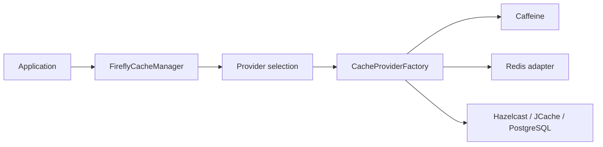

# Common Cache Library

Use a common cache API with a local Caffeine default and pluggable distributed providers.

Depend on the core abstraction, inject FireflyCacheManager or use CacheAdapter, and choose a provider through firefly.cache. Provider discovery and selection live in the core; add only the external provider library you need.

| Maven artifact | Packaging | Source project |
| --- | --- | --- |
| `org.fireflyframework:fireflyframework-cache` | `jar` | [modules/cache](https://github.com/fireflyframework/fireflyframework-jafly/tree/main/modules/cache) |

Part of [Domain and data](index.md#domain-and-data).

## Cache selection



The manager owns the common cache contract. External adapters participate through the provider SPI; the application selects and configures the backing service.

## In the onboarding service

A reviewer portal may read the same application status repeatedly. Cache those reads only after defining when status changes invalidate them; the tutorial query deliberately bypasses caching.

## Add the component

[Installation and version availability](../installation.md) explains source builds and published releases.

```xml
<dependency>
    <groupId>org.fireflyframework</groupId>
    <artifactId>fireflyframework-cache</artifactId>
    <version>26.10.20</version>
</dependency>
```

## Quick start

The injection examples use Lombok `@RequiredArgsConstructor`. Add its provided dependency and annotation processor as described in [Constructor injection](../maven.md#constructor-injection).

The Java examples in this section are API fragments for application code. Use the stated imports and supply the application-owned collaborators described alongside them.

With the dependency on the classpath, `CacheAutoConfiguration` provides a primary `FireflyCacheManager` (Caffeine by default). This application-owned API class caches onboarding status values; it does not connect itself to the tutorial repository. Compose each returned `Mono`, and evict the cached value when the authoritative status changes:

```java
import lombok.RequiredArgsConstructor;
import java.time.Duration;
import java.util.Optional;
import org.fireflyframework.cache.manager.FireflyCacheManager;
import org.springframework.stereotype.Service;
import reactor.core.publisher.Mono;

@Service
@RequiredArgsConstructor
public class ApplicationStatusCache {
    private final FireflyCacheManager cache;


    public Mono<Void> put(String applicationId, String status) {
        return cache.put(applicationId, status, Duration.ofMinutes(5));
    }

    public Mono<Optional<String>> get(String applicationId) {
        return cache.get(applicationId, String.class);
    }

    public Mono<Boolean> evict(String applicationId) {
        return cache.evict(applicationId);
    }
}
```

Need a dedicated, namespaced cache (separate key prefix, TTL and provider)? Inject the factory:

```java
import org.fireflyframework.cache.core.CacheType;
import org.fireflyframework.cache.factory.CacheManagerFactory;
import org.fireflyframework.cache.manager.FireflyCacheManager;

FireflyCacheManager idempotencyCache = factory.createCacheManager(
        "http-idempotency",
        CacheType.AUTO,                // Redis if present, else Caffeine
        "firefly:http:idempotency",
        Duration.ofHours(24));
```

## Configuration and wiring

The `firefly.cache` namespace is bound by [CacheProperties.java](https://github.com/fireflyframework/fireflyframework-jafly/blob/main/modules/cache/src/main/java/org/fireflyframework/cache/properties/CacheProperties.java). Nested configuration is declared in the linked class. Defaults are the field initializers.

| Setting | Java type | Source default |
| --- | --- | --- |
| `firefly.cache.enabled` | `boolean` | `true` |
| `firefly.cache.default-cache-type` | `CacheType` | `CacheType.CAFFEINE` |
| `firefly.cache.metrics-enabled` | `boolean` | `true` |
| `firefly.cache.health-enabled` | `boolean` | `true` |
| `firefly.cache.stats-enabled` | `boolean` | `true` |
| `firefly.cache.caffeine` | `CaffeineConfig` | `new CaffeineConfig()` |
| `firefly.cache.redis` | `RedisConfig` | `new RedisConfig()` |
| `firefly.cache.postgres` | `PostgresConfig` | `new PostgresConfig()` |
| `firefly.cache.smart` | `SmartConfig` | `new SmartConfig()` |

Property-based wiring conditions found in this module:

- `prefix = "firefly.cache", name = "enabled", havingValue = "true", matchIfMissing = true`. [CacheAutoConfiguration.java](https://github.com/fireflyframework/fireflyframework-jafly/blob/main/modules/cache/src/main/java/org/fireflyframework/cache/config/CacheAutoConfiguration.java).
- `prefix = "firefly.cache", name = "enabled", havingValue = "true", matchIfMissing = true`. [CacheObservabilityAutoConfiguration.java](https://github.com/fireflyframework/fireflyframework-jafly/blob/main/modules/cache/src/main/java/org/fireflyframework/cache/observability/CacheObservabilityAutoConfiguration.java).
- `prefix = "firefly.observability.metrics", name = "enabled", havingValue = "true", matchIfMissing = true`. [CacheObservabilityAutoConfiguration.java](https://github.com/fireflyframework/fireflyframework-jafly/blob/main/modules/cache/src/main/java/org/fireflyframework/cache/observability/CacheObservabilityAutoConfiguration.java).
- `prefix = "firefly.observability.health", name = "enabled", havingValue = "true", matchIfMissing = true`. [CacheObservabilityAutoConfiguration.java](https://github.com/fireflyframework/fireflyframework-jafly/blob/main/modules/cache/src/main/java/org/fireflyframework/cache/observability/CacheObservabilityAutoConfiguration.java).

## Public API and extension points

| Type | Contract and responsibility |
| --- | --- |
| [`FireflyCacheManager`](https://github.com/fireflyframework/fireflyframework-jafly/blob/main/modules/cache/src/main/java/org/fireflyframework/cache/manager/FireflyCacheManager.java) | Unified cache manager that provides a single cache interface. |
| [`CacheAdapter`](https://github.com/fireflyframework/fireflyframework-jafly/blob/main/modules/cache/src/main/java/org/fireflyframework/cache/core/CacheAdapter.java) | Unified interface for cache operations across different cache providers. |
| [`CacheProviderFactory`](https://github.com/fireflyframework/fireflyframework-jafly/blob/main/modules/cache/src/main/java/org/fireflyframework/cache/spi/CacheProviderFactory.java) | Service Provider Interface for creating cache adapters. |
| [`CacheProperties`](https://github.com/fireflyframework/fireflyframework-jafly/blob/main/modules/cache/src/main/java/org/fireflyframework/cache/properties/CacheProperties.java) | Configuration properties for the Cache library. |
| [`CacheSelectionStrategy`](https://github.com/fireflyframework/fireflyframework-jafly/blob/main/modules/cache/src/main/java/org/fireflyframework/cache/manager/CacheSelectionStrategy.java) | Strategy interface for selecting the best cache from available options. |

## Related components

| Related component | Why it belongs nearby |
| --- | --- |
| [Kernel](kernel.md) | Share a consistent exception vocabulary across application, domain, and infrastructure boundaries. |
| [Observability](observability.md) | Provide a common metrics, tracing, health, and context-propagation foundation for framework components. |

## Build and test

Use Java 25. From the repository root, build this component with its required dependencies:

```bash
git clone https://github.com/fireflyframework/fireflyframework-jafly.git
cd fireflyframework-jafly
./mvnw -pl :fireflyframework-cache -am verify
./mvnw -pl :fireflyframework-cache -am install
```

`verify` runs the selected projects' tests. `install` makes the current build available in your local Maven repository.

Representative test sources:

- [CaffeineCacheAdapterTest.java](https://github.com/fireflyframework/fireflyframework-jafly/blob/main/modules/cache/src/test/java/org/fireflyframework/cache/adapter/caffeine/CaffeineCacheAdapterTest.java).
- [SmartCacheAdapterTest.java](https://github.com/fireflyframework/fireflyframework-jafly/blob/main/modules/cache/src/test/java/org/fireflyframework/cache/adapter/smart/SmartCacheAdapterTest.java).
- [CacheAutoConfigurationCaffeineDefaultTest.java](https://github.com/fireflyframework/fireflyframework-jafly/blob/main/modules/cache/src/test/java/org/fireflyframework/cache/config/CacheAutoConfigurationCaffeineDefaultTest.java).
- [FireflyCacheManagerTest.java](https://github.com/fireflyframework/fireflyframework-jafly/blob/main/modules/cache/src/test/java/org/fireflyframework/cache/manager/FireflyCacheManagerTest.java).

## Test fixture

The `shouldStoreAndRetrieveValue` test demonstrates one concrete behavior. Excerpt from [CaffeineCacheAdapterTest.java](https://github.com/fireflyframework/fireflyframework-jafly/blob/main/modules/cache/src/test/java/org/fireflyframework/cache/adapter/caffeine/CaffeineCacheAdapterTest.java). The test class supplies its fixtures and imports.

```java
@Test
void shouldStoreAndRetrieveValue() {
    // Given
    String key = "test-key";
    String value = "test-value";

    // When & Then
    StepVerifier.create(cacheAdapter.put(key, value))
            .verifyComplete();

    StepVerifier.create(cacheAdapter.get(key))
            .assertNext(result -> {
                assertThat(result).isPresent();
                assertThat(result.get()).isEqualTo(value);
            })
            .verifyComplete();
}
```

## Detailed reference

### Cache Provider Adapters

The core ships Caffeine. To enable a distributed provider, add its adapter module and select it via `firefly.cache.default-cache-type` (or `AUTO`). Each adapter self-registers through the `CacheProviderFactory` SPI.

| Provider | Adapter module | `CacheType` | Notes |
| --- | --- | --- | --- |
| Caffeine | _(built into core)_ | `CAFFEINE` | In-memory L1, always available |
| Redis | `fireflyframework-cache-redis` | `REDIS` | Reactive, Lettuce-based distributed cache |
| Hazelcast | `fireflyframework-cache-hazelcast` | `HAZELCAST` | Distributed in-memory data grid |
| JCache (JSR-107) | `fireflyframework-cache-jcache` | `JCACHE` | Standards-based (Ehcache, Infinispan, …) |
| PostgreSQL | `fireflyframework-cache-postgres` | `POSTGRES` | R2DBC-backed persistent distributed cache |

```xml
<!-- Example: add Redis as the distributed (L2) provider -->
<dependency>
    <groupId>org.fireflyframework</groupId>
    <artifactId>fireflyframework-cache-redis</artifactId>
</dependency>
```

```yaml
firefly:
  cache:
    default-cache-type: REDIS   # or AUTO to auto-select the best available provider
```

When a distributed provider is active and `firefly.cache.smart.enabled` is `true`, the factory wraps it with `SmartCacheAdapter` to provide an L1 (Caffeine) + L2 (distributed) write-through cache.

### Configuration

All properties are bound from the `firefly.cache.*` prefix into the validated `CacheProperties` class. Defaults shown below.

```yaml
firefly:
  cache:
    enabled: true                 # master switch for the cache library
    default-cache-type: CAFFEINE  # CAFFEINE | REDIS | HAZELCAST | JCACHE | POSTGRES | NOOP | AUTO
    metrics-enabled: true         # publish Micrometer cache metrics
    health-enabled: true          # expose the Actuator cache health indicator
    stats-enabled: true           # collect cache statistics

    caffeine:                     # built-in in-memory (L1) provider
      enabled: true
      cache-name: default
      key-prefix: "firefly:cache"
      maximum-size: 1000
      expire-after-write: 1h
      expire-after-access:        # disabled by default
      refresh-after-write:        # disabled by default
      record-stats: true
      weak-keys: false
      weak-values: false
      soft-values: false

    redis:                        # used by fireflyframework-cache-redis
      enabled: true
      cache-name: default
      host: localhost
      port: 6379
      database: 0
      username:
      password:
      connection-timeout: 10s
      command-timeout: 5s
      key-prefix: "firefly:cache"
      default-ttl:                # no TTL unless set
      enable-keyspace-notifications: false
      max-pool-size: 8
      min-pool-size: 0
      ssl: false

    postgres:                     # used by fireflyframework-cache-postgres
      enabled: false
      cache-name: default
      host: localhost
      port: 5432
      database:
      username:
      password:
      schema: public
      cache-table: firefly_cache_entries
      key-prefix: ""
      default-ttl: 30m
      auto-create-schema: true
      max-pool-size: 10
      min-pool-size: 1

    smart:                        # L1 (Caffeine) + L2 (distributed) composite
      enabled: true
      write-strategy: WRITE_THROUGH   # only WRITE_THROUGH is implemented
      backfill-l1-on-read: true
```

Key properties:

- `default-cache-type`. selects the provider. `CAFFEINE` (default) keeps everything in-process. Set to a distributed type once its adapter is on the classpath, or use `AUTO` to let the framework pick the highest-priority available provider.
- `enabled`. when `false`, `CacheAutoConfiguration` backs off entirely.
- `caffeine.*`. sizing and eviction for the built-in L1 cache (`maximum-size`, `expire-after-write`, `expire-after-access`, `refresh-after-write`, reference strength).
- `redis.*` / `postgres.*`. connection, pooling, key-prefix and TTL settings consumed by the respective adapter modules (`hazelcast` and `jcache` adapters add their own properties).
- `smart.*`. controls the write-through L1+L2 composite applied automatically over distributed providers.
- Observability. metrics and health honor `firefly.observability.metrics.enabled` and `firefly.observability.health.enabled` (both default `true`).

## Continue the application

Use the [CQRS guide](cqrs.md) for the next part of this integration. The runnable submission/query service is in [Getting started](../getting-started.md).

## Source and further reading

- [Maven project and dependency declarations](https://github.com/fireflyframework/fireflyframework-jafly/blob/main/modules/cache/pom.xml).
- [Production source](https://github.com/fireflyframework/fireflyframework-jafly/tree/main/modules/cache/src/main/java).
- [org.fireflyframework.cache.spi.CacheProviderFactory](https://github.com/fireflyframework/fireflyframework-jafly/blob/main/modules/cache/src/main/resources/META-INF/services/org.fireflyframework.cache.spi.CacheProviderFactory).
- [org.springframework.boot.autoconfigure.AutoConfiguration.imports](https://github.com/fireflyframework/fireflyframework-jafly/blob/main/modules/cache/src/main/resources/META-INF/spring/org.springframework.boot.autoconfigure.AutoConfiguration.imports).
- [Module catalog](index.md) and [getting started](../getting-started.md).
- [Maven platform](../maven.md) and [architecture](../architecture.md).
