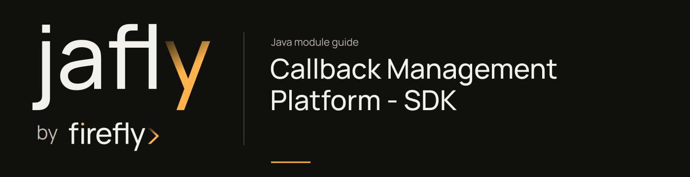

# Callback Management Platform - SDK

Generate a reactive Java WebClient SDK from the callback platform OpenAPI specification.

Build the module to generate its APIs/models before importing them in a client. Treat the checked-in OpenAPI input and POM package settings as the source of the generated surface; edit the specification rather than generated files.

| Maven artifact | Packaging | Source project |
| --- | --- | --- |
| `org.fireflyframework:fireflyframework-callbacks-sdk` | `jar` | [modules/callbacks/fireflyframework-callbacks-sdk](https://github.com/fireflyframework/fireflyframework-jafly/tree/main/modules/callbacks/fireflyframework-callbacks-sdk) |

Part of [External services](index.md#external-services).

## In the onboarding service

A partner-management client can use this generated SDK to register or inspect callbacks for onboarding events. Its model classes belong to the remote HTTP contract, not the onboarding application's persistence model.

## Add the component

[Installation and version availability](../installation.md) explains source builds and published releases.

```xml
<dependency>
    <groupId>org.fireflyframework</groupId>
    <artifactId>fireflyframework-callbacks-sdk</artifactId>
    <version>26.10.19</version>
</dependency>
```

## Quick start

The Java examples in this section are API fragments for application code. Use the stated imports and supply the application-owned collaborators described alongside them.

After building the SDK, create the generated client for the deployed callbacks service. Use an existing callback configuration UUID for this read operation:

```java
import com.firefly.common.callbacks.sdk.api.CallbackConfigurationsApi;
import com.firefly.common.callbacks.sdk.invoker.ApiClient;
import com.firefly.common.callbacks.sdk.model.CallbackConfigurationDTO;
import reactor.core.publisher.Mono;

ApiClient client = new ApiClient()
        .setBasePath(System.getenv("CALLBACKS_URL"));
CallbackConfigurationsApi api = new CallbackConfigurationsApi(client);
Mono<CallbackConfigurationDTO> configuration =
        api.findById2(configurationId, null);
```

`configurationId` is a `UUID`; the second argument is the optional idempotency header. The generated `findById2` name follows the checked-in OpenAPI operation IDs, which distinguish similarly named operations across tags. SDK models live under `com.firefly.common.callbacks.sdk.model`; use these generated types in a remote client rather than importing server DTOs. Configure the generated `ApiClient` authentication/default headers for the deployment and compose the returned `Mono`.

## Configuration and wiring

This module has no authored configuration-properties class. Its behavior is configured through the Maven generator or the dependencies listed below.

## Generated client contract

The generation input is [openapi.yml](https://github.com/fireflyframework/fireflyframework-jafly/blob/main/modules/callbacks/fireflyframework-callbacks-sdk/src/main/resources/api-spec/openapi.yml). The build produces the Java surface under `target`; this module contains no authored production Java classes. The current WebClient generation explicitly uses Spring Boot 4 with Jackson 2 compatibility.

| POM setting | Value |
| --- | --- |
| `inputSpec` | `${project.basedir}/src/main/resources/api-spec/openapi.yml` |
| `generatorName` | `java` |
| `library` | `webclient` |
| `apiPackage` | `com.firefly.common.callbacks.sdk.api` |
| `modelPackage` | `com.firefly.common.callbacks.sdk.model` |
| `invokerPackage` | `com.firefly.common.callbacks.sdk.invoker` |
| `useSpringBoot4` | `true` |
| `useJackson3` | `false` |
| `sourceFolder` | `src/gen/java/main` |
| `reactive` | `true` |


### Operations from the API specification

`findById`, `update`, `delete`, `findById_2`, `update_1`, `delete_1`, `update_2`, `delete_2`, `filterSubscriptions`, `create`, `filterExecutions`, `filterConfigurations`. Additional operations are defined in the linked specification.

## Related components

| Related component | Why it belongs nearby |
| --- | --- |
| [Callbacks Library](callbacks.md) | Group the outbound callback platform: configuration, domain authorization, subscriptions, execution tracking, and dispatch. |
| [Callback Management Platform - Web](callbacks-web.md) | Expose the callback-management HTTP API and its Spring Boot application. |

## Build and test

Use Java 25. From the repository root, build this component with its required dependencies:

```bash
git clone https://github.com/fireflyframework/fireflyframework-jafly.git
cd fireflyframework-jafly
./mvnw -pl :fireflyframework-callbacks-sdk -am verify
./mvnw -pl :fireflyframework-callbacks-sdk -am install
```

`verify` runs the selected projects' tests. `install` makes the current build available in your local Maven repository.

This subproject has no authored `src/test/java` suite. Its Maven build still validates the configured compilation/generation and any reactor prerequisites. Use the consuming component tests to validate integration behavior.

## Continue the application

Use the [Callback Management Platform - Web guide](callbacks-web.md) for the next part of this integration. The runnable submission/query service is in [Getting started](../getting-started.md).

## Source and further reading

- [Maven project and dependency declarations](https://github.com/fireflyframework/fireflyframework-jafly/blob/main/modules/callbacks/fireflyframework-callbacks-sdk/pom.xml).
- [openapi.yml](https://github.com/fireflyframework/fireflyframework-jafly/blob/main/modules/callbacks/fireflyframework-callbacks-sdk/src/main/resources/api-spec/openapi.yml).
- [Module catalog](index.md) and [getting started](../getting-started.md).
- [Maven platform](../maven.md) and [architecture](../architecture.md).
