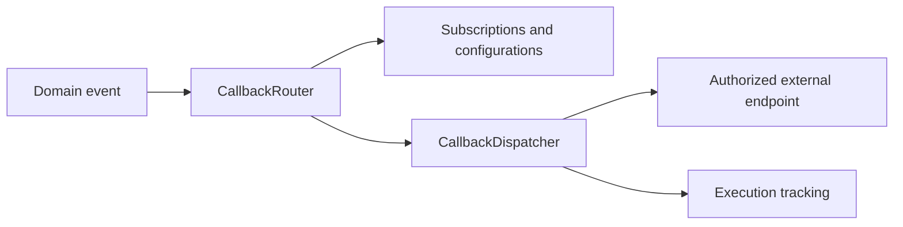

# Callbacks Library

Group the outbound callback platform: configuration, domain authorization, subscriptions, execution tracking, and dispatch.

Use callbacks-web for the service, callbacks-core for embedded dispatch logic, and the SDK for remote clients. This family sends events to external endpoints; incoming webhook ingestion is documented under webhooks.

| Maven artifact | Packaging | Source project |
| --- | --- | --- |
| `org.fireflyframework:fireflyframework-callbacks` | `pom` | [modules/callbacks](https://github.com/fireflyframework/fireflyframework-jafly/tree/main/modules/callbacks) |

Part of [External services](index.md#external-services).

## Outbound delivery flow



Configure authorized destinations and subscriptions before routing an event. Dispatch and execution tracking are separate from simply registering a callback.

## In the onboarding service

An onboarding partner may need an outbound notification when an application changes status. Register its authorized destination and subscription before dispatching events to it.

## Choose a component

| Related component | Why it belongs nearby |
| --- | --- |
| [Callback Management Platform - Interfaces](callbacks-interfaces.md) | Share callback configuration, subscription, domain, and execution DTOs and status enums. |
| [Callback Management Platform - Models](callbacks-models.md) | Persist callback configurations, authorized domains, event subscriptions, and execution records with reactive repositories. |
| [Callback Management Platform - Core](callbacks-core.md) | Route subscribed events and dispatch outbound HTTP callbacks with signing, retries, circuit breaking, and execution tracking. |
| [Callback Management Platform - Web](callbacks-web.md) | Expose the callback-management HTTP API and its Spring Boot application. |
| [Callback Management Platform - SDK](callbacks-sdk.md) | Generate a reactive Java WebClient SDK from the callback platform OpenAPI specification. |

## Add the component

[Installation and version availability](../installation.md) explains source builds and published releases.

This artifact has `pom` packaging and groups child projects. Select a concrete child JAR for the application classpath.

```xml
<dependency>
    <groupId>org.fireflyframework</groupId>
    <artifactId>fireflyframework-callbacks-interfaces</artifactId>
    <version>26.10.17-SNAPSHOT</version>
</dependency>
```

## Quick start

The injection examples use Lombok `@RequiredArgsConstructor`. Add its provided dependency and annotation processor as described in [Constructor injection](../maven.md#constructor-injection).

The Java examples in this section are API fragments for application code. Use the stated imports and supply the application-owned collaborators described alongside them.

### Run the service

Build the aggregator and start the web module against a PostgreSQL database and a Kafka broker:

```bash
./mvnw -pl :fireflyframework-callbacks,:fireflyframework-callbacks-core,:fireflyframework-callbacks-interfaces,:fireflyframework-callbacks-models,:fireflyframework-callbacks-sdk,:fireflyframework-callbacks-web -am install
./mvnw -f modules/callbacks/fireflyframework-callbacks-web/pom.xml spring-boot:run
```

Connection settings are environment-driven (see [Configuration](#configuration)); the defaults assume PostgreSQL on `localhost:5432/callbacks_db` and Kafka on `localhost:9092`. Once running, the API and Swagger UI are available at:

- OpenAPI JSON: `http://localhost:8080/v3/api-docs`
- Swagger UI: `http://localhost:8080/swagger-ui.html`

### Register a callback configuration

Tell the platform where to deliver events and which event types to deliver. The target domain must be authorized first (see the authorized-domains API).

```bash
curl -X POST http://localhost:8080/api/v1/callback-configurations \
  -H "Content-Type: application/json" \
  -d '{
        "name": "orders-webhook",
        "url": "https://partner.example.com/webhooks/orders",
        "httpMethod": "POST",
        "status": "ACTIVE",
        "subscribedEventTypes": ["order.created", "order.updated"],
        "signatureEnabled": true,
        "secret": "s3cr3t",
        "signatureHeader": "X-Firefly-Signature",
        "maxRetries": 3,
        "retryDelayMs": 1000,
        "timeoutMs": 30000
      }'
```

When an `order.created` event arrives on a subscribed topic, the platform delivers a signed `POST` to the URL above, retrying with exponential backoff on transient failures and recording every attempt.

### Subscribe to events

An `EventSubscription` binds the platform to a messaging topic/queue and a set of event-type patterns. Subscriptions are loaded from the database and registered as dynamic EDA listeners at runtime.

```bash
curl -X POST http://localhost:8080/api/v1/event-subscriptions \
  -H "Content-Type: application/json" \
  -d '{
        "name": "order-events",
        "messagingSystemType": "KAFKA",
        "topicOrQueue": "orders",
        "consumerGroupId": "callbacks-mgmt-consumer",
        "eventTypePatterns": ["order.*"],
        "active": true
      }'
```

### Reusing the dispatcher in code

If you embed the core module, dispatching is a reactive call that takes a resolved configuration, the event metadata, and a JSON payload:

```java
import lombok.RequiredArgsConstructor;
import org.fireflyframework.callbacks.core.service.CallbackDispatcher;
import org.fireflyframework.callbacks.interfaces.dto.CallbackConfigurationDTO;
import com.fasterxml.jackson.databind.JsonNode;
import reactor.core.publisher.Mono;

import java.util.UUID;

@RequiredArgsConstructor
public class OrderNotifier {

    private final CallbackDispatcher dispatcher;


    public Mono<Void> notify(CallbackConfigurationDTO config, UUID eventId, JsonNode payload) {
        // Validates the domain, signs the payload, retries, and records the execution.
        return dispatcher.dispatch(config, "order.created", eventId, payload);
    }
}
```

## Configuration and wiring

This POM has no runtime configuration namespace. Configure the selected child libraries in the application that uses them.

## Build and test

Use Java 25. From the repository root, build this component with its required dependencies:

```bash
git clone https://github.com/fireflyframework/fireflyframework-jafly.git
cd fireflyframework-jafly
./mvnw -pl :fireflyframework-callbacks,:fireflyframework-callbacks-core,:fireflyframework-callbacks-interfaces,:fireflyframework-callbacks-models,:fireflyframework-callbacks-sdk,:fireflyframework-callbacks-web -am verify
./mvnw -pl :fireflyframework-callbacks,:fireflyframework-callbacks-core,:fireflyframework-callbacks-interfaces,:fireflyframework-callbacks-models,:fireflyframework-callbacks-sdk,:fireflyframework-callbacks-web -am install
```

`verify` runs the selected projects' tests. `install` makes the current build available in your local Maven repository.

This subproject has no authored `src/test/java` suite. Its Maven build still validates the configured compilation/generation and any reactor prerequisites. Use the consuming component tests to validate integration behavior.

## Detailed reference

### REST API

All endpoints are reactive and served under `/api/v1`. Each resource provides standard CRUD plus a `POST /filter` endpoint that accepts a `FilterRequest` and returns a paginated `PaginationResponse`.

| Resource | Base path | Purpose |
| --- | --- | --- |
| Callback configurations | `/api/v1/callback-configurations` | Register and manage outbound webhook endpoints. |
| Event subscriptions | `/api/v1/event-subscriptions` | Bind the platform to messaging topics/queues and event-type patterns. |
| Authorized domains | `/api/v1/authorized-domains` | Maintain the allow-list of domains callbacks may target. |
| Callback executions | `/api/v1/callback-executions` | Query the audit trail of delivery attempts. |

### Configuration

The platform reads plain Spring properties. There is no `@ConfigurationProperties` binding class; values are environment-overridable. The defaults below match `fireflyframework-callbacks-web/src/main/resources/application.yml`.

```yaml
spring:
  application:
    name: common-platform-callbacks-mgmt
  r2dbc:
    url: r2dbc:postgresql://${DB_HOST:localhost}:${DB_PORT:5432}/${DB_NAME:callbacks_db}
    username: ${DB_USERNAME:firefly}
    password: ${DB_PASSWORD:firefly}
    pool:
      initial-size: 10
      max-size: 50

server:
  port: ${SERVER_PORT:8080}

firefly:
  callbacks:
    # Topics are loaded dynamically from EventSubscription rows at startup
    listener:
      topics: ${CALLBACK_LISTENER_TOPICS:*}
      group-id: ${CALLBACK_LISTENER_GROUP_ID:callbacks-mgmt-consumer}
    dispatcher:
      thread-pool-size: ${CALLBACK_DISPATCHER_THREADS:20}
      default-timeout-ms: ${CALLBACK_DEFAULT_TIMEOUT:30000}
      follow-redirects: ${CALLBACK_FOLLOW_REDIRECTS:false}
    circuit-breaker:
      failure-rate-threshold: ${CALLBACK_CB_FAILURE_RATE:50}
      slow-call-duration-threshold-ms: ${CALLBACK_CB_SLOW_DURATION:10000}
      sliding-window-size: ${CALLBACK_CB_WINDOW_SIZE:100}
      minimum-number-of-calls: ${CALLBACK_CB_MIN_CALLS:10}
      wait-duration-in-open-state-ms: ${CALLBACK_CB_WAIT_DURATION:60000}
    retry:
      max-attempts: ${CALLBACK_RETRY_MAX_ATTEMPTS:3}
      initial-delay-ms: ${CALLBACK_RETRY_INITIAL_DELAY:1000}
      max-delay-ms: ${CALLBACK_RETRY_MAX_DELAY:60000}
      multiplier: ${CALLBACK_RETRY_MULTIPLIER:2.0}
    signature:
      algorithm: ${CALLBACK_SIGNATURE_ALGORITHM:HmacSHA256}
      header-name: ${CALLBACK_SIGNATURE_HEADER:X-Firefly-Signature}

  # Event-driven architecture (provided by fireflyframework-eda)
  eda:
    enabled: true
    consumer:
      kafka:
        default:
          enabled: true
          bootstrap-servers: ${FIREFLY_KAFKA_BOOTSTRAP_SERVERS:localhost:9092}
```

Key properties:

| Property | Default | Description |
| --- | --- | --- |
| `firefly.callbacks.listener.topics` | `*` | Topics the consumer subscribes to; populated at startup from `EventSubscription` rows. Supports wildcards (`*`, `customer.*`). |
| `firefly.callbacks.dispatcher.thread-pool-size` | `20` | Worker pool size for HTTP callbacks. |
| `firefly.callbacks.dispatcher.default-timeout-ms` | `30000` | Default per-request HTTP timeout. |
| `firefly.callbacks.circuit-breaker.failure-rate-threshold` | `50` | Percentage of failed calls that opens the circuit. |
| `firefly.callbacks.retry.max-attempts` | `3` | Maximum delivery attempts before a callback is marked `FAILED_PERMANENT`. |
| `firefly.callbacks.retry.multiplier` | `2.0` | Exponential backoff multiplier between retries. |
| `firefly.callbacks.signature.header-name` | `X-Firefly-Signature` | Header carrying the HMAC signature. |
| `firefly.eda.consumer.kafka.default.bootstrap-servers` | `localhost:9092` | Kafka brokers for the EDA consumer. |

Per-configuration values (`maxRetries`, `retryDelayMs`, `timeoutMs`, `signatureEnabled`, `signatureHeader`, `secret`, `failureThreshold`) stored on each `CallbackConfiguration` override the service-wide defaults at dispatch time. Resilience4j circuit-breaker and time-limiter instances (`callbackDispatcher`) and Actuator/metrics/tracing are also configured in `application.yml`.

## Continue the application

Use the [Callback Management Platform - Core guide](callbacks-core.md) for the next part of this integration. The runnable submission/query service is in [Getting started](../getting-started.md).

## Source and further reading

- [Maven project and dependency declarations](https://github.com/fireflyframework/fireflyframework-jafly/blob/main/modules/callbacks/pom.xml).
- [Module catalog](index.md) and [getting started](../getting-started.md).
- [Maven platform](../maven.md) and [architecture](../architecture.md).
