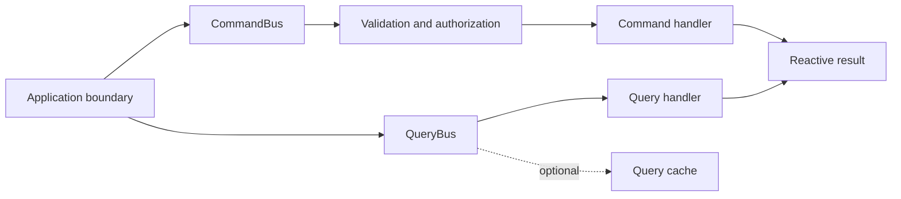

# Common CQRS Library

Separate commands and queries with reactive dispatch, execution context, validation, and authorization hooks.

Define command/query messages and their handlers, then invoke the appropriate bus. Configure timeouts and query caching through firefly.cqrs; use the EDA integration only when the event transport has also been configured.

| Maven artifact | Packaging | Source project |
| --- | --- | --- |
| `org.fireflyframework:fireflyframework-cqrs` | `jar` | [modules/cqrs](https://github.com/fireflyframework/fireflyframework-jafly/tree/main/modules/cqrs) |

Part of [Business operations](index.md#business-operations).

## Command and query paths



Commands and queries have different handlers and policies. The buses connect application messages to those handlers while keeping results in Reactor publishers.

## Add the component

[Installation and version availability](../installation.md) explains source builds and published releases.

```xml
<dependency>
    <groupId>org.fireflyframework</groupId>
    <artifactId>fireflyframework-cqrs</artifactId>
    <version>26.10.22</version>
</dependency>
```

## Quick start

The runnable example is a customer onboarding service. `POST /applications` submits an applicant's name and email through `CommandBus`; `GET /applications/{id}` reads the saved application through `QueryBus`.

Use the [first-service tutorial](../getting-started.md) for the complete Maven project, main class, run commands, and HTTP tests. The classes here belong to that project. Its repository is an in-memory map that loses data on restart, and its query disables caching. Authentication, outbound events, and a database are later integration choices.

### Submit a customer application

[SubmitApplication.java](https://github.com/fireflyframework/fireflyframework-jafly/blob/main/docs/examples/getting-started/src/main/java/com/example/jafly/SubmitApplication.java):

```java
--8<-- "docs/examples/getting-started/src/main/java/com/example/jafly/SubmitApplication.java"
```

[SubmitApplicationHandler.java](https://github.com/fireflyframework/fireflyframework-jafly/blob/main/docs/examples/getting-started/src/main/java/com/example/jafly/SubmitApplicationHandler.java):

```java
--8<-- "docs/examples/getting-started/src/main/java/com/example/jafly/SubmitApplicationHandler.java"
```

### Read an application by ID

[FindApplication.java](https://github.com/fireflyframework/fireflyframework-jafly/blob/main/docs/examples/getting-started/src/main/java/com/example/jafly/FindApplication.java):

```java
--8<-- "docs/examples/getting-started/src/main/java/com/example/jafly/FindApplication.java"
```

[FindApplicationHandler.java](https://github.com/fireflyframework/fireflyframework-jafly/blob/main/docs/examples/getting-started/src/main/java/com/example/jafly/FindApplicationHandler.java):

```java
--8<-- "docs/examples/getting-started/src/main/java/com/example/jafly/FindApplicationHandler.java"
```

### Store the tutorial state

[OnboardingApplication.java](https://github.com/fireflyframework/fireflyframework-jafly/blob/main/docs/examples/getting-started/src/main/java/com/example/jafly/OnboardingApplication.java):

```java
--8<-- "docs/examples/getting-started/src/main/java/com/example/jafly/OnboardingApplication.java"
```

[InMemoryApplicationRepository.java](https://github.com/fireflyframework/fireflyframework-jafly/blob/main/docs/examples/getting-started/src/main/java/com/example/jafly/InMemoryApplicationRepository.java):

```java
--8<-- "docs/examples/getting-started/src/main/java/com/example/jafly/InMemoryApplicationRepository.java"
```

### Expose the two HTTP routes

[ApplicationsController.java](https://github.com/fireflyframework/fireflyframework-jafly/blob/main/docs/examples/getting-started/src/main/java/com/example/jafly/ApplicationsController.java):

```java
--8<-- "docs/examples/getting-started/src/main/java/com/example/jafly/ApplicationsController.java"
```

The controller returns `201 Created` with a `Location` header for a submission, `200 OK` for a known ID, `404` for an unknown ID, and `400` for invalid name/email input. The handlers use the application's concrete repository; the bus supplies dispatch and its configured processing pipeline.

### Run and check the application

After installing the required framework libraries, run the standalone project from the repository root:

```sh
./mvnw -f docs/examples/getting-started/pom.xml spring-boot:run
```

Submit a fictional applicant from another terminal:

```sh
curl -i -X POST http://localhost:8080/applications \
  -H 'Content-Type: application/json' \
  -d '{"applicantName":"Ada Lovelace","email":"ada@example.com"}'
```

Use the returned `id` in `GET /applications/{id}`. Run the project's tests with:

```sh
./mvnw -B -ntp -f docs/examples/getting-started/pom.xml verify
```

### Authorization and optional bridges

The command/query interfaces allow execution by default. Protected operations need an authorization rule and trusted identity context. Jakarta annotation validation needs a `Validator` bean; the example declares the validation starter.

`ContextAwareCommandHandler<C, R>` and `ContextAwareQueryHandler<Q, R>` support handlers that require the bus's `ExecutionContext`. Bind their message and result types in a concrete subclass. Type resolution follows generic bindings through intermediate classes, reordered parameters, interfaces and standard generated subclasses; raw or unbound message variables do not become permission to dispatch every command/query through their upper bound. Construction still rejects an unresolved handler type. Parameterized result types expose their raw Java class for dispatch metadata, rather than a complete serialization schema. Context propagation does not authenticate an arbitrary context: populate identity through a trusted application boundary and enforce the operation's authorization policy.

Publishing a command result requires EDA, an `EventPublisherFactory` bean, the enabled CQRS/EDA bridge, and `@PublishDomainEvent` on the handler. Query invalidation requires a `QueryCacheAdapter` and a matching `@InvalidateCacheOn` event delivered through Spring's application-event path. Connect broker events to that local path explicitly. The onboarding tutorial configures neither bridge.

These annotation declarations are API fragments for an application that has added that infrastructure:

```java
@PublishDomainEvent(destination = "application-events", eventType = "application.submitted")
@InvalidateCacheOn(eventTypes = {"application.submitted", "application.reviewed"})
```

Apply each annotation to its corresponding command or query handler. If you enable query caching, update the tutorial's query and handler cache settings and verify invalidation; its current query intentionally reads the map directly.

## Configuration and wiring

The `firefly.cqrs.authorization` namespace is bound by [AuthorizationProperties.java](https://github.com/fireflyframework/fireflyframework-jafly/blob/main/modules/cqrs/src/main/java/org/fireflyframework/cqrs/config/AuthorizationProperties.java). Nested configuration is declared in the linked class. Defaults are the field initializers.

| Setting | Java type | Source default |
| --- | --- | --- |
| `firefly.cqrs.authorization.enabled` | `boolean` | `true` |
| `firefly.cqrs.authorization.custom` | `Custom` | `new Custom()` |
| `firefly.cqrs.authorization.logging` | `Logging` | `new Logging()` |
| `firefly.cqrs.authorization.performance` | `Performance` | `new Performance()` |

The `firefly.cqrs` namespace is bound by [CqrsProperties.java](https://github.com/fireflyframework/fireflyframework-jafly/blob/main/modules/cqrs/src/main/java/org/fireflyframework/cqrs/config/CqrsProperties.java). Nested configuration is declared in the linked class. Defaults are the field initializers.

| Setting | Java type | Source default |
| --- | --- | --- |
| `firefly.cqrs.enabled` | `boolean` | `true` |
| `firefly.cqrs.command` | `Command` | `new Command()` |
| `firefly.cqrs.query` | `Query` | `new Query()` |

Property-based wiring conditions found in this module:

- `prefix = "firefly.cqrs", name = "enabled", havingValue = "true", matchIfMissing = true`. [CqrsActuatorAutoConfiguration.java](https://github.com/fireflyframework/fireflyframework-jafly/blob/main/modules/cqrs/src/main/java/org/fireflyframework/cqrs/config/CqrsActuatorAutoConfiguration.java).
- `prefix = "firefly.cqrs", name = "enabled", havingValue = "true", matchIfMissing = true`. [CqrsAutoConfiguration.java](https://github.com/fireflyframework/fireflyframework-jafly/blob/main/modules/cqrs/src/main/java/org/fireflyframework/cqrs/config/CqrsAutoConfiguration.java).
- `name = "firefly.cqrs.authorization.enabled", havingValue = "true", matchIfMissing = true`. [CqrsAutoConfiguration.java](https://github.com/fireflyframework/fireflyframework-jafly/blob/main/modules/cqrs/src/main/java/org/fireflyframework/cqrs/config/CqrsAutoConfiguration.java).
- `prefix = "firefly.cqrs.eda", name = "enabled", havingValue = "true", matchIfMissing = true`. [CqrsEdaAutoConfiguration.java](https://github.com/fireflyframework/fireflyframework-jafly/blob/main/modules/cqrs/src/main/java/org/fireflyframework/cqrs/config/CqrsEdaAutoConfiguration.java).

## Public API and extension points

| Type | Contract and responsibility |
| --- | --- |
| [`CommandBus`](https://github.com/fireflyframework/fireflyframework-jafly/blob/main/modules/cqrs/src/main/java/org/fireflyframework/cqrs/command/CommandBus.java) | Interface for the Command Bus in CQRS architecture. |
| [`QueryBus`](https://github.com/fireflyframework/fireflyframework-jafly/blob/main/modules/cqrs/src/main/java/org/fireflyframework/cqrs/query/QueryBus.java) | Interface for the Query Bus in CQRS architecture. |
| [`CommandHandler`](https://github.com/fireflyframework/fireflyframework-jafly/blob/main/modules/cqrs/src/main/java/org/fireflyframework/cqrs/command/CommandHandler.java) | Base class for all command handlers in the CQRS framework. |
| [`QueryHandler`](https://github.com/fireflyframework/fireflyframework-jafly/blob/main/modules/cqrs/src/main/java/org/fireflyframework/cqrs/query/QueryHandler.java) | Base class for all query handlers in the CQRS framework. |
| [`ExecutionContext`](https://github.com/fireflyframework/fireflyframework-jafly/blob/main/modules/cqrs/src/main/java/org/fireflyframework/cqrs/context/ExecutionContext.java) | Execution context for CQRS commands and queries. |

## Related components

| Related component | Why it belongs nearby |
| --- | --- |
| [Kernel](kernel.md) | Share a consistent exception vocabulary across application, domain, and infrastructure boundaries. |
| [Validators](validators.md) | Apply Jakarta Bean Validation constraints to financial, identity, contact, and date fields. |
| [Common Cache Library](cache.md) | Use a common cache API with a local Caffeine default and pluggable distributed providers. |
| [Observability](observability.md) | Provide a common metrics, tracing, health, and context-propagation foundation for framework components. |
| [Common EDA Library](eda.md) | Publish and consume events through a common envelope and transport-independent APIs. |

## Build and test

Use Java 25. From the repository root, build this component with its required dependencies:

```bash
git clone https://github.com/fireflyframework/fireflyframework-jafly.git
cd fireflyframework-jafly
./mvnw -pl :fireflyframework-cqrs -am verify
./mvnw -pl :fireflyframework-cqrs -am install
```

`verify` runs the selected projects' tests. `install` makes the current build available in your local Maven repository.

Representative test sources:

- [CqrsFrameworkIntegrationTest.java](https://github.com/fireflyframework/fireflyframework-jafly/blob/main/modules/cqrs/src/test/java/org/fireflyframework/cqrs/CqrsFrameworkIntegrationTest.java).
- [SpringCqrsIntegrationTest.java](https://github.com/fireflyframework/fireflyframework-jafly/blob/main/modules/cqrs/src/test/java/org/fireflyframework/cqrs/SpringCqrsIntegrationTest.java).
- [CqrsActuatorIntegrationTest.java](https://github.com/fireflyframework/fireflyframework-jafly/blob/main/modules/cqrs/src/test/java/org/fireflyframework/cqrs/actuator/CqrsActuatorIntegrationTest.java).
- [AuthorizationIntegrationTest.java](https://github.com/fireflyframework/fireflyframework-jafly/blob/main/modules/cqrs/src/test/java/org/fireflyframework/cqrs/authorization/AuthorizationIntegrationTest.java).
- [AuthorizationResultTest.java](https://github.com/fireflyframework/fireflyframework-jafly/blob/main/modules/cqrs/src/test/java/org/fireflyframework/cqrs/authorization/AuthorizationResultTest.java).
- [AuthorizationServiceTest.java](https://github.com/fireflyframework/fireflyframework-jafly/blob/main/modules/cqrs/src/test/java/org/fireflyframework/cqrs/authorization/AuthorizationServiceTest.java).

## Test fixture

The `shouldCreateFailedAuthorizationResultWithSingleError` test demonstrates one concrete behavior. Excerpt from [AuthorizationResultTest.java](https://github.com/fireflyframework/fireflyframework-jafly/blob/main/modules/cqrs/src/test/java/org/fireflyframework/cqrs/authorization/AuthorizationResultTest.java). The test class supplies its fixtures and imports.

```java
@Test
@DisplayName("Should create failed authorization result with single error")
void shouldCreateFailedAuthorizationResultWithSingleError() {
    // Given
    AuthorizationError error = AuthorizationError.of("account", "Account access denied");

    // When
    AuthorizationResult result = AuthorizationResult.failure(error);

    // Then
    assertThat(result.isAuthorized()).isFalse();
    assertThat(result.isUnauthorized()).isTrue();
    assertThat(result.getErrors()).hasSize(1);
    assertThat(result.getErrors().get(0)).isEqualTo(error);
    assertThat(result.getSummary()).isEqualTo("Authorization failed");
    assertThat(result.getFirstError()).isEqualTo(error);
    assertThat(result.getErrorMessages()).isEqualTo("Account access denied");
}
```

## Detailed reference

### Explicit query cache identity

`Query.getCacheKey()` returns `null` by default, so a handler executes without a cached result unless the query explicitly supplies a key. The former class-name/metadata-hash default could collapse different resources into the same entry. Updating the framework stops reading those implicit entries; existing explicit custom keys keep their own semantics and must be reviewed separately.

A custom key must represent all result-affecting inputs and the relevant trusted tenant, subject, and policy scope, including resource identity, filters, pagination, and version where applicable. Do not put credentials or personal data in keys. If an execution context changes the result, either include its trusted scope in the query's explicit key or keep that handler uncached. The bus does not infer a complete authority boundary from an arbitrary context map.

Both `query(query)` and `query(query, context)` require the query and handler to allow caching and a non-null explicit key. Validation and configured authorization precede cache access. `@QueryHandlerComponent(cacheable = false)` bypasses both cache reads and writes, including when a matching stale entry exists. Prefer that setting for authoritative workflow status/result reads without a qualified invalidation and freshness policy.

### Configuration

All properties live under the `firefly.cqrs.*` namespace. The values below are the configured defaults; you only need to set what you want to change.

```yaml
firefly:
  cqrs:
    enabled: true                 # master switch for the CQRS framework
    command:
      timeout: 30s                # default command processing timeout
      metrics-enabled: true
      tracing-enabled: true
    query:
      timeout: 15s                # default query processing timeout
      caching-enabled: true       # provide caching; each query still needs an explicit key
      cache-ttl: 15m              # default TTL for the dedicated CQRS query cache
      metrics-enabled: true
      tracing-enabled: true
    eda:
      enabled: true               # EDA classpath + the relevant publisher/cache beans are required
    authorization:
      enabled: true               # master switch for authorization checks
      custom:
        enabled: true
        timeout-ms: 5000          # timeout for custom authorize() logic
      logging:
        enabled: true
        log-successful: false     # only log failures/errors when false
        log-performance: true
        level: INFO
      performance:
        cache-enabled: false      # cache authorization results
        cache-ttl-seconds: 300
        cache-max-size: 1000
        async-enabled: false
```

#### Key properties

| Property | Default | Description |
| --- | --- | --- |
| `firefly.cqrs.enabled` | `true` | Enables/disables the entire CQRS framework. |
| `firefly.cqrs.command.timeout` | `30s` | Default per-command processing timeout. |
| `firefly.cqrs.query.timeout` | `15s` | Default per-query processing timeout. |
| `firefly.cqrs.query.caching-enabled` | `true` | Turns query-result caching on/off globally. |
| `firefly.cqrs.query.cache-ttl` | `15m` | Default TTL of the dedicated CQRS query cache. |
| `firefly.cqrs.eda.enabled` | `true` | Enables the `@PublishDomainEvent` / `@InvalidateCacheOn` bridge (requires `fireflyframework-eda`). |
| `firefly.cqrs.authorization.enabled` | `true` | Enables authorization on commands and queries. |
| `firefly.cqrs.authorization.custom.timeout-ms` | `5000` | Timeout (ms) for custom `authorize()` logic. |
| `firefly.cqrs.authorization.performance.cache-enabled` | `false` | Caches authorization decisions. |

> Query caching note: the actual cache provider (Caffeine, Redis, Hazelcast, JCache, or PostgreSQL) is selected by `fireflyframework-cache` via `CacheType.AUTO`. Configure the provider through `firefly.cache.*`; the legacy `firefly.cqrs.query.cache.*` keys are deprecated in favor of it.

#### Actuator endpoints

When Spring Boot Actuator is on the classpath, expose the CQRS endpoints:

```yaml
management:
  endpoints:
    web:
      exposure:
        include: health, info, metrics, cqrs
```

- `GET /actuator/cqrs`. overview (with `/commands`, `/queries`, `/handlers`, `/health` selectors)
- `GET /actuator/health/cqrs`. CQRS framework health

### How It Works

Auto-configuration is split into three classes, registered via `META-INF/spring/org.springframework.boot.autoconfigure.AutoConfiguration.imports`:

- `CqrsAutoConfiguration`. wires `CommandBus`, `QueryBus`, the handler registry, validation, authorization, the dedicated `cqrsQueryCacheManager`/`QueryCacheAdapter`, the correlation context, and metrics. Gated on `firefly.cqrs.enabled=true`.
- `CqrsActuatorAutoConfiguration`. registers the `CqrsMetricsEndpoint` and `CqrsHealthIndicatorImpl` when Actuator is present.
- `CqrsEdaAutoConfiguration`. registers the EDA bridge (`CommandEventPublisher`, `EventDrivenCacheInvalidator`) when `fireflyframework-eda` is on the classpath and `firefly.cqrs.eda.enabled=true`.

Each command/query flows through its bus: validate → authorize → dispatch to handler → metrics & tracing. Every bean is annotated `@ConditionalOnMissingBean`, so you can override any piece by declaring your own.

## Source and further reading

- [Maven project and dependency declarations](https://github.com/fireflyframework/fireflyframework-jafly/blob/main/modules/cqrs/pom.xml).
- [Production source](https://github.com/fireflyframework/fireflyframework-jafly/tree/main/modules/cqrs/src/main/java).
- [org.springframework.boot.autoconfigure.AutoConfiguration.imports](https://github.com/fireflyframework/fireflyframework-jafly/blob/main/modules/cqrs/src/main/resources/META-INF/spring/org.springframework.boot.autoconfigure.AutoConfiguration.imports).
- [Module catalog](index.md) and [getting started](../getting-started.md).
- [Maven platform](../maven.md) and [architecture](../architecture.md).
