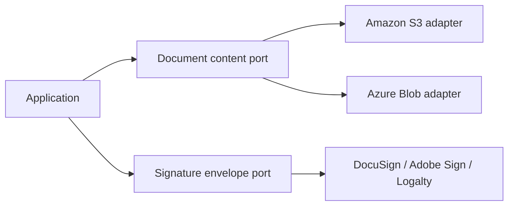

# Enterprise Content Management Library

Define content-management ports, adapter selection, document contracts, and resilience/observability support.

Select the concrete storage or signature adapter required by the application and call the ECM ports. Review adapter availability and graceful-degradation behavior before assuming an optional capability is backed by a live provider.

| Maven artifact | Packaging | Source project |
| --- | --- | --- |
| `org.fireflyframework:fireflyframework-ecm` | `jar` | [modules/ecm](https://github.com/fireflyframework/fireflyframework-jafly/tree/main/modules/ecm) |

Part of [Domain and data](index.md#domain-and-data).

## Content contracts and adapters



Call the ECM contract and select the adapter for each capability. Provider credentials, storage resources, and signature accounts belong to the deployment.

## In the onboarding service

An applicant may upload supporting documents or sign an agreement after submission. Use the content/signature ports with a real provider adapter; OCR and classification ports need an application-supplied implementation.

## Add the component

[Installation and version availability](../installation.md) explains source builds and published releases.

```xml
<dependency>
    <groupId>org.fireflyframework</groupId>
    <artifactId>fireflyframework-ecm</artifactId>
    <version>26.10.21-SNAPSHOT</version>
</dependency>
```

## Quick start

The injection examples use Lombok `@RequiredArgsConstructor`. Add its provided dependency and annotation processor as described in [Constructor injection](../maven.md#constructor-injection).

The Java examples in this section are API fragments for application code. Use the stated imports and supply the application-owned collaborators described alongside them.

1. Add the dependency (above) and a provider adapter. Select it via configuration:

```yaml
firefly:
  ecm:
    enabled: true
    adapter-type: s3          # selects the storage/core adapter (e.g. AWS S3)
    properties:               # adapter-specific settings (free-form map)
      bucket-name: my-documents
      region: us-east-1
    features:
      document-management: true
      content-storage: true
      esignature: true        # off by default — opt in
    esignature:
      provider: docusign      # selects the e-signature adapter independently
```

2. Inject the reactive ports you need. Your code is provider-agnostic:

```java
import lombok.RequiredArgsConstructor;
import org.fireflyframework.ecm.port.document.DocumentContentPort;
import org.fireflyframework.ecm.port.esignature.SignatureEnvelopePort;
import org.springframework.stereotype.Service;
import reactor.core.publisher.Mono;

import java.util.UUID;

@Service
@RequiredArgsConstructor
public class DocumentService {

    private final DocumentContentPort content;
    private final SignatureEnvelopePort envelopes;


    /** Store binary content for a document and return its storage path. */
    public Mono<String> upload(UUID documentId, byte[] bytes, String mimeType) {
        return content.storeContent(documentId, bytes, mimeType);
    }
}
```

3. (Optional) Use the built-in in-memory adapters for local development/tests:

```yaml
firefly:
  ecm:
    search:
      enabled: true       # registers LocalDocumentSearchAdapter
    permissions:
      enabled: true       # registers LocalPermissionAdapter
```

To write your own adapter, annotate a port implementation with `@EcmAdapter` and the registry will discover it:

```java
import org.fireflyframework.ecm.adapter.EcmAdapter;
import org.fireflyframework.ecm.adapter.AdapterFeature;
import org.fireflyframework.ecm.port.document.DocumentContentPort;

@EcmAdapter(
    type = "s3",
    description = "AWS S3 content storage adapter",
    supportedFeatures = { AdapterFeature.CONTENT_STORAGE, AdapterFeature.STREAMING, AdapterFeature.CLOUD_STORAGE }
)
public class S3DocumentContentAdapter implements DocumentContentPort {
    // ... reactive implementation ...
}
```

## Configuration and wiring

The `firefly.ecm` namespace is bound by [EcmProperties.java](https://github.com/fireflyframework/fireflyframework-jafly/blob/main/modules/ecm/src/main/java/org/fireflyframework/ecm/config/EcmProperties.java). Nested configuration is declared in the linked class. Defaults are the field initializers.

| Setting | Java type | Source default |
| --- | --- | --- |
| `firefly.ecm.enabled` | `Boolean` | `true` |
| `firefly.ecm.adapter-type` | `String` | `not initialized` |
| `firefly.ecm.properties` | `Map<String, Object>` | `not initialized` |
| `firefly.ecm.connection` | `Connection` | `new Connection()` |
| `firefly.ecm.features` | `Features` | `new Features()` |
| `firefly.ecm.defaults` | `Defaults` | `new Defaults()` |
| `firefly.ecm.performance` | `Performance` | `new Performance()` |
| `firefly.ecm.esignature` | `Esignature` | `new Esignature()` |

Property-based wiring conditions found in this module:

- `prefix = "firefly.ecm", name = "enabled", havingValue = "true", matchIfMissing = true`. [EcmAutoConfiguration.java](https://github.com/fireflyframework/fireflyframework-jafly/blob/main/modules/ecm/src/main/java/org/fireflyframework/ecm/config/EcmAutoConfiguration.java).
- `name = "firefly.ecm.search.enabled", havingValue = "true", matchIfMissing = false`. [EcmAutoConfiguration.java](https://github.com/fireflyframework/fireflyframework-jafly/blob/main/modules/ecm/src/main/java/org/fireflyframework/ecm/config/EcmAutoConfiguration.java).
- `name = "firefly.ecm.permissions.enabled", havingValue = "true", matchIfMissing = false`. [EcmAutoConfiguration.java](https://github.com/fireflyframework/fireflyframework-jafly/blob/main/modules/ecm/src/main/java/org/fireflyframework/ecm/config/EcmAutoConfiguration.java).
- `prefix = "firefly.ecm.features", name = "document-management", havingValue = "true", matchIfMissing = true`. [EcmAutoConfiguration.java](https://github.com/fireflyframework/fireflyframework-jafly/blob/main/modules/ecm/src/main/java/org/fireflyframework/ecm/config/EcmAutoConfiguration.java).
- `prefix = "firefly.ecm.features", name = "content-storage", havingValue = "true", matchIfMissing = true`. [EcmAutoConfiguration.java](https://github.com/fireflyframework/fireflyframework-jafly/blob/main/modules/ecm/src/main/java/org/fireflyframework/ecm/config/EcmAutoConfiguration.java).
- `prefix = "firefly.ecm.features", name = "versioning", havingValue = "true", matchIfMissing = true`. [EcmAutoConfiguration.java](https://github.com/fireflyframework/fireflyframework-jafly/blob/main/modules/ecm/src/main/java/org/fireflyframework/ecm/config/EcmAutoConfiguration.java).
- `prefix = "firefly.ecm.features", name = "search", havingValue = "true", matchIfMissing = true`. [EcmAutoConfiguration.java](https://github.com/fireflyframework/fireflyframework-jafly/blob/main/modules/ecm/src/main/java/org/fireflyframework/ecm/config/EcmAutoConfiguration.java).
- `prefix = "firefly.ecm.features", name = "folder-management", havingValue = "true", matchIfMissing = true`. [EcmAutoConfiguration.java](https://github.com/fireflyframework/fireflyframework-jafly/blob/main/modules/ecm/src/main/java/org/fireflyframework/ecm/config/EcmAutoConfiguration.java).
- `prefix = "firefly.ecm.features", name = "folder-hierarchy", havingValue = "true", matchIfMissing = true`. [EcmAutoConfiguration.java](https://github.com/fireflyframework/fireflyframework-jafly/blob/main/modules/ecm/src/main/java/org/fireflyframework/ecm/config/EcmAutoConfiguration.java).
- `prefix = "firefly.ecm.features", name = "permissions", havingValue = "true", matchIfMissing = true`. [EcmAutoConfiguration.java](https://github.com/fireflyframework/fireflyframework-jafly/blob/main/modules/ecm/src/main/java/org/fireflyframework/ecm/config/EcmAutoConfiguration.java).

## Public API and extension points

| Type | Contract and responsibility |
| --- | --- |
| [`DocumentContentPort`](https://github.com/fireflyframework/fireflyframework-jafly/blob/main/modules/ecm/src/main/java/org/fireflyframework/ecm/port/document/DocumentContentPort.java) | Port interface for document binary content storage and retrieval operations. |
| [`SignatureEnvelopePort`](https://github.com/fireflyframework/fireflyframework-jafly/blob/main/modules/ecm/src/main/java/org/fireflyframework/ecm/port/esignature/SignatureEnvelopePort.java) | Port interface for signature envelope management operations in the Firefly ECM system. |
| [`AdapterRegistry`](https://github.com/fireflyframework/fireflyframework-jafly/blob/main/modules/ecm/src/main/java/org/fireflyframework/ecm/adapter/AdapterRegistry.java) | Central registry for ECM adapter discovery, registration, and management. |
| [`AdapterSelector`](https://github.com/fireflyframework/fireflyframework-jafly/blob/main/modules/ecm/src/main/java/org/fireflyframework/ecm/adapter/AdapterSelector.java) | Service responsible for selecting appropriate ECM adapters based on configuration and requirements. |
| [`EcmProperties`](https://github.com/fireflyframework/fireflyframework-jafly/blob/main/modules/ecm/src/main/java/org/fireflyframework/ecm/config/EcmProperties.java) | Configuration properties for the Firefly ECM (Enterprise Content Management) system. |

## Related components

| Related component | Why it belongs nearby |
| --- | --- |
| [Kernel](kernel.md) | Share a consistent exception vocabulary across application, domain, and infrastructure boundaries. |
| [Observability](observability.md) | Provide a common metrics, tracing, health, and context-propagation foundation for framework components. |

## Build and test

Use Java 25. From the repository root, build this component with its required dependencies:

```bash
git clone https://github.com/fireflyframework/fireflyframework-jafly.git
cd fireflyframework-jafly
./mvnw -pl :fireflyframework-ecm -am verify
./mvnw -pl :fireflyframework-ecm -am install
```

`verify` runs the selected projects' tests. `install` makes the current build available in your local Maven repository.

Representative test sources:

- [NoOpAdapterLoggingTest.java](https://github.com/fireflyframework/fireflyframework-jafly/blob/main/modules/ecm/src/test/java/org/fireflyframework/ecm/adapter/noop/NoOpAdapterLoggingTest.java).
- [EcmAutoConfigurationTest.java](https://github.com/fireflyframework/fireflyframework-jafly/blob/main/modules/ecm/src/test/java/org/fireflyframework/ecm/config/EcmAutoConfigurationTest.java).
- [EcmGracefulDegradationTest.java](https://github.com/fireflyframework/fireflyframework-jafly/blob/main/modules/ecm/src/test/java/org/fireflyframework/ecm/config/EcmGracefulDegradationTest.java).

## Test fixture

The `shouldReturnDenyByDefaultForSecurityOperations` test demonstrates one concrete behavior. Excerpt from [EcmGracefulDegradationTest.java](https://github.com/fireflyframework/fireflyframework-jafly/blob/main/modules/ecm/src/test/java/org/fireflyframework/ecm/config/EcmGracefulDegradationTest.java). The test class supplies its fixtures and imports.

```java
@Test
void shouldReturnDenyByDefaultForSecurityOperations() {
    UUID testDocumentId = UUID.randomUUID();
    UUID testUserId = UUID.randomUUID();

    // Access checks should return false (deny by default)
    StepVerifier.create(documentSecurityPort.canAccessDocument(testDocumentId, testUserId, "READ"))
            .expectNext(false)
            .verifyComplete();

    StepVerifier.create(documentSecurityPort.canDeleteDocument(testDocumentId, testUserId))
            .expectNext(false)
            .verifyComplete();

    StepVerifier.create(documentSecurityPort.canModifyDocument(testDocumentId, testUserId))
            .expectNext(false)
            .verifyComplete();
}
```

## Detailed reference

### Configuration

All properties are bound under the `firefly.ecm` prefix (`EcmProperties`). The block below shows the real keys and their defaults:

```yaml
firefly:
  ecm:
    enabled: true                 # master switch for the ECM auto-configuration
    adapter-type:                 # storage/core adapter to select (e.g. "s3"); none by default
    properties:                   # free-form, adapter-specific settings (Map<String,Object>)
      # bucket-name: my-documents
      # region: us-east-1

    connection:
      connect-timeout: PT30S      # connection establishment timeout
      read-timeout: PT5M          # read/transfer timeout
      max-connections: 100        # max pooled connections
      retry-attempts: 3           # retries for transient failures

    features:                     # independent capability toggles
      document-management: true
      content-storage: true
      versioning: true
      folder-management: true
      folder-hierarchy: true
      permissions: true
      security: true
      search: true
      auditing: true
      esignature: false           # opt-in
      virus-scanning: false       # opt-in
      content-extraction: false   # opt-in
      idp: false                  # opt-in (Intelligent Document Processing)

    defaults:
      max-file-size-mb: 100
      allowed-extensions: [pdf, doc, docx, txt, jpg, png]
      blocked-extensions: [exe, bat, cmd, scr]
      checksum-algorithm: SHA-256
      default-folder: "/"

    performance:
      batch-size: 100
      cache-enabled: true
      cache-expiration: PT30M
      compression-enabled: true

    esignature:
      provider:                   # e-signature adapter (e.g. "docusign", "adobe-sign")

    # The two built-in local adapters are opt-in and live outside the blocks above:
    search:
      enabled: false              # registers LocalDocumentSearchAdapter when true
    permissions:
      enabled: false              # registers LocalPermissionAdapter when true
```

Key properties:

| Property | Default | Purpose |
| --- | --- | --- |
| `firefly.ecm.enabled` | `true` | Master switch. When `false`, no ECM beans are created. |
| `firefly.ecm.adapter-type` | *(none)* | Selects the storage/core adapter by its `@EcmAdapter(type=…)`. |
| `firefly.ecm.properties` | *(empty)* | Adapter-specific key/value settings (bucket, region, credentials, …). |
| `firefly.ecm.esignature.provider` | *(none)* | Selects the e-signature adapter independently of `adapter-type`. |
| `firefly.ecm.features.*` | see above | Enable/disable each capability family. `esignature` and `idp` are off by default; most others on. |
| `firefly.ecm.defaults.*` | see above | Upload validation: size limit, allowed/blocked extensions, checksum algorithm, default folder. |
| `firefly.ecm.connection.*` | see above | Timeouts, pool size and retry attempts for adapter connections. |
| `firefly.ecm.performance.*` | see above | Batch size, caching and compression toggles. |
| `firefly.ecm.search.enabled` | `false` | Registers the in-memory `LocalDocumentSearchAdapter`. |
| `firefly.ecm.permissions.enabled` | `false` | Registers the in-memory `LocalPermissionAdapter`. |

> Security note: if `permissions` or `security` is enabled but no real adapter is found, the no-op fallback denies by default and logs a warning. Always configure a real adapter for production.

### Architecture

```
your application
        │  depends only on ports (reactive interfaces)
        ▼
┌─────────────────────────────────────────────────────────────┐
│ ECM core (this module)                                       │
│                                                              │
│  Ports:  document · esignature · idp · folder · security ·   │
│          audit   (Mono / Flux)                               │
│                                                              │
│  Routing:  @EcmAdapter → AdapterRegistry → AdapterSelector   │
│            (by adapter-type / esignature.provider)           │
│                                                              │
│  Fallback: NoOpAdapterFactory (deny-by-default for security) │
│  Built-in: LocalDocumentSearchAdapter, LocalPermissionAdapter│
└─────────────────────────────────────────────────────────────┘
        ▲                         ▲
        │ classpath adapters      │
   storage adapters          e-signature / IDP adapters
   (S3, Azure Blob, …)       (DocuSign, Adobe Sign, Textract, …)
```

`EcmAutoConfiguration` registers the registry, selector, no-op factory and `EcmPortProvider`, then exposes one bean per port. Each gated by its `firefly.ecm.features.*` flag and resolved through the selector with a no-op fallback.

### Observability

`EcmMetrics` (auto-configured via `EcmObservabilityAutoConfiguration`, built on `fireflyframework-observability`) publishes Micrometer meters:

- `firefly.ecm.documents.operations`. counter, tagged by `operation`
- `firefly.ecm.operation.duration`. timer, tagged by `operation`, `provider`
- `firefly.ecm.bytes.transferred`. distribution summary of payload bytes (by `direction`, `provider`)
- `firefly.ecm.errors`. failed operations, tagged by `operation`, `provider`
- `firefly.ecm.signatures.completed`. successful e-signature workflows, tagged by `provider`

## Continue the application

Use the [ECM Storage - AWS (S3) guide](ecm-storage-aws.md) for the next part of this integration. The runnable submission/query service is in [Getting started](../getting-started.md).

## Source and further reading

- [Maven project and dependency declarations](https://github.com/fireflyframework/fireflyframework-jafly/blob/main/modules/ecm/pom.xml).
- [Production source](https://github.com/fireflyframework/fireflyframework-jafly/tree/main/modules/ecm/src/main/java).
- [org.springframework.boot.autoconfigure.AutoConfiguration.imports](https://github.com/fireflyframework/fireflyframework-jafly/blob/main/modules/ecm/src/main/resources/META-INF/spring/org.springframework.boot.autoconfigure.AutoConfiguration.imports).
- [spring-configuration-metadata.json](https://github.com/fireflyframework/fireflyframework-jafly/blob/main/modules/ecm/src/main/resources/META-INF/spring-configuration-metadata.json).
- [application-ecm-example.yml](https://github.com/fireflyframework/fireflyframework-jafly/blob/main/modules/ecm/src/main/resources/application-ecm-example.yml).
- [Module catalog](index.md) and [getting started](../getting-started.md).
- [Maven platform](../maven.md) and [architecture](../architecture.md).
