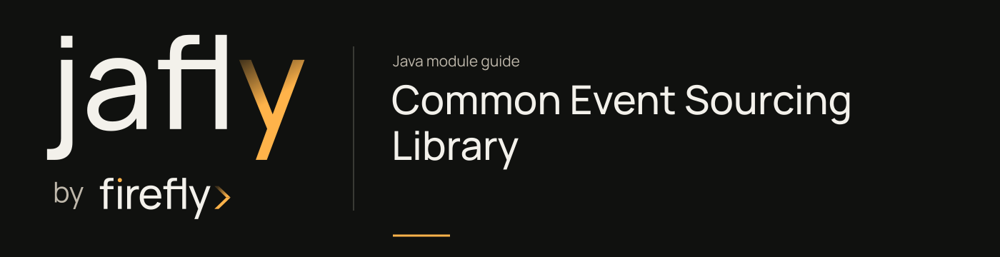

# Common Event Sourcing Library

Persist domain events, rehydrate aggregates, and manage snapshots through reactive event-store contracts.

Define events and an aggregate, then use EventStore rather than writing the aggregate state as the source of truth. Pay attention to expected versions and concurrency failures when appending events. Configure the backing store and its schema before starting the service.

| Maven artifact | Packaging | Source project |
| --- | --- | --- |
| `org.fireflyframework:fireflyframework-eventsourcing` | `jar` | [modules/eventsourcing](https://github.com/fireflyframework/fireflyframework-jafly/tree/main/modules/eventsourcing) |

Part of [Domain and data](index.md#domain-and-data).

## In the onboarding service

If the product needs application history as the source of truth, model submitted and reviewed events and rebuild state from that history. This changes the persistence design; it is more than replacing the tutorial map with a repository.

## Add the component

[Installation and version availability](../installation.md) explains source builds and published releases.

```xml
<dependency>
    <groupId>org.fireflyframework</groupId>
    <artifactId>fireflyframework-eventsourcing</artifactId>
    <version>26.10.17-SNAPSHOT</version>
</dependency>
```

## Quick start

Follow [Persist onboarding application history](../guides/onboarding-event-store.md) for the complete tested extension to the onboarding service. The API fragments below illustrate individual contracts.

The Java examples in this section are API fragments for application code. Use the stated imports and supply the application-owned collaborators described alongside them.

### 1. Define domain events

```java
@DomainEvent("order.placed")
@SuperBuilder
@Getter
@NoArgsConstructor
@AllArgsConstructor
public class OrderPlacedEvent extends AbstractDomainEvent {
    private String productId;
    private int quantity;
    private BigDecimal totalPrice;
}
```

### 2. Create an aggregate

```java
public class Order extends AggregateRoot {

    private String productId;
    private int quantity;
    private BigDecimal totalPrice;

    // Constructor for loading from the event store
    public Order(UUID id) {
        super(id, "Order");
    }

    // Constructor for creating a new order (command)
    public Order(UUID id, String productId, int quantity, BigDecimal totalPrice) {
        super(id, "Order");
        applyChange(OrderPlacedEvent.builder()
                .aggregateId(id)
                .productId(productId)
                .quantity(quantity)
                .totalPrice(totalPrice)
                .build());
    }

    // Event handler — updates state only, no validation
    private void on(OrderPlacedEvent event) {
        this.productId = event.getProductId();
        this.quantity = event.getQuantity();
        this.totalPrice = event.getTotalPrice();
    }
}
```

### 3. Persist and load via the EventStore

```java
@Service
@RequiredArgsConstructor
public class OrderService {
    private final EventStore eventStore;

    public Mono<Order> placeOrder(String productId, int qty, BigDecimal price) {
        UUID orderId = UUID.randomUUID();
        Order order = new Order(orderId, productId, qty, price);

        return eventStore.appendEvents(
                orderId, "Order", order.getUncommittedEvents(), -1L) // -1 = new aggregate
            .doOnSuccess(stream -> order.markEventsAsCommitted())
            .thenReturn(order);
    }

    public Mono<Order> getOrder(UUID orderId) {
        return eventStore.loadEventStream(orderId, "Order")
            .map(stream -> {
                Order order = new Order(orderId);
                order.loadFromHistory(stream.getEvents());
                return order;
            });
    }
}
```

### 4. Point it at a database

```yaml
spring:
  r2dbc:
    url: r2dbc:postgresql://localhost:5432/mydb
    username: user
    password: pass

firefly:
  eventsourcing:
    enabled: true
    event-scan-packages: "com.example.myapp"  # where @DomainEvent classes live
```

Flyway runs the bundled V1-V8 migrations on startup to create the `events`, `snapshots`, `event_outbox`, and `projection_positions` tables.

## Configuration and wiring

The `firefly.eventsourcing.projection` namespace is bound by [EventSourcingProjectionProperties.java](https://github.com/fireflyframework/fireflyframework-jafly/blob/main/modules/eventsourcing/src/main/java/org/fireflyframework/eventsourcing/config/EventSourcingProjectionProperties.java). Nested configuration is declared in the linked class. Defaults are the field initializers.

| Setting | Java type | Source default |
| --- | --- | --- |
| `firefly.eventsourcing.projection.batch-processing` | `BatchProcessing` | `new BatchProcessing()` |
| `firefly.eventsourcing.projection.health-check` | `HealthCheck` | `new HealthCheck()` |
| `firefly.eventsourcing.projection.retry` | `Retry` | `new Retry()` |
| `firefly.eventsourcing.projection.metrics` | `Metrics` | `new Metrics()` |

The `firefly.eventsourcing` namespace is bound by [EventSourcingProperties.java](https://github.com/fireflyframework/fireflyframework-jafly/blob/main/modules/eventsourcing/src/main/java/org/fireflyframework/eventsourcing/config/EventSourcingProperties.java). Nested configuration is declared in the linked class. Defaults are the field initializers.

| Setting | Java type | Source default |
| --- | --- | --- |
| `firefly.eventsourcing.enabled` | `boolean` | `true` |
| `firefly.eventsourcing.store` | `EventStore` | `new EventStore()` |
| `firefly.eventsourcing.snapshot` | `Snapshot` | `new Snapshot()` |
| `firefly.eventsourcing.publisher` | `Publisher` | `new Publisher()` |
| `firefly.eventsourcing.performance` | `Performance` | `new Performance()` |

Property-based wiring conditions found in this module:

- `prefix = "firefly.eventsourcing", name = "enabled", havingValue = "true", matchIfMissing = true`. [EventSourcingAutoConfiguration.java](https://github.com/fireflyframework/fireflyframework-jafly/blob/main/modules/eventsourcing/src/main/java/org/fireflyframework/eventsourcing/config/EventSourcingAutoConfiguration.java).
- `prefix = "firefly.eventsourcing.publisher", name = "enabled", havingValue = "true", matchIfMissing = true`. [EventSourcingAutoConfiguration.java](https://github.com/fireflyframework/fireflyframework-jafly/blob/main/modules/eventsourcing/src/main/java/org/fireflyframework/eventsourcing/config/EventSourcingAutoConfiguration.java).
- `prefix = "firefly.eventsourcing.outbox.processor", name = "enabled", havingValue = "true", matchIfMissing = false`. [EventSourcingAutoConfiguration.java](https://github.com/fireflyframework/fireflyframework-jafly/blob/main/modules/eventsourcing/src/main/java/org/fireflyframework/eventsourcing/config/EventSourcingAutoConfiguration.java).
- `prefix = "firefly.eventsourcing.performance", name = "health-checks-enabled", havingValue = "true", matchIfMissing = true`. [EventSourcingHealthAutoConfiguration.java](https://github.com/fireflyframework/fireflyframework-jafly/blob/main/modules/eventsourcing/src/main/java/org/fireflyframework/eventsourcing/config/EventSourcingHealthAutoConfiguration.java).
- `prefix = "firefly.eventsourcing.performance", name = "metrics-enabled", havingValue = "true", matchIfMissing = true`. [EventSourcingMetricsAutoConfiguration.java](https://github.com/fireflyframework/fireflyframework-jafly/blob/main/modules/eventsourcing/src/main/java/org/fireflyframework/eventsourcing/config/EventSourcingMetricsAutoConfiguration.java).
- `prefix = "firefly.eventsourcing.store", name = "enabled", havingValue = "true", matchIfMissing = true`. [EventStoreAutoConfiguration.java](https://github.com/fireflyframework/fireflyframework-jafly/blob/main/modules/eventsourcing/src/main/java/org/fireflyframework/eventsourcing/config/EventStoreAutoConfiguration.java).
- `name = "firefly.eventsourcing.store.type", havingValue = "r2dbc", matchIfMissing = true`. [EventStoreAutoConfiguration.java](https://github.com/fireflyframework/fireflyframework-jafly/blob/main/modules/eventsourcing/src/main/java/org/fireflyframework/eventsourcing/config/EventStoreAutoConfiguration.java).
- `prefix = "firefly.eventsourcing.snapshot", name = "enabled", havingValue = "true", matchIfMissing = true`. [SnapshotAutoConfiguration.java](https://github.com/fireflyframework/fireflyframework-jafly/blob/main/modules/eventsourcing/src/main/java/org/fireflyframework/eventsourcing/config/SnapshotAutoConfiguration.java).
- `prefix = "firefly.eventsourcing.multitenancy", name = "enabled", havingValue = "true", matchIfMissing = false`. [MultiTenancyAutoConfiguration.java](https://github.com/fireflyframework/fireflyframework-jafly/blob/main/modules/eventsourcing/src/main/java/org/fireflyframework/eventsourcing/multitenancy/MultiTenancyAutoConfiguration.java).
- `prefix = "firefly.eventsourcing.resilience.circuit-breaker", name = "enabled", havingValue = "true", matchIfMissing = false`. [CircuitBreakerAutoConfiguration.java](https://github.com/fireflyframework/fireflyframework-jafly/blob/main/modules/eventsourcing/src/main/java/org/fireflyframework/eventsourcing/resilience/CircuitBreakerAutoConfiguration.java).

## Public API and extension points

| Type | Contract and responsibility |
| --- | --- |
| [`EventStore`](https://github.com/fireflyframework/fireflyframework-jafly/blob/main/modules/eventsourcing/src/main/java/org/fireflyframework/eventsourcing/store/EventStore.java) | Main interface for event storage and retrieval in the event sourcing system. |
| [`AggregateRoot`](https://github.com/fireflyframework/fireflyframework-jafly/blob/main/modules/eventsourcing/src/main/java/org/fireflyframework/eventsourcing/aggregate/AggregateRoot.java) | Base class for event-sourced aggregates that provides the foundation for implementing Domain-Driven Design aggregates with Event Sourcing. |
| [`DomainEvent`](https://github.com/fireflyframework/fireflyframework-jafly/blob/main/modules/eventsourcing/src/main/java/org/fireflyframework/eventsourcing/annotation/DomainEvent.java) | Marks a class as a domain event and specifies its event type identifier. |
| [`SnapshotStore`](https://github.com/fireflyframework/fireflyframework-jafly/blob/main/modules/eventsourcing/src/main/java/org/fireflyframework/eventsourcing/snapshot/SnapshotStore.java) | Interface for snapshot storage and retrieval operations. |
| [`EventSourcingProjectionProperties`](https://github.com/fireflyframework/fireflyframework-jafly/blob/main/modules/eventsourcing/src/main/java/org/fireflyframework/eventsourcing/config/EventSourcingProjectionProperties.java) | Configuration properties for Event Sourcing projections. |

## Related components

| Related component | Why it belongs nearby |
| --- | --- |
| [Kernel](kernel.md) | Share a consistent exception vocabulary across application, domain, and infrastructure boundaries. |
| [R2DBC](r2dbc.md) | Build reactive repository filtering and pagination on Spring Data R2DBC. |
| [Common EDA Library](eda.md) | Publish and consume events through a common envelope and transport-independent APIs. |
| [Common Cache Library](cache.md) | Use a common cache API with a local Caffeine default and pluggable distributed providers. |
| [Observability](observability.md) | Provide a common metrics, tracing, health, and context-propagation foundation for framework components. |

## Build and test

Use Java 25. From the repository root, build this component with its required dependencies:

```bash
git clone https://github.com/fireflyframework/fireflyframework-jafly.git
cd fireflyframework-jafly
./mvnw -pl :fireflyframework-eventsourcing -am verify
./mvnw -pl :fireflyframework-eventsourcing -am install
```

`verify` runs the selected projects' tests. `install` makes the current build available in your local Maven repository.

Representative test sources:

- [EventSourcingIntegrationTest.java](https://github.com/fireflyframework/fireflyframework-jafly/blob/main/modules/eventsourcing/src/test/java/org/fireflyframework/eventsourcing/EventSourcingIntegrationTest.java).
- [AggregateRootTest.java](https://github.com/fireflyframework/fireflyframework-jafly/blob/main/modules/eventsourcing/src/test/java/org/fireflyframework/eventsourcing/aggregate/AggregateRootTest.java).
- [DomainEventTest.java](https://github.com/fireflyframework/fireflyframework-jafly/blob/main/modules/eventsourcing/src/test/java/org/fireflyframework/eventsourcing/annotation/DomainEventTest.java).
- [EventSourcingTransactionalTest.java](https://github.com/fireflyframework/fireflyframework-jafly/blob/main/modules/eventsourcing/src/test/java/org/fireflyframework/eventsourcing/annotation/EventSourcingTransactionalTest.java).
- [EventStreamTest.java](https://github.com/fireflyframework/fireflyframework-jafly/blob/main/modules/eventsourcing/src/test/java/org/fireflyframework/eventsourcing/domain/EventStreamTest.java).
- [EventTest.java](https://github.com/fireflyframework/fireflyframework-jafly/blob/main/modules/eventsourcing/src/test/java/org/fireflyframework/eventsourcing/domain/EventTest.java).

Some tests use Testcontainers. A working Docker-compatible container runtime is required for those fixtures; inspect their annotations and the build output to distinguish executed tests from environment-dependent skips.

## Test fixture

The `shouldHaveDefaultValues` test demonstrates one concrete behavior. Excerpt from [EventSourcingTransactionalTest.java](https://github.com/fireflyframework/fireflyframework-jafly/blob/main/modules/eventsourcing/src/test/java/org/fireflyframework/eventsourcing/annotation/EventSourcingTransactionalTest.java). The test class supplies its fixtures and imports.

```java
@Test
void shouldHaveDefaultValues() throws NoSuchMethodException {
    // Given
    Method method = TestClass.class.getMethod("defaultTransactional");

    // When
    EventSourcingTransactional annotation = method.getAnnotation(EventSourcingTransactional.class);

    // Then
    assertNotNull(annotation);
    assertEquals(EventSourcingTransactional.Propagation.REQUIRED, annotation.propagation());
    assertTrue(annotation.publishEvents());
    assertFalse(annotation.retryOnConcurrencyConflict());
    assertEquals(3, annotation.maxRetries());
    assertEquals(100, annotation.retryDelay());
    assertEquals(-1, annotation.timeout());
    assertFalse(annotation.readOnly());
}
```

## Detailed reference

### How It Works

#### Command flow (write)

```
Command --> Aggregate --> [validate] --> Event(s) --> EventStore.appendEvents()
                                                         |
                                              +----------+-----------+
                                              |                      |
                                       events table            event_outbox
                                     (BIGSERIAL seq)          (if publisher
                                                                configured)
```

#### Read flow (query)

```
EventStore.loadEventStream() --> StoredEventEnvelope[] --> aggregate.loadFromHistory()
                                                               |
                                                        Aggregate (current state)
```

#### Auto-configuration chain

Registered in `META-INF/spring/org.springframework.boot.autoconfigure.AutoConfiguration.imports`:

```
R2dbcBeansAutoConfiguration
EventStoreAutoConfiguration
SnapshotAutoConfiguration
EventSourcingAutoConfiguration
EventSourcingProjectionAutoConfiguration
EventSourcingHealthAutoConfiguration
EventSourcingMetricsAutoConfiguration
CircuitBreakerAutoConfiguration        (resilience, off by default)
MultiTenancyAutoConfiguration          (off by default)
```

### Version Semantics

| State                  | `AggregateRoot.version` | `expectedVersion` for `appendEvents` |
|------------------------|:-----------------------:|:------------------------------------:|
| New (no events yet)    | -1                      | -1                                   |
| After 1st event        | 0                       | 0 (for next append)                  |
| After Nth event        | N-1                     | N-1 (for next append)                |

The aggregate version starts at -1 and increments with each event applied via `applyChange()`. When calling `appendEvents`, pass the aggregate's current version as `expectedVersion` for optimistic concurrency control; a mismatch raises `ConcurrencyException`.

### Configuration

All properties live under the `firefly.eventsourcing.*` prefix (bound by `EventSourcingProperties` and `EventSourcingProjectionProperties`). The block below shows the real keys with their defaults:

```yaml
firefly:
  eventsourcing:
    enabled: true                         # master switch
    event-scan-packages: org.fireflyframework  # packages scanned for @DomainEvent
    store:
      type: r2dbc                         # event store backend
      batch-size: 100
      connection-timeout: 30s
      query-timeout: 30s
      validate-schemas: true
      max-events-per-load: 1000
    snapshot:
      enabled: true
      threshold: 50                       # snapshot after N events
      check-interval: 5m
      keep-count: 3
      max-age: 30d
      store-type: same                    # same | cache | ...
    publisher:
      enabled: true
      type: AUTO                          # AUTO | KAFKA | RABBITMQ ... (EDA PublisherType)
      destination-prefix: events
      async: true
      batch-size: 10
      publish-timeout: 10s
      continue-on-failure: true
      retry:
        enabled: true
        max-attempts: 3
        initial-delay: 1s
        max-delay: 10s
        backoff-multiplier: 2.0
    performance:
      buffer-size: 1000
      metrics-enabled: true
      health-checks-enabled: true
      tracing-enabled: true
      statistics-interval: 1m
      circuit-breaker:
        enabled: false                    # Resilience4j, opt-in
        failure-rate-threshold: 50.0
        minimum-number-of-calls: 10
        sliding-window-size: 60s
        wait-duration-in-open-state: 30s
    projection:
      batch-processing:
        default-batch-size: 100
        default-interval: 5s
        max-batch-size: 1000
        min-interval: 100ms
      health-check:
        timeout: 5s
        max-acceptable-lag: 1000          # events behind before "unhealthy"
        include-details: true
        fail-on-unhealthy-projection: true
      retry:
        default-max-attempts: 3
        default-delay: 1s
        max-delay: 5m
        backoff-multiplier: 2.0
      metrics:
        enabled: true
        include-projection-tags: true
        track-event-processing-time: true
        enable-export: true
```

Key properties:

- `firefly.eventsourcing.enabled`. master switch for the whole library.
- `firefly.eventsourcing.event-scan-packages`. packages scanned for `@DomainEvent` types so events deserialize to the correct class (default `org.fireflyframework`; set to your app's base package).
- `firefly.eventsourcing.snapshot.threshold`. number of events after which a snapshot is written to cap replay cost.
- `firefly.eventsourcing.publisher.type`. selects the EDA transport for outbox publishing (`AUTO` picks the configured EDA provider; e.g. `KAFKA`, `RABBITMQ`).
- `firefly.eventsourcing.performance.circuit-breaker.enabled` and `multi-tenancy` are off by default; enable them only when you need the corresponding resilience or tenant-isolation behavior.

### Database Schema

The library ships 8 Flyway migrations (`V1`-`V8`). Key tables:

| Table                  | Purpose                                | Primary key                       |
|------------------------|----------------------------------------|-----------------------------------|
| `events`               | Append-only event log                  | `event_id` (UUID)                 |
| `snapshots`            | Aggregate state cache                   | `(aggregate_id, aggregate_type)`  |
| `event_outbox`         | Transactional outbox for publishing     | `outbox_id` (UUID)                |
| `projection_positions` | Projection checkpoint tracking          | `projection_name`                 |

The `events` table uses `BIGSERIAL` for `global_sequence`. The database auto-assigns sequence numbers, so the INSERT statement omits that column. `event_data` and `metadata` are `TEXT` (database-agnostic), not JSONB. See [docs/database-schema.md](https://github.com/fireflyframework/fireflyframework-jafly/blob/main/modules/eventsourcing/docs/database-schema.md) for full details.

## Continue the application

Use the [Orchestration guide](orchestration.md) for the next part of this integration. The runnable submission/query service is in [Getting started](../getting-started.md).

## Source and further reading

- [Maven project and dependency declarations](https://github.com/fireflyframework/fireflyframework-jafly/blob/main/modules/eventsourcing/pom.xml).
- [Production source](https://github.com/fireflyframework/fireflyframework-jafly/tree/main/modules/eventsourcing/src/main/java).
- [org.springframework.boot.autoconfigure.AutoConfiguration.imports](https://github.com/fireflyframework/fireflyframework-jafly/blob/main/modules/eventsourcing/src/main/resources/META-INF/spring/org.springframework.boot.autoconfigure.AutoConfiguration.imports).
- [application-eventsourcing.yml](https://github.com/fireflyframework/fireflyframework-jafly/blob/main/modules/eventsourcing/src/main/resources/application-eventsourcing.yml).
- [application.yml](https://github.com/fireflyframework/fireflyframework-jafly/blob/main/modules/eventsourcing/src/main/resources/application.yml).
- [V1__Create_Events_Table.sql](https://github.com/fireflyframework/fireflyframework-jafly/blob/main/modules/eventsourcing/src/main/resources/db/migration/V1__Create_Events_Table.sql).
- [V2__Create_Snapshots_Table.sql](https://github.com/fireflyframework/fireflyframework-jafly/blob/main/modules/eventsourcing/src/main/resources/db/migration/V2__Create_Snapshots_Table.sql).
- [V3__Create_Event_Outbox_Table.sql](https://github.com/fireflyframework/fireflyframework-jafly/blob/main/modules/eventsourcing/src/main/resources/db/migration/V3__Create_Event_Outbox_Table.sql).
- [Module catalog](index.md) and [getting started](../getting-started.md).
- [Maven platform](../maven.md) and [architecture](../architecture.md).
