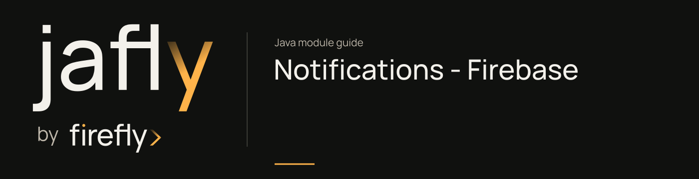

# Notifications - Firebase

Send push notifications through Firebase Cloud Messaging.

Add this adapter beside notifications-core and configure Firebase credentials/settings. Use the shared push service/request contracts rather than binding application code directly to the Firebase implementation.

| Maven artifact | Packaging | Source project |
| --- | --- | --- |
| `org.fireflyframework:fireflyframework-notifications-firebase` | `jar` | [modules/notifications-firebase](https://github.com/fireflyframework/fireflyframework-jafly/tree/main/modules/notifications-firebase) |

Part of [External services](index.md#external-services).

## In the onboarding service

A mobile applicant portal can receive push notifications through Firebase. The application supplies the device/topic target and decides which application-status changes should trigger a message.

## Add the component

[Installation and version availability](../installation.md) explains source builds and published releases.

```xml
<dependency>
    <groupId>org.fireflyframework</groupId>
    <artifactId>fireflyframework-notifications-firebase</artifactId>
    <version>26.10.17</version>
</dependency>
```

## Quick start

The injection examples use Lombok `@RequiredArgsConstructor`. Add its provided dependency and annotation processor as described in [Constructor injection](../maven.md#constructor-injection).

The Java examples in this section are API fragments for application code. Use the stated imports and supply the application-owned collaborators described alongside them.

If you use a core channel service instead of the provider SPI directly, [register the matching service implementation explicitly](notifications-core.md#quick-start). Provider auto-configuration does not expand the application's component scan.

1. Add the dependencies (core + this adapter):

```xml
<dependencies>
    <dependency>
        <groupId>org.fireflyframework</groupId>
        <artifactId>fireflyframework-notifications-core</artifactId>
    </dependency>
    <dependency>
        <groupId>org.fireflyframework</groupId>
        <artifactId>fireflyframework-notifications-firebase</artifactId>
    </dependency>
</dependencies>
```

2. Select and configure the Firebase adapter in `application.yml`:

```yaml
firefly:
  notifications:
    push:
      provider: firebase          # selects this adapter
    firebase:
      credentials-path: /etc/secrets/firebase-service-account.json
      project-id: my-firebase-project
```

3. Inject and use the `PushProvider`. Your code depends on the core SPI, not on Firebase directly:

```java
import lombok.RequiredArgsConstructor;
import org.fireflyframework.notifications.interfaces.dtos.push.v1.PushNotificationRequest;
import org.fireflyframework.notifications.interfaces.dtos.push.v1.PushNotificationResponse;
import org.fireflyframework.notifications.interfaces.providers.push.v1.PushProvider;
import org.springframework.stereotype.Service;
import reactor.core.publisher.Mono;

import java.util.Map;

@Service
@RequiredArgsConstructor
public class AlertService {

    private final PushProvider pushProvider; // FcmPushProvider injected by auto-config


    public Mono<PushNotificationResponse> notifyDevice(String deviceToken) {
        PushNotificationRequest request = PushNotificationRequest.builder()
                .token(deviceToken)
                .title("Payment received")
                .body("Your transfer of €250.00 has been completed.")
                .data(Map.of("type", "PAYMENT", "txId", "abc-123"))
                .build();

        return pushProvider.sendPush(request);
    }
}
```

On success the returned `PushNotificationResponse` carries the FCM `messageId` and `success = true`; on failure it returns `success = false` with an `errorMessage`.

## Configuration and wiring

The `firefly.notifications.firebase` namespace is bound by [FcmProperties.java](https://github.com/fireflyframework/fireflyframework-jafly/blob/main/modules/notifications-firebase/src/main/java/org/fireflyframework/notifications/providers/firebase/properties/v1/FcmProperties.java). Nested configuration is declared in the linked class. Defaults are the field initializers.

| Setting | Java type | Source default |
| --- | --- | --- |
| `firefly.notifications.firebase.credentials-path` | `String` | `not initialized` |
| `firefly.notifications.firebase.project-id` | `String` | `not initialized` |

Property-based wiring conditions found in this module:

- `name = "firefly.notifications.push.provider", havingValue = "firebase"`. [FcmAutoConfiguration.java](https://github.com/fireflyframework/fireflyframework-jafly/blob/main/modules/notifications-firebase/src/main/java/org/fireflyframework/notifications/providers/firebase/config/v1/FcmAutoConfiguration.java).

## Public API and extension points

| Type | Contract and responsibility |
| --- | --- |
| [`FcmProperties`](https://github.com/fireflyframework/fireflyframework-jafly/blob/main/modules/notifications-firebase/src/main/java/org/fireflyframework/notifications/providers/firebase/properties/v1/FcmProperties.java) | Carries `credentialsPath`, `projectId` data; field constraints and defaults are declared in the linked source. |
| [`FcmAutoConfiguration`](https://github.com/fireflyframework/fireflyframework-jafly/blob/main/modules/notifications-firebase/src/main/java/org/fireflyframework/notifications/providers/firebase/config/v1/FcmAutoConfiguration.java) | Defines `firebaseApp`, `firebaseMessaging`, `fcmPushProvider` operations. |
| [`FcmPushProvider`](https://github.com/fireflyframework/fireflyframework-jafly/blob/main/modules/notifications-firebase/src/main/java/org/fireflyframework/notifications/providers/firebase/core/v1/FcmPushProvider.java) | Defines `FcmPushProvider`, `sendPush` operations. |

## Related components

| Related component | Why it belongs nearby |
| --- | --- |
| [Notifications Core](notifications-core.md) | Send email, SMS, and push notifications through provider ports, with templates, preferences, and metrics. |

## Build and test

Use Java 25. From the repository root, build this component with its required dependencies:

```bash
git clone https://github.com/fireflyframework/fireflyframework-jafly.git
cd fireflyframework-jafly
./mvnw -pl :fireflyframework-notifications-firebase -am verify
./mvnw -pl :fireflyframework-notifications-firebase -am install
```

`verify` runs the selected projects' tests. `install` makes the current build available in your local Maven repository.

This subproject has no authored `src/test/java` suite. Its Maven build still validates the configured compilation/generation and any reactor prerequisites. Use the consuming component tests to validate integration behavior.

## API reference excerpt

Contract excerpt from [FcmProperties.java](https://github.com/fireflyframework/fireflyframework-jafly/blob/main/modules/notifications-firebase/src/main/java/org/fireflyframework/notifications/providers/firebase/properties/v1/FcmProperties.java). This fragment needs the full type and its imports.

```java
public class FcmProperties {
    private String credentialsPath;
    private String projectId;
}
```

## Detailed reference

### Configuration

All properties live under the `firefly.notifications.firebase` prefix (bound by `FcmProperties`). The adapter is enabled by the separate selector property `firefly.notifications.push.provider`.

```yaml
firefly:
  notifications:
    push:
      provider: firebase          # required: activates the Firebase auto-configuration
    firebase:
      credentials-path:           # path to service-account JSON; empty = Application Default Credentials
      project-id:                 # Firebase / GCP project id (optional if inferable from credentials)
```

| Property | Default | Description |
| --- | --- | --- |
| `firefly.notifications.push.provider` | _(none)_ | Selector that activates this adapter. Must equal `firebase` for the Firebase auto-configuration to apply. |
| `firefly.notifications.firebase.credentials-path` | _(empty)_ | Filesystem path to a Firebase service-account JSON key. When blank, the adapter falls back to Google Application Default Credentials. |
| `firefly.notifications.firebase.project-id` | _(empty)_ | Firebase / GCP project id. Set explicitly when it cannot be inferred from the credentials. |

### How It Works

`FcmAutoConfiguration` is registered via `META-INF/spring/org.springframework.boot.autoconfigure.AutoConfiguration.imports` and is gated by:

- `@ConditionalOnProperty(name = "firefly.notifications.push.provider", havingValue = "firebase")`. the runtime selector.
- `@ConditionalOnClass(FirebaseMessaging.class)`. the Firebase Admin SDK must be present.

When both conditions hold it contributes three beans (each `@ConditionalOnMissingBean`, so all are overridable):

1. `FirebaseApp`. Built from `credentials-path` (or Application Default Credentials) and `project-id`; an already-initialized default app is reused if present.
2. `FirebaseMessaging`. Obtained from the `FirebaseApp`.
3. `PushProvider`. An `FcmPushProvider` wrapping the `FirebaseMessaging` client, consumed by the notifications core.

## Continue the application

Use the [Notifications Core guide](notifications-core.md) for the next part of this integration. The runnable submission/query service is in [Getting started](../getting-started.md).

## Source and further reading

- [Maven project and dependency declarations](https://github.com/fireflyframework/fireflyframework-jafly/blob/main/modules/notifications-firebase/pom.xml).
- [Production source](https://github.com/fireflyframework/fireflyframework-jafly/tree/main/modules/notifications-firebase/src/main/java).
- [org.springframework.boot.autoconfigure.AutoConfiguration.imports](https://github.com/fireflyframework/fireflyframework-jafly/blob/main/modules/notifications-firebase/src/main/resources/META-INF/spring/org.springframework.boot.autoconfigure.AutoConfiguration.imports).
- [Module catalog](index.md) and [getting started](../getting-started.md).
- [Maven platform](../maven.md) and [architecture](../architecture.md).
