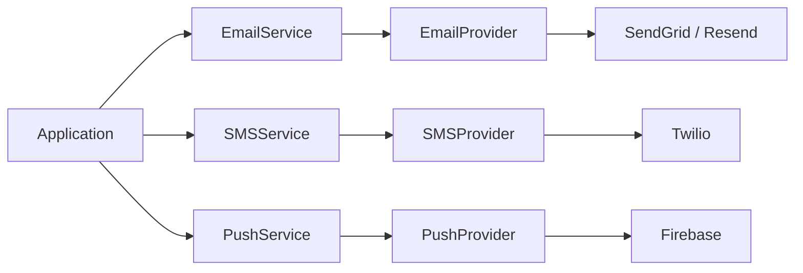

# Notifications Library

Group the notification service contracts and their core implementation.

Use notifications-core for the concrete service APIs, then choose email, SMS, or push provider adapters. This aggregator is a POM, so select a child JAR rather than declaring it as an ordinary runtime JAR.

| Maven artifact | Packaging | Source project |
| --- | --- | --- |
| `org.fireflyframework:fireflyframework-notifications` | `pom` | [modules/notifications](https://github.com/fireflyframework/fireflyframework-jafly/tree/main/modules/notifications) |

Part of [External services](index.md#external-services).

## Service and provider boundaries



The core owns service/request contracts. Provider artifacts implement the delivery boundary, so callers can keep the same service API while choosing a provider.

## In the onboarding service

After the service accepts an application, it may send a confirmation to the applicant. Choose a delivery provider and explicitly register the channel service before connecting notification work to the handler or event consumer.

## Choose a component

| Related component | Why it belongs nearby |
| --- | --- |
| [Notifications Core](notifications-core.md) | Send email, SMS, and push notifications through provider ports, with templates, preferences, and metrics. |

## Add the component

[Installation and version availability](../installation.md) explains source builds and published releases.

This artifact has `pom` packaging and groups child projects. Select a concrete child JAR for the application classpath.

```xml
<dependency>
    <groupId>org.fireflyframework</groupId>
    <artifactId>fireflyframework-notifications-core</artifactId>
    <version>26.10.22</version>
</dependency>
```

## Quick start

The injection examples use Lombok `@RequiredArgsConstructor`. Add its provided dependency and annotation processor as described in [Constructor injection](../maven.md#constructor-injection).

The Java examples in this section are API fragments for application code. Use the stated imports and supply the application-owned collaborators described alongside them.

1. Add a provider adapter (here: SendGrid for email). The adapter brings `fireflyframework-notifications-core` in transitively.

```xml
<dependency>
    <groupId>org.fireflyframework</groupId>
    <artifactId>fireflyframework-notifications-sendgrid</artifactId>
</dependency>
```

2. Select and configure the provider in `application.yml`:

```yaml
firefly:
  notifications:
    email:
      provider: sendgrid        # binds the SendGrid EmailProvider adapter
    sendgrid:
      api-key: ${SENDGRID_API_KEY}
```

3. Register the email service, then inject it. The adapter creates the `EmailProvider` bean. Register the core service explicitly in application configuration:

```java
import org.fireflyframework.notifications.core.services.email.v1.EmailServiceImpl;
import org.springframework.context.annotation.Configuration;
import org.springframework.context.annotation.Import;

@Configuration(proxyBeanMethods = false)
@Import(EmailServiceImpl.class)
class EmailNotificationsConfiguration {
}
```

Inject `EmailService` after the configuration and provider have been loaded:

```java
import lombok.RequiredArgsConstructor;
import org.fireflyframework.notifications.core.services.email.v1.EmailService;
import org.fireflyframework.notifications.interfaces.dtos.email.v1.EmailRequestDTO;
import org.fireflyframework.notifications.interfaces.dtos.email.v1.EmailResponseDTO;
import org.springframework.stereotype.Service;
import reactor.core.publisher.Mono;

@Service
@RequiredArgsConstructor
public class OrderNotificationService {

    private final EmailService emailService;


    public Mono<EmailResponseDTO> sendOrderConfirmation(String customerEmail, String orderId) {
        EmailRequestDTO request = EmailRequestDTO.builder()
                .from("orders@example.com")
                .to(customerEmail)
                .subject("Order Confirmation - " + orderId)
                .html("<h1>Thanks!</h1><p>Your order " + orderId + " is confirmed.</p>")
                .build();
        return emailService.sendEmail(request);
    }
}
```

Templated email. Provide a `NotificationTemplateEngine` bean (the FreeMarker engine renders `.ftl` files from `/notification-templates`) and call `sendTemplateEmail`:

```java
@Bean
NotificationTemplateEngine notificationTemplateEngine() {
    return new FreemarkerNotificationTemplateEngineImpl(); // classpath:/notification-templates
}

// ...
EmailTemplateRequestDTO request = EmailTemplateRequestDTO.builder()
        .from("welcome@example.com")
        .to(user.getEmail())
        .subject("Welcome!")
        .templateId("welcome-email")                 // resolves welcome-email.ftl
        .templateVariables(Map.of("firstName", user.getFirstName()))
        .build();
return emailService.sendTemplateEmail(request);
```

Respect user preferences before dispatching:

```java
return preferenceService.isChannelEnabled(userId, "email")
        .filter(Boolean::booleanValue)
        .flatMap(enabled -> emailService.sendEmail(request));
```

SMS and push use `SMSService.sendSMS(SMSRequestDTO)` and `PushService.sendPush(PushNotificationRequest)`. Select their provider adapter and explicitly register the matching channel service; see the core wiring recipe for the service/provider pairs.

## Configuration and wiring

This POM has no runtime configuration namespace. Configure the selected child libraries in the application that uses them.

## Build and test

Use Java 25. From the repository root, build this component with its required dependencies:

```bash
git clone https://github.com/fireflyframework/fireflyframework-jafly.git
cd fireflyframework-jafly
./mvnw -pl :fireflyframework-notifications,:fireflyframework-notifications-core -am verify
./mvnw -pl :fireflyframework-notifications,:fireflyframework-notifications-core -am install
```

`verify` runs the selected projects' tests. `install` makes the current build available in your local Maven repository.

This subproject has no authored `src/test/java` suite. Its Maven build still validates the configured compilation/generation and any reactor prerequisites. Use the consuming component tests to validate integration behavior.

## Detailed reference

### Configuration

This core module exposes one auto-configuration toggle; the bulk of configuration (API keys, sender identities, provider selection) lives in the provider adapter you choose.

```yaml
firefly:
  notifications:
    # Provider selection — supplied by the adapter modules you add (see table below).
    email:
      provider: sendgrid        # or: resend
    sms:
      provider: twilio
    push:
      provider: firebase
  observability:
    metrics:
      enabled: true             # default; set false to skip NotificationMetricsImpl registration
```

| Property | Default | Description |
| --- | --- | --- |
| `firefly.notifications.email.provider` | _(none)_ | Selects the email `EmailProvider` adapter. `sendgrid` or `resend`. Defined by the adapter module. |
| `firefly.notifications.sms.provider` | _(none)_ | Selects the SMS `SMSProvider` adapter. `twilio`. Defined by the adapter module. |
| `firefly.notifications.push.provider` | _(none)_ | Selects the push `PushProvider` adapter. `firebase`. Defined by the adapter module. |
| `firefly.observability.metrics.enabled` | `true` | When `true` (and a `MeterRegistry` is present), registers the shared `NotificationMetricsImpl` bean used by all adapters. |

Provider-specific keys (for example `firefly.notifications.sendgrid.*`, `firefly.notifications.twilio.*`, `firefly.notifications.firebase.*`) are documented in each adapter's README.

Template engine. `FreemarkerNotificationTemplateEngineImpl` is not auto-registered; declare it as a bean. Its constructor accepts a classpath prefix (default `/notification-templates`) and an optional filesystem directory for template overrides. Without a `NotificationTemplateEngine` bean, `sendTemplateEmail` fails fast with an `UnsupportedOperationException`.

Notification preferences. `InMemoryNotificationPreferenceServiceImpl` is suitable for development and single-instance deployments. For multi-instance/production usage, provide your own `NotificationPreferenceService` backed by R2DBC or a cache.

## Continue the application

Use the [Notifications Core guide](notifications-core.md) for the next part of this integration. The runnable submission/query service is in [Getting started](../getting-started.md).

## Source and further reading

- [Maven project and dependency declarations](https://github.com/fireflyframework/fireflyframework-jafly/blob/main/modules/notifications/pom.xml).
- [Module catalog](index.md) and [getting started](../getting-started.md).
- [Maven platform](../maven.md) and [architecture](../architecture.md).
