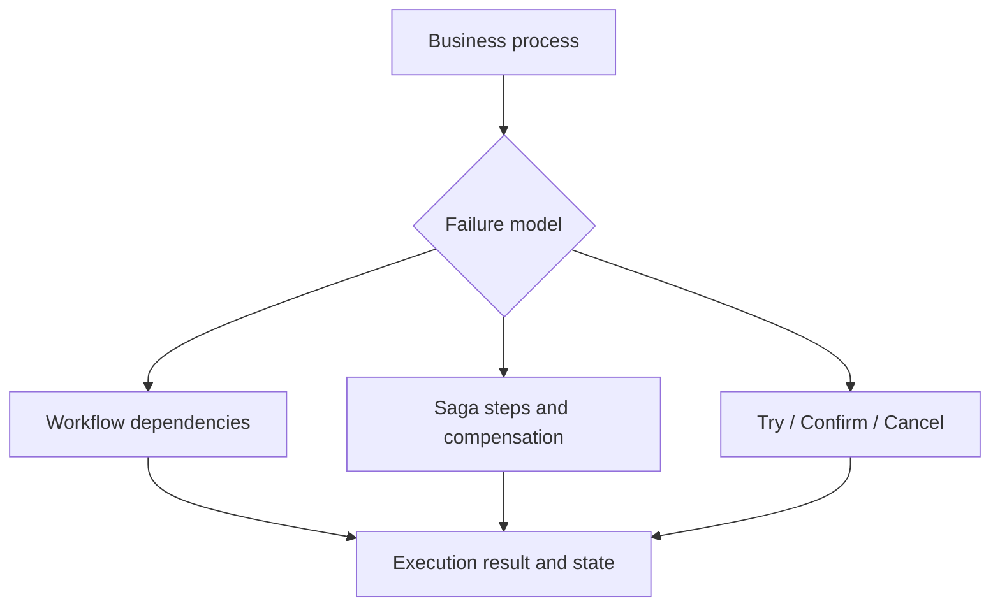

# : Orchestration

Coordinate workflows, compensating sagas, and try-confirm-cancel operations in a reactive application.

Choose a pattern based on the business failure model: workflow dependencies, saga compensation, or TCC reservation. Define steps and failure behavior explicitly, then use the corresponding engine. The configuration and tests below are the reference for persistence, retries, and event integration.

| Maven artifact | Packaging | Source project |
| --- | --- | --- |
| `org.fireflyframework:fireflyframework-orchestration` | `jar` | [modules/orchestration](https://github.com/fireflyframework/fireflyframework-jafly/tree/main/modules/orchestration) |

Part of [Business coordination](index.md#business-coordination).

## Choose a coordination pattern



Select the pattern from the business operation and recovery model. Define dependencies, compensation, or reservation semantics explicitly rather than assuming all patterns recover in the same way.

## In the onboarding service

An extended onboarding flow might verify documents, wait for a review, and provision an account. Define the steps and the response to each partial failure before choosing a workflow, saga, or TCC definition.

## Add the component

[Installation and version availability](../installation.md) explains source builds and published releases.

```xml
<dependency>
    <groupId>org.fireflyframework</groupId>
    <artifactId>fireflyframework-orchestration</artifactId>
    <version>26.10.17-SNAPSHOT</version>
</dependency>
```

## Quick start

Follow [Coordinate an onboarding review](../guides/onboarding-coordination.md) for the complete tested extension to the onboarding service. The API fragments below illustrate individual contracts.

The Java examples in this section are API fragments for application code. Use the stated imports and supply the application-owned collaborators described alongside them.

### Saga (annotations)

```java
@Saga(name = "OrderSaga")
public class OrderSaga {

    @SagaStep(id = "reserve", compensate = "cancelReservation")
    public Mono<String> reserveInventory(@Input OrderRequest request) {
        return inventoryService.reserve(request.items());
    }

    public Mono<Void> cancelReservation(@Input String reservationId) {
        return inventoryService.cancel(reservationId);
    }

    @SagaStep(id = "charge", dependsOn = "reserve", compensate = "refund")
    public Mono<String> chargePayment(@FromStep("reserve") String reservationId) {
        return paymentService.charge(reservationId);
    }

    public Mono<Void> refund(@Input String chargeId) {
        return paymentService.refund(chargeId);
    }

    @OnSagaComplete
    public void onComplete(SagaResult result) {
        log.info("Order saga completed: {}", result.correlationId());
    }
}
```

Execute it through the injected `SagaEngine`:

```java
sagaEngine.execute("OrderSaga", StepInputs.of("reserve", orderRequest))
    .subscribe(result -> {
        if (result.isSuccess()) {
            log.info("All steps completed in {}ms", result.duration().toMillis());
        } else {
            log.error("Failed at step: {}", result.firstErrorStepId().orElse("unknown"));
        }
    });
```

### Saga (builder DSL)

```java
SagaDefinition def = SagaBuilder.saga("TransferFunds")
    .triggerEventType("TransferRequested")
    .step("debit")
        .handler((input, ctx) -> accountService.debit(input))
        .compensation((result, ctx) -> accountService.credit(result))
        .retry(3).backoffMs(500).jitter()
        .stepEvent("transfers", "DebitCompleted", "accountId")
        .add()
    .step("credit")
        .dependsOn("debit")
        .handlerInput(input -> accountService.credit(input))
        .add()
    .build();

sagaEngine.execute(def, StepInputs.of("debit", transferRequest));
```

### TCC

```java
TccDefinition def = TccBuilder.tcc("PaymentTransaction")
    .triggerEventType("PaymentRequested")
    .participant("debit")
        .tryHandler((input, ctx) -> accountService.holdFunds(input))
        .confirmHandler((tryResult, ctx) -> accountService.commitHold(tryResult))
        .cancelHandler((tryResult, ctx) -> accountService.releaseHold(tryResult))
        .event("payments", "DebitConfirmed", "holdId")
        .add()
    .participant("credit")
        .tryHandler((input, ctx) -> accountService.prepareCredit(input))
        .confirmHandler((tryResult, ctx) -> accountService.commitCredit(tryResult))
        .cancelHandler((tryResult, ctx) -> accountService.cancelCredit(tryResult))
        .add()
    .build();

tccEngine.execute(def, TccInputs.of(Map.of("debit", request, "credit", request)))
    .subscribe(result -> {
        if (result.isConfirmed())   log.info("Transaction confirmed");
        else if (result.isCanceled()) log.warn("Transaction canceled");
    });
```

### Workflow

```java
@Workflow(id = "OrderProcessing", version = "1.0",
          publishEvents = true, triggerEventType = "OrderReceived")
public class OrderProcessingWorkflow {

    @WorkflowStep(id = "validate", timeoutMs = 5000)
    public Mono<Map<String, Object>> validate(@Input Map<String, Object> input) {
        return Mono.just(Map.of("orderId", input.get("orderId"), "validated", true));
    }

    @WorkflowStep(id = "charge", dependsOn = "validate",
                  maxRetries = 3, retryDelayMs = 1000)
    public Mono<String> charge(@FromStep("validate") Map<String, Object> validated) {
        return paymentService.charge((String) validated.get("orderId"));
    }

    @WorkflowStep(id = "ship", dependsOn = "charge")
    public Mono<String> ship(@FromStep("charge") String chargeId) {
        return shippingService.ship(chargeId);
    }
}
```

## Configuration and wiring

The `firefly.orchestration` namespace is bound by [OrchestrationProperties.java](https://github.com/fireflyframework/fireflyframework-jafly/blob/main/modules/orchestration/src/main/java/org/fireflyframework/orchestration/config/OrchestrationProperties.java). Nested configuration is declared in the linked class. Defaults are the field initializers.

| Setting | Java type | Source default |
| --- | --- | --- |
| `firefly.orchestration.workflow` | `WorkflowProperties` | `new WorkflowProperties()` |
| `firefly.orchestration.saga` | `SagaProperties` | `new SagaProperties()` |
| `firefly.orchestration.tcc` | `TccProperties` | `new TccProperties()` |
| `firefly.orchestration.persistence` | `PersistenceProperties` | `new PersistenceProperties()` |
| `firefly.orchestration.recovery` | `RecoveryProperties` | `new RecoveryProperties()` |
| `firefly.orchestration.scheduling` | `SchedulingProperties` | `new SchedulingProperties()` |
| `firefly.orchestration.rest` | `RestProperties` | `new RestProperties()` |
| `firefly.orchestration.health` | `HealthProperties` | `new HealthProperties()` |
| `firefly.orchestration.metrics` | `MetricsProperties` | `new MetricsProperties()` |
| `firefly.orchestration.tracing` | `TracingProperties` | `new TracingProperties()` |
| `firefly.orchestration.dlq` | `DlqProperties` | `new DlqProperties()` |
| `firefly.orchestration.resilience` | `ResilienceProperties` | `new ResilienceProperties()` |
| `firefly.orchestration.backpressure` | `BackpressureProperties` | `new BackpressureProperties()` |
| `firefly.orchestration.validation` | `ValidationProperties` | `new ValidationProperties()` |

Property-based wiring conditions found in this module:

- `name = "firefly.orchestration.validation.enabled", havingValue = "true", matchIfMissing = true`. [OrchestrationAutoConfiguration.java](https://github.com/fireflyframework/fireflyframework-jafly/blob/main/modules/orchestration/src/main/java/org/fireflyframework/orchestration/config/OrchestrationAutoConfiguration.java).
- `name = "firefly.orchestration.dlq.enabled", havingValue = "true", matchIfMissing = true`. [OrchestrationAutoConfiguration.java](https://github.com/fireflyframework/fireflyframework-jafly/blob/main/modules/orchestration/src/main/java/org/fireflyframework/orchestration/config/OrchestrationAutoConfiguration.java).
- `prefix = "firefly.orchestration.events", name = "enabled", havingValue = "true", matchIfMissing = false`. [OrchestrationAutoConfiguration.java](https://github.com/fireflyframework/fireflyframework-jafly/blob/main/modules/orchestration/src/main/java/org/fireflyframework/orchestration/config/OrchestrationAutoConfiguration.java).
- `name = "firefly.orchestration.recovery.enabled", havingValue = "true", matchIfMissing = true`. [OrchestrationAutoConfiguration.java](https://github.com/fireflyframework/fireflyframework-jafly/blob/main/modules/orchestration/src/main/java/org/fireflyframework/orchestration/config/OrchestrationAutoConfiguration.java).
- `name = "firefly.orchestration.metrics.enabled", havingValue = "true", matchIfMissing = true`. [OrchestrationMetricsAutoConfiguration.java](https://github.com/fireflyframework/fireflyframework-jafly/blob/main/modules/orchestration/src/main/java/org/fireflyframework/orchestration/config/OrchestrationMetricsAutoConfiguration.java).
- `name = "firefly.orchestration.persistence.provider", havingValue = "cache"`. [OrchestrationPersistenceAutoConfiguration.java](https://github.com/fireflyframework/fireflyframework-jafly/blob/main/modules/orchestration/src/main/java/org/fireflyframework/orchestration/config/OrchestrationPersistenceAutoConfiguration.java).
- `name = "firefly.orchestration.persistence.provider", havingValue = "redis"`. [OrchestrationPersistenceAutoConfiguration.java](https://github.com/fireflyframework/fireflyframework-jafly/blob/main/modules/orchestration/src/main/java/org/fireflyframework/orchestration/config/OrchestrationPersistenceAutoConfiguration.java).
- `name = "firefly.orchestration.persistence.provider", havingValue = "event-sourced"`. [OrchestrationPersistenceAutoConfiguration.java](https://github.com/fireflyframework/fireflyframework-jafly/blob/main/modules/orchestration/src/main/java/org/fireflyframework/orchestration/config/OrchestrationPersistenceAutoConfiguration.java).
- `name = "firefly.orchestration.resilience.enabled", havingValue = "true", matchIfMissing = true`. [OrchestrationResilienceAutoConfiguration.java](https://github.com/fireflyframework/fireflyframework-jafly/blob/main/modules/orchestration/src/main/java/org/fireflyframework/orchestration/config/OrchestrationResilienceAutoConfiguration.java).
- `name = "firefly.orchestration.rest.enabled", havingValue = "true", matchIfMissing = true`. [OrchestrationRestAutoConfiguration.java](https://github.com/fireflyframework/fireflyframework-jafly/blob/main/modules/orchestration/src/main/java/org/fireflyframework/orchestration/config/OrchestrationRestAutoConfiguration.java).

## Public API and extension points

| Type | Contract and responsibility |
| --- | --- |
| [`SagaEngine`](https://github.com/fireflyframework/fireflyframework-jafly/blob/main/modules/orchestration/src/main/java/org/fireflyframework/orchestration/saga/engine/SagaEngine.java) | Core saga engine that orchestrates saga execution with compensation, persistence, DLQ integration, and ExpandEach fan-out support. |
| [`WorkflowEngine`](https://github.com/fireflyframework/fireflyframework-jafly/blob/main/modules/orchestration/src/main/java/org/fireflyframework/orchestration/workflow/engine/WorkflowEngine.java) | Defines `WorkflowEngine`, `startWorkflow`, `cancelWorkflow`, `suspendWorkflow` operations. |
| [`TccEngine`](https://github.com/fireflyframework/fireflyframework-jafly/blob/main/modules/orchestration/src/main/java/org/fireflyframework/orchestration/tcc/engine/TccEngine.java) | Core TCC engine that orchestrates TCC transaction execution with persistence, DLQ integration, and lifecycle events. |
| [`SagaBuilder`](https://github.com/fireflyframework/fireflyframework-jafly/blob/main/modules/orchestration/src/main/java/org/fireflyframework/orchestration/saga/builder/SagaBuilder.java) | Fluent builder for constructing saga definitions programmatically. |
| [`WorkflowBuilder`](https://github.com/fireflyframework/fireflyframework-jafly/blob/main/modules/orchestration/src/main/java/org/fireflyframework/orchestration/workflow/builder/WorkflowBuilder.java) | Defines `WorkflowBuilder`, `description`, `version`, `triggerMode` operations. |

## Related components

| Related component | Why it belongs nearby |
| --- | --- |
| [Kernel](kernel.md) | Share a consistent exception vocabulary across application, domain, and infrastructure boundaries. |
| [Observability](observability.md) | Provide a common metrics, tracing, health, and context-propagation foundation for framework components. |
| [Common EDA Library](eda.md) | Publish and consume events through a common envelope and transport-independent APIs. |
| [Common Cache Library](cache.md) | Use a common cache API with a local Caffeine default and pluggable distributed providers. |
| [Common Event Sourcing Library](eventsourcing.md) | Persist domain events, rehydrate aggregates, and manage snapshots through reactive event-store contracts. |

## Build and test

Use Java 25. From the repository root, build this component with its required dependencies:

```bash
git clone https://github.com/fireflyframework/fireflyframework-jafly.git
cd fireflyframework-jafly
./mvnw -pl :fireflyframework-orchestration -am verify
./mvnw -pl :fireflyframework-orchestration -am install
```

`verify` runs the selected projects' tests. `install` makes the current build available in your local Maven repository.

Representative test sources:

- [CompositeEventsWiringTest.java](https://github.com/fireflyframework/fireflyframework-jafly/blob/main/modules/orchestration/src/test/java/org/fireflyframework/orchestration/config/CompositeEventsWiringTest.java).
- [BuilderDslIntegrationTest.java](https://github.com/fireflyframework/fireflyframework-jafly/blob/main/modules/orchestration/src/test/java/org/fireflyframework/orchestration/integration/BuilderDslIntegrationTest.java).
- [CrossPatternTest.java](https://github.com/fireflyframework/fireflyframework-jafly/blob/main/modules/orchestration/src/test/java/org/fireflyframework/orchestration/integration/CrossPatternTest.java).
- [EventWiringIntegrationTest.java](https://github.com/fireflyframework/fireflyframework-jafly/blob/main/modules/orchestration/src/test/java/org/fireflyframework/orchestration/integration/EventWiringIntegrationTest.java).
- [SagaIntegrationTest.java](https://github.com/fireflyframework/fireflyframework-jafly/blob/main/modules/orchestration/src/test/java/org/fireflyframework/orchestration/integration/SagaIntegrationTest.java).
- [TccIntegrationTest.java](https://github.com/fireflyframework/fireflyframework-jafly/blob/main/modules/orchestration/src/test/java/org/fireflyframework/orchestration/integration/TccIntegrationTest.java).

## Test fixture

The `create_acceptsInputMapWithNullValues` test demonstrates one concrete behavior. Excerpt from [DeadLetterEntryTest.java](https://github.com/fireflyframework/fireflyframework-jafly/blob/main/modules/orchestration/src/test/java/org/fireflyframework/orchestration/unit/core/DeadLetterEntryTest.java). The test class supplies its fixtures and imports.

```java
@Test
void create_acceptsInputMapWithNullValues() {
    Map<String, Object> input = new HashMap<>();
    input.put("present", "value");
    input.put("missing", null);

    assertThatCode(() ->
            DeadLetterEntry.create("saga", "corr", ExecutionPattern.SAGA, "step",
                    ExecutionStatus.FAILED, new RuntimeException("boom"), input))
            .doesNotThrowAnyException();

    DeadLetterEntry entry = DeadLetterEntry.create("saga", "corr", ExecutionPattern.SAGA, "step",
            ExecutionStatus.FAILED, new RuntimeException("boom"), input);

    assertThat(entry.input()).hasSize(2);
    assertThat(entry.input()).containsEntry("present", "value");
    assertThat(entry.input()).containsEntry("missing", null);
}
```

## Detailed reference

### Pattern Selection Guide

```
Need to undo on failure?
├─ No  ──▶  WORKFLOW
└─ Yes
   ├─ Need resource reservation / locking?  ──▶  TCC
   └─ Compensating actions sufficient?       ──▶  SAGA
```

| Aspect       | Workflow                          | Saga                    | TCC                     |
|--------------|-----------------------------------|-------------------------|-------------------------|
| Consistency  | Eventual                          | Eventual                | Strong                  |
| Isolation    | None                              | None                    | Soft-lock               |
| Rollback     | None (or per-step compensation)   | Automatic compensation  | Cancel phase            |
| Use case     | Pipelines, ETL, deployments       | Orders, transfers       | Reservations, holds     |

### Event Integration

Inbound. Event-driven triggering. Any orchestration can be started by an external event using
`triggerEventType` (annotation or builder); route events through the `EventGateway`:

```java
@Saga(name = "OrderSaga", triggerEventType = "OrderCreated")              // annotation
SagaBuilder.saga("OrderSaga").triggerEventType("OrderCreated")            // builder

eventGateway.routeEvent("OrderCreated", Map.of("orderId", "ORD-123")).subscribe();
```

Outbound. Step-level events.

- Saga: `@StepEvent(topic, type, key)` or builder `.stepEvent(topic, type, key)`
- TCC: `@TccEvent(topic, eventType, key)` or builder `.event(topic, eventType, key)`
- Workflow: `publishEvents = true` on `@Workflow` or builder `.publishEvents(true)`

Event integration is delivered over the `fireflyframework-eda` abstraction (optional dependency).

### Scheduling

All three patterns support scheduled execution with full parity:

```java
@Saga(name = "CleanupSaga")
@ScheduledSaga(cron = "0 0 2 * * *", zone = "America/New_York",
               enabled = true, input = "{\"daysOld\": 30}")
public class CleanupSaga { /* ... */ }

@Tcc(name = "ReconciliationTcc")
@ScheduledTcc(fixedRate = 60000, initialDelay = 5000)
public class ReconciliationTcc { /* ... */ }

@Workflow(id = "ReportWorkflow")
@ScheduledWorkflow(fixedDelay = 3600000, zone = "UTC")
public class ReportWorkflow { /* ... */ }
```

Every scheduling annotation supports `cron`, `fixedRate`, `fixedDelay`, `initialDelay`, `zone`,
`enabled`, `input`, and `description`.

### Configuration

All properties live under the `firefly.orchestration` prefix and are bound by `OrchestrationProperties`.
The defaults below are the real values from the `@ConfigurationProperties` class. Every value shown is
the engine default, so a zero-config application runs in-memory with its default configuration.

```yaml
firefly:
  orchestration:
    workflow:
      enabled: true
    saga:
      enabled: true
      compensation-policy: STRICT_SEQUENTIAL   # STRICT_SEQUENTIAL | GROUPED_PARALLEL | RETRY_WITH_BACKOFF | CIRCUIT_BREAKER | BEST_EFFORT_PARALLEL
      default-timeout: 5m
      compensation-error-handler: default
    tcc:
      enabled: true
      default-timeout: 30s
      composition:
        enabled: true
        compensation-policy: STRICT_SEQUENTIAL
    persistence:
      provider: in-memory          # in-memory | redis | cache | event-sourced
      key-prefix: "orchestration:"
      key-ttl:                      # unset = no TTL
      retention-period: 7d
      cleanup-interval: 1h
    recovery:
      enabled: true
      stale-threshold: 1h
    scheduling:
      thread-pool-size: 4
    rest:
      enabled: true
    health:
      enabled: true
    metrics:
      enabled: true
    tracing:
      enabled: true
    dlq:
      enabled: true
    resilience:
      enabled: true
    backpressure:
      strategy: adaptive
      batch-size: 10
      circuit-breaker:
        failure-threshold: 5
        recovery-timeout: 30s
        half-open-max-calls: 3
    validation:
      enabled: true
      fail-on-warning: false
    eventsourcing:
      snapshot-interval: 100
      projection-poll-interval: 5s
```

Key properties:

| Property                                       | Default             | Description                                                            |
|------------------------------------------------|---------------------|------------------------------------------------------------------------|
| `persistence.provider`                         | `in-memory`         | Selects the persistence backend: `in-memory`, `redis`, `cache`, or `event-sourced`. |
| `persistence.retention-period`                 | `7d`                | How long completed execution records are kept before cleanup.          |
| `saga.compensation-policy`                     | `STRICT_SEQUENTIAL` | Default compensation strategy when a saga step fails.                   |
| `saga.default-timeout` / `tcc.default-timeout` | `5m` / `30s`        | Default per-execution timeout for saga / TCC runs.                     |
| `recovery.stale-threshold`                     | `1h`                | Age after which an in-flight execution is considered stale and recovered. |
| `scheduling.thread-pool-size`                  | `4`                 | Threads backing cron/fixed-rate scheduled orchestrations.              |
| `backpressure.strategy`                        | `adaptive`          | Backpressure strategy for high-throughput execution.                   |
| `metrics.enabled` / `tracing.enabled` / `dlq.enabled` | `true`       | Toggle observability and dead-letter capture.                          |

Optional features activate only when the matching dependency is present (e.g. Redis client for
`provider: redis`, Resilience4j for `resilience.enabled`, `fireflyframework-eventsourcing` for
`provider: event-sourced`).

## Continue the application

Use the [EDA guide](eda.md) for the next part of this integration. The runnable submission/query service is in [Getting started](../getting-started.md).

## Source and further reading

- [Maven project and dependency declarations](https://github.com/fireflyframework/fireflyframework-jafly/blob/main/modules/orchestration/pom.xml).
- [Production source](https://github.com/fireflyframework/fireflyframework-jafly/tree/main/modules/orchestration/src/main/java).
- [org.springframework.boot.autoconfigure.AutoConfiguration.imports](https://github.com/fireflyframework/fireflyframework-jafly/blob/main/modules/orchestration/src/main/resources/META-INF/spring/org.springframework.boot.autoconfigure.AutoConfiguration.imports).
- [Module catalog](index.md) and [getting started](../getting-started.md).
- [Maven platform](../maven.md) and [architecture](../architecture.md).
