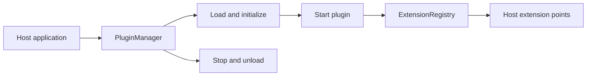

# Common Plugins

Group the API and implementation of the framework plugin system.

Depend on plugin-api when authoring a plugin or extension point, and plugin-core in the host that loads and manages plugins. The aggregator itself does not supply a standalone runtime JAR.

| Maven artifact | Packaging | Source project |
| --- | --- | --- |
| `org.fireflyframework:fireflyframework-plugins` | `pom` | [modules/plugins](https://github.com/fireflyframework/fireflyframework-jafly/tree/main/modules/plugins) |

Part of [Team-wide architecture](index.md#team-wide-architecture).

## Host and extension lifecycle



The API defines plugin metadata, lifecycle, and extension contracts. The core supplies the default manager, dependency resolver, and extension registry.

## In the onboarding service

A host may expose an extension point for product-specific onboarding checks. Plugin authors use plugin-api; the host uses plugin-core to load classes and manage their lifecycle.

## Choose a component

| Related component | Why it belongs nearby |
| --- | --- |
| [Plugin API](plugin-api.md) | Define plugins, extension points, extension registration, and lifecycle contracts without the host implementation. |
| [Plugin Core](plugin-core.md) | Load plugins, resolve dependencies, and manage extension registration in a host process. |

## Add the component

[Installation and version availability](../installation.md) explains source builds and published releases.

This artifact has `pom` packaging and groups child projects. Select a concrete child JAR for the application classpath.

```xml
<dependency>
    <groupId>org.fireflyframework</groupId>
    <artifactId>plugin-api</artifactId>
    <version>26.10.20</version>
</dependency>
```

## Quick start

The Java examples in this section are API fragments for application code. Use the stated imports and supply the application-owned collaborators described alongside them.

### 1. Define an extension point (in the host)

```java
import org.fireflyframework.plugin.annotation.ExtensionPoint;

@ExtensionPoint(id = "payment-processor", description = "Processes payments")
public interface PaymentProcessor {
    PaymentResult process(PaymentRequest request);
}
```

### 2. Write a plugin that contributes an extension

A plugin is a class with a no-arg constructor that implements `org.fireflyframework.plugin.api.Plugin`. Its extensions are `@Extension`-annotated inner classes that implement an extension-point interface.

```java
import org.fireflyframework.plugin.annotation.Extension;
import org.fireflyframework.plugin.annotation.Plugin;
import org.fireflyframework.plugin.api.PluginException;
import org.fireflyframework.plugin.model.PluginMetadata;

@Plugin(
    id = "stripe-payments",
    name = "Stripe Payments",
    version = "1.0.0",
    description = "Stripe payment processing",
    author = "Acme Corp"
)
public class StripePlugin implements org.fireflyframework.plugin.api.Plugin {

    @Override
    public PluginMetadata getMetadata() {
        return PluginMetadata.builder()
            .id("stripe-payments")
            .name("Stripe Payments")
            .version("1.0.0")
            .build();
    }

    @Override public void initialize() throws PluginException { /* set up clients */ }
    @Override public void start()      throws PluginException { /* begin work */ }
    @Override public void stop()       throws PluginException { /* pause work */ }
    @Override public void destroy()    throws PluginException { /* release resources */ }

    @Extension(extensionPointId = "payment-processor", priority = 100)
    public static class StripePaymentProcessor implements PaymentProcessor {
        @Override
        public PaymentResult process(PaymentRequest request) {
            return /* call Stripe and map the result */ null;
        }
    }
}
```

### 3. Load, run, and use the extension (in the host)

```java
import org.fireflyframework.plugin.api.ExtensionRegistry;
import org.fireflyframework.plugin.api.PluginManager;
import org.fireflyframework.plugin.core.DefaultPluginManager;

PluginManager manager = new DefaultPluginManager();
manager.initialize();

ExtensionRegistry registry = manager.getExtensionRegistry();
// Extension points must be registered before extensions can be added to them:
registry.registerExtensionPoint("payment-processor", PaymentProcessor.class);

// Loading a plugin also initializes it and auto-registers its @Extension classes:
manager.loadPlugin(StripePlugin.class);
manager.startPlugin("stripe-payments");

// Highest-priority extension for the point:
PaymentProcessor processor = registry.<PaymentProcessor>getExtension("payment-processor").orElseThrow();
PaymentResult result = processor.process(request);

// ...or fan out across all contributed extensions (ordered by priority, highest first):
for (PaymentProcessor p : registry.<PaymentProcessor>getExtensions("payment-processor")) {
    // ...
}

manager.shutdown(); // stops, unloads, and destroys all plugins
```

## Configuration and wiring

This POM has no runtime configuration namespace. Configure the selected child libraries in the application that uses them.

## Build and test

Use Java 25. From the repository root, build this component with its required dependencies:

```bash
git clone https://github.com/fireflyframework/fireflyframework-jafly.git
cd fireflyframework-jafly
./mvnw -pl :fireflyframework-plugins,:plugin-api,:plugin-core -am verify
./mvnw -pl :fireflyframework-plugins,:plugin-api,:plugin-core -am install
```

`verify` runs the selected projects' tests. `install` makes the current build available in your local Maven repository.

This subproject has no authored `src/test/java` suite. Its Maven build still validates the configured compilation/generation and any reactor prerequisites. Use the consuming component tests to validate integration behavior.

## Detailed reference

### How It Works

- Loading. `loadPlugin(Class)` instantiates the plugin via its no-arg constructor, reads its `PluginMetadata`, records a `PluginDescriptor` in state `LOADED`, calls `initialize()` (moving it to `INITIALIZED`, or `FAILED` on error), then registers its `@Extension` inner classes.
- Starting. `startPlugin(id)` first resolves declared dependencies via `PluginDependencyResolver` and starts any not-yet-started dependencies, then calls the plugin's `start()` (→ `STARTED`).
- Extension lookup. extensions are validated to implement their point, stored thread-safely, and returned ordered by descending priority. `getExtension` returns the single highest-priority extension; `getExtensions` returns them all.
- Shutdown. `unloadPlugin(id)` stops a running plugin, unregisters its extensions, and calls `destroy()`. `shutdown()` does this for every loaded plugin.

### Configuration

This module has no configuration properties. It contains no Spring Boot auto-configuration and no `@ConfigurationProperties` classes. You wire a `PluginManager` (typically `DefaultPluginManager`) yourself, as a plain object or as a Spring `@Bean`, and drive it through its API. Plugin metadata (ids, versions, dependencies, extension priorities) is declared in code via annotations or the `PluginMetadata` builder, not in `application.yml`.

## Continue the application

Use the [Plugin API guide](plugin-api.md) for the next part of this integration. The runnable submission/query service is in [Getting started](../getting-started.md).

## Source and further reading

- [Maven project and dependency declarations](https://github.com/fireflyframework/fireflyframework-jafly/blob/main/modules/plugins/pom.xml).
- [Module catalog](index.md) and [getting started](../getting-started.md).
- [Maven platform](../maven.md) and [architecture](../architecture.md).
