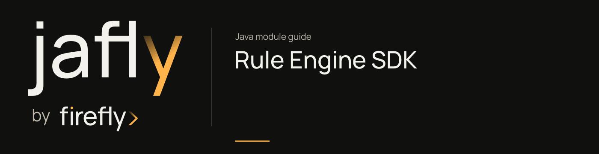

# Rule Engine SDK

Generate a reactive Java WebClient SDK for the rule engine HTTP API.

Generate from the checked-in OpenAPI specification with this POM. The API/model/invoker package names below are authoritative; generated code belongs under target and should not be edited as the long-term source.

| Maven artifact | Packaging | Source project |
| --- | --- | --- |
| `org.fireflyframework:fireflyframework-rule-engine-sdk` | `jar` | [modules/rule-engine/fireflyframework-rule-engine-sdk](https://github.com/fireflyframework/fireflyframework-jafly/tree/main/modules/rule-engine/fireflyframework-rule-engine-sdk) |

Part of [Business operations](index.md#business-operations).

## In the onboarding service

A separate onboarding service can call the rule service through generated WebClient APIs. Supply a generated request model with valid YAML/input or a configured stored-rule code.

## Add the component

[Installation and version availability](../installation.md) explains source builds and published releases.

```xml
<dependency>
    <groupId>org.fireflyframework</groupId>
    <artifactId>fireflyframework-rule-engine-sdk</artifactId>
    <version>26.10.20-SNAPSHOT</version>
</dependency>
```

## Quick start

The Java examples in this section are API fragments for application code. Use the stated imports and supply the application-owned collaborators described alongside them.

After building the SDK, configure its generated client for the deployed rule service. The request and response below are SDK model types, distinct from the server's interfaces DTOs:

```java
import org.fireflyframework.rules.sdk.api.RulesEvaluationApi;
import org.fireflyframework.rules.sdk.invoker.ApiClient;
import org.fireflyframework.rules.sdk.model.PlainYamlEvaluationRequestDTO;
import org.fireflyframework.rules.sdk.model.RulesEvaluationResponseDTO;
import reactor.core.publisher.Mono;

ApiClient client = new ApiClient()
        .setBasePath(System.getenv("RULE_ENGINE_URL"));
RulesEvaluationApi api = new RulesEvaluationApi(client);
Mono<RulesEvaluationResponseDTO> result =
        api.evaluateRulesPlain(request, "rule-request-123");
```

`request` is a generated `PlainYamlEvaluationRequestDTO` containing valid DSL YAML and input data. The second argument is the optional idempotency key defined by the specification. Compose the returned `Mono` in the calling application and configure authentication headers on `ApiClient` for the deployed service. The generated methods also provide `WithHttpInfo` variants for status and headers.

## Configuration and wiring

This module has no authored configuration-properties class. Its behavior is configured through the Maven generator or the dependencies listed below.

## Generated client contract

The generation input is [openapi.yml](https://github.com/fireflyframework/fireflyframework-jafly/blob/main/modules/rule-engine/fireflyframework-rule-engine-sdk/src/main/resources/api-spec/openapi.yml). The build produces the Java surface under `target`; this module contains no authored production Java classes. The current WebClient generation explicitly uses Spring Boot 4 with Jackson 2 compatibility.

| POM setting | Value |
| --- | --- |
| `inputSpec` | `${project.basedir}/src/main/resources/api-spec/openapi.yml` |
| `generatorName` | `java` |
| `library` | `webclient` |
| `apiPackage` | `org.fireflyframework.rules.sdk.api` |
| `modelPackage` | `org.fireflyframework.rules.sdk.model` |
| `invokerPackage` | `org.fireflyframework.rules.sdk.invoker` |
| `useSpringBoot4` | `true` |
| `useJackson3` | `false` |
| `sourceFolder` | `src/gen/java/main` |
| `reactive` | `true` |


### Operations from the API specification

`getRuleDefinitionById`, `updateRuleDefinition`, `deleteRuleDefinition`, `getConstantById`, `updateConstant`, `deleteConstant`, `validateYaml`, `evaluateRulesPlain`, `evaluateRulesDirect`, `evaluateRuleByCode`, `createRuleDefinition`, `validateRuleDefinition`. Additional operations are defined in the linked specification.

## Related components

| Related component | Why it belongs nearby |
| --- | --- |
| [Rule Engine Library](rule-engine.md) | Group the YAML rule evaluator, public DTOs, persistence models, HTTP service, and generated SDK. |
| [Rule Engine Web](rule-engine-web.md) | Expose HTTP APIs for evaluation, stored rule definitions, constants, batch operations, validation, and audit trails. |

## Build and test

Use Java 25. From the repository root, build this component with its required dependencies:

```bash
git clone https://github.com/fireflyframework/fireflyframework-jafly.git
cd fireflyframework-jafly
./mvnw -pl :fireflyframework-rule-engine-sdk -am verify
./mvnw -pl :fireflyframework-rule-engine-sdk -am install
```

`verify` runs the selected projects' tests. `install` makes the current build available in your local Maven repository.

This subproject has no authored `src/test/java` suite. Its Maven build still validates the configured compilation/generation and any reactor prerequisites. Use the consuming component tests to validate integration behavior.

## Continue the application

Use the [Rule Engine Web guide](rule-engine-web.md) for the next part of this integration. The runnable submission/query service is in [Getting started](../getting-started.md).

## Source and further reading

- [Maven project and dependency declarations](https://github.com/fireflyframework/fireflyframework-jafly/blob/main/modules/rule-engine/fireflyframework-rule-engine-sdk/pom.xml).
- [openapi.yml](https://github.com/fireflyframework/fireflyframework-jafly/blob/main/modules/rule-engine/fireflyframework-rule-engine-sdk/src/main/resources/api-spec/openapi.yml).
- [Module catalog](index.md) and [getting started](../getting-started.md).
- [Maven platform](../maven.md) and [architecture](../architecture.md).
