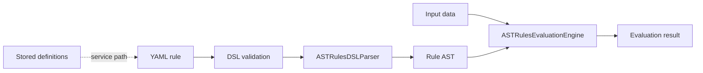

# Rule Engine Library

Group the YAML rule evaluator, public DTOs, persistence models, HTTP service, and generated SDK.

Use rule-engine-core for embedded evaluation or rule-engine-web for the service API. Decide whether rules are supplied as YAML in a request or loaded from stored definitions, because their service and audit requirements differ.

| Maven artifact | Packaging | Source project |
| --- | --- | --- |
| `org.fireflyframework:fireflyframework-rule-engine` | `pom` | [modules/rule-engine](https://github.com/fireflyframework/fireflyframework-jafly/tree/main/modules/rule-engine) |

Part of [Business operations](index.md#business-operations).

## Rule authoring and evaluation



Embedded evaluation uses the parser and AST engine. The service path adds stored definitions, request DTOs, and audit context around that evaluation.

## In the onboarding service

A product may keep changeable onboarding rules in YAML instead of hard-coding every check in a handler. Choose embedded evaluation or the rule HTTP service, then define input data and validation for those rules.

## Choose a component

| Related component | Why it belongs nearby |
| --- | --- |
| [Rule Engine Core](rule-engine-core.md) | Parse YAML rule DSL into an AST, evaluate conditions/actions, and provide rule, constant, batch, and audit services. |
| [Rule Engine Interfaces](rule-engine-interfaces.md) | Share request/response DTOs, rule definitions, validation results, and value/result enums for the rule engine. |
| [Rule Engine Web](rule-engine-web.md) | Expose HTTP APIs for evaluation, stored rule definitions, constants, batch operations, validation, and audit trails. |
| [Rule Engine SDK](rule-engine-sdk.md) | Generate a reactive Java WebClient SDK for the rule engine HTTP API. |
| [Rule Engine Models](rule-engine-models.md) | Persist rule definitions, constants, and audit trails with reactive repositories. |

## Add the component

[Installation and version availability](../installation.md) explains source builds and published releases.

This artifact has `pom` packaging and groups child projects. Select a concrete child JAR for the application classpath.

```xml
<dependency>
    <groupId>org.fireflyframework</groupId>
    <artifactId>fireflyframework-rule-engine-core</artifactId>
    <version>26.10.20</version>
</dependency>
```

## Quick start

The injection examples use Lombok `@RequiredArgsConstructor`. Add its provided dependency and annotation processor as described in [Constructor injection](../maven.md#constructor-injection).

The Java examples in this section are API fragments for application code. Use the stated imports and supply the application-owned collaborators described alongside them.

### Embedded library usage

The fastest path: inject `ASTRulesEvaluationEngine` and evaluate a YAML rule string directly. No database required.

```yaml
# credit-check.yaml — a rule authored in the YAML DSL
name: "Credit Eligibility"
description: "Decide loan eligibility from credit score and income"
inputs: [creditScore, annualIncome]
output: {approval_status: text, tier: text}

constants:
  - code: MIN_SCORE
    defaultValue: 650

when:
  - creditScore >= MIN_SCORE
  - annualIncome >= 50000
then:
  - set approval_status to "APPROVED"
  - set tier to "premium"
else:
  - set approval_status to "DECLINED"
  - set tier to "standard"
```

```java
@Service
public class CreditCheckService {

    private final ASTRulesEvaluationEngine engine;
    private final String ruleYaml; // load from classpath, DB, or config

    public CreditCheckService(ASTRulesEvaluationEngine engine,
                              @Value("classpath:credit-check.yaml") Resource rule) throws IOException {
        this.engine = engine;
        this.ruleYaml = rule.getContentAsString(StandardCharsets.UTF_8);
    }

    public Mono<ASTRulesEvaluationResult> evaluate(int creditScore, long annualIncome) {
        Map<String, Object> inputs = Map.of(
                "creditScore", creditScore,
                "annualIncome", annualIncome);
        return engine.evaluateRulesReactive(ruleYaml, inputs);
        // result.isSuccess(), result.getOutputData(), result.getExecutionTimeMs()
    }
}
```

### Stored rules via the service layer

Persist rule definitions and evaluate them by stable `code` (each evaluation is audited automatically):

```java

import lombok.RequiredArgsConstructor;

@Service
@RequiredArgsConstructor
public class DecisionService {

    private final RulesEvaluationService evaluationService;


    public Mono<RulesEvaluationResponseDTO> decide(Map<String, Object> inputData,
                                                   ServerWebExchange exchange) {
        RuleEvaluationByCodeRequestDTO request = new RuleEvaluationByCodeRequestDTO();
        request.setRuleDefinitionCode("credit-eligibility");
        request.setInputData(inputData);          // camelCase keys
        request.setIncludeDetails(true);
        return evaluationService.evaluateRuleByCodeWithAudit(request, exchange);
    }
}
```

### REST API

Run `fireflyframework-rule-engine-web` and the full surface is available under `/api/v1` (Swagger UI at `/swagger-ui.html`):

| Area | Base path |
| --- | --- |
| Evaluate (direct / plain YAML / by-code) | `POST /api/v1/rules/evaluate/{direct,plain,by-code}` |
| Rule definitions (CRUD + validate) | `/api/v1/rules/definitions` |
| Batch evaluation | `/api/v1/rules/batch/{evaluate,validate,statistics,health}` |
| Constants | `/api/v1/constants` |
| YAML validation | `/api/v1/validation/{yaml,syntax}` |
| Audit trails | `/api/v1/audit/trails` |
| Python compilation | `/api/v1/python/compile` |

```bash
curl -X POST http://localhost:8080/api/v1/rules/evaluate/by-code \
  -H 'Content-Type: application/json' \
  -d '{
        "ruleDefinitionCode": "credit-eligibility",
        "inputData": { "creditScore": 720, "annualIncome": 84000 },
        "includeDetails": true
      }'
```

## Configuration and wiring

This POM has no runtime configuration namespace. Configure the selected child libraries in the application that uses them.

## Build and test

Use Java 25. From the repository root, build this component with its required dependencies:

```bash
git clone https://github.com/fireflyframework/fireflyframework-jafly.git
cd fireflyframework-jafly
./mvnw -pl :fireflyframework-rule-engine,:fireflyframework-rule-engine-core,:fireflyframework-rule-engine-interfaces,:fireflyframework-rule-engine-models,:fireflyframework-rule-engine-sdk,:fireflyframework-rule-engine-web -am verify
./mvnw -pl :fireflyframework-rule-engine,:fireflyframework-rule-engine-core,:fireflyframework-rule-engine-interfaces,:fireflyframework-rule-engine-models,:fireflyframework-rule-engine-sdk,:fireflyframework-rule-engine-web -am install
```

`verify` runs the selected projects' tests. `install` makes the current build available in your local Maven repository.

This subproject has no authored `src/test/java` suite. Its Maven build still validates the configured compilation/generation and any reactor prerequisites. Use the consuming component tests to validate integration behavior.

## Detailed reference

### Configuration

The rule engine reads cache settings under the `firefly.rules.cache` prefix and uses standard Spring `spring.r2dbc` / `spring.flyway` properties for persistence. Caching defaults to Caffeine; the dedicated rule-engine cache manager (`RuleEngineCacheAutoConfiguration`) keys entries under `firefly:rules:engine`. The defaults below are the real values from the bundled `application.yaml`:

```yaml
firefly:
  rules:
    cache:
      provider: CAFFEINE          # CAFFEINE (default, local) or REDIS (distributed)
      caffeine:
        ast-cache:                # parsed AST models
          maximum-size: 1000
          expire-after-write: 2h
          expire-after-access: 30m
        constants-cache:
          maximum-size: 500
          expire-after-write: 15m
          expire-after-access: 5m
        rule-definitions-cache:
          maximum-size: 200
          expire-after-write: 10m
          expire-after-access: 3m
        validation-cache:
          maximum-size: 100
          expire-after-write: 5m
          expire-after-access: 2m
      # redis:                    # uncomment to use a distributed cache
      #   host: ${REDIS_HOST:localhost}
      #   port: ${REDIS_PORT:6379}
      #   password: ${REDIS_PASSWORD:}
      #   database: ${REDIS_DATABASE:0}
      #   timeout: 5s

spring:
  r2dbc:
    url: r2dbc:postgresql://${DB_HOST}:${DB_PORT}/${DB_NAME}
    username: ${DB_USERNAME}
    password: ${DB_PASSWORD}
    pool:
      initial-size: 10
      max-size: 50
      min-idle: 5
  flyway:
    enabled: true
    baseline-on-migrate: true
    locations: classpath:db/migration
```

Key properties:

| Property | Default | Description |
| --- | --- | --- |
| `firefly.rules.cache.provider` | `CAFFEINE` | Cache backend for definitions/ASTs/constants/validation. Set to `REDIS` for distributed rule evaluation across instances. |
| `firefly.rules.cache.caffeine.ast-cache.*` | size 1000, write 2h | Sizing/TTL for the parsed-AST cache (the hottest cache). |
| `firefly.rules.cache.caffeine.rule-definitions-cache.*` | size 200, write 10m | Cache of stored rule definitions loaded from the database. |
| `firefly.observability.metrics.enabled` | `true` | Gates registration of `RuleEngineMetrics` (Micrometer). |
| `spring.r2dbc.*` / `spring.flyway.*` | see above | PostgreSQL connection, pool sizing, and migration of the rule/constant/audit schema. |

The web module ships `dev`, `testing`, and `prod` profiles that tune pool sizing and cache capacity. Cache TTLs and pool settings have no hard-coded annotations. They are plain Spring config and can be overridden per environment or via environment variables.

## Continue the application

Use the [Rule Engine Core guide](rule-engine-core.md) for the next part of this integration. The runnable submission/query service is in [Getting started](../getting-started.md).

## Source and further reading

- [Maven project and dependency declarations](https://github.com/fireflyframework/fireflyframework-jafly/blob/main/modules/rule-engine/pom.xml).
- [Module catalog](index.md) and [getting started](../getting-started.md).
- [Maven platform](../maven.md) and [architecture](../architecture.md).
