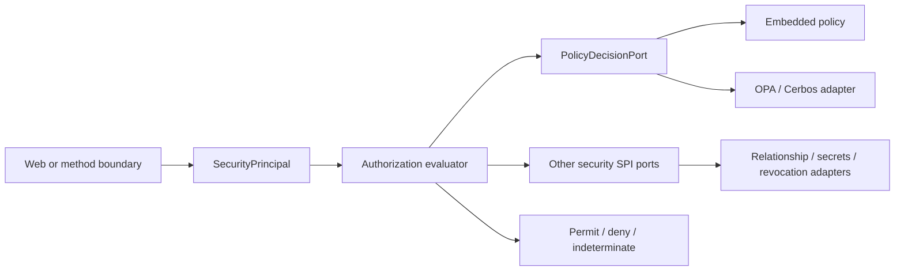

# Security Core

Evaluate the framework security model with authority mapping, policy decisions, introspection caching, and principal projection.

Configure the core engine and its ports, then use the authorization evaluator from method or web bindings. Review the default-deny and non-permit behavior in the tests before adding a custom policy adapter.

| Maven artifact | Packaging | Source project |
| --- | --- | --- |
| `org.fireflyframework:fireflyframework-security-core` | `jar` | [modules/security-core](https://github.com/fireflyframework/fireflyframework-jafly/tree/main/modules/security-core) |

Part of [Security and identity](index.md#security-and-identity).

## Security decisions and external ports



The API carries product-neutral principals and decisions. The core evaluates authorization, while the SPI keeps external policy and infrastructure products behind adapters.

## In the onboarding service

Map the authenticated applicant/reviewer claims and evaluate the configured authority requirements. Choose the HTTP and method bindings separately from this core engine.

## Add the component

[Installation and version availability](../installation.md) explains source builds and published releases.

```xml
<dependency>
    <groupId>org.fireflyframework</groupId>
    <artifactId>fireflyframework-security-core</artifactId>
    <version>26.10.18</version>
</dependency>
```

## Quick start

The Java examples in this section are API fragments for application code. Use the stated imports and supply the application-owned collaborators described alongside them.

The core is normally wired by `security-autoconfigure`, but every component is a constructable plain object. Direct authorization-engine usage:

```java
import org.fireflyframework.security.api.domain.Decision;
import org.fireflyframework.security.api.domain.SecurityPrincipal;
import org.fireflyframework.security.core.authority.ConfigurableAuthorityMapper;
import org.fireflyframework.security.core.authz.SecureAuthorizationEvaluator;
import org.fireflyframework.security.core.authz.SecureRequirement;
import org.fireflyframework.security.core.context.PrincipalFactory;

import java.util.List;
import java.util.Map;

// 1. Project validated claims into a generic principal, normalizing authorities/scopes.
var authorityMapper = new ConfigurableAuthorityMapper(null); // null -> sensible defaults
var principalFactory = new PrincipalFactory(authorityMapper);

Map<String, Object> claims = Map.of(
        "sub", "user-123",
        "realm_access", Map.of("roles", List.of("admin")),
        "scope", "accounts:read accounts:write");
SecurityPrincipal principal = principalFactory.fromClaims("user-123", "https://issuer.example", claims);

// 2. Evaluate a requirement (here: ALL of these roles AND a scope), fail-closed.
var evaluator = new SecureAuthorizationEvaluator();
var requirement = new SecureRequirement(
        List.of("admin"),            // roles
        List.of("accounts:write"),   // scopes
        List.of(),                   // permissions
        true, false, false,          // requireAllRoles / Scopes / Permissions
        "principal.subject != null"); // SpEL expression (denies on throw)

Decision decision = evaluator.evaluate(principal, requirement);
boolean allowed = decision.granted();
```

`SecureRequirement.from(secure)` builds the same requirement straight from a `@Secure` annotation, which is how the `security-webflux` / method-policy PEPs invoke the evaluator.

## Configuration and wiring

This module declares no `@ConfigurationProperties` class of its own. Use the constructor/port contracts above and the configuration of the host or related core module.

## Public API and extension points

| Type | Contract and responsibility |
| --- | --- |
| [`SecureAuthorizationEvaluator`](https://github.com/fireflyframework/fireflyframework-jafly/blob/main/modules/security-core/src/main/java/org/fireflyframework/security/core/authz/SecureAuthorizationEvaluator.java) | Evaluates a `SecureRequirement` against a `SecurityPrincipal`. |
| [`EmbeddedPolicyDecisionAdapter`](https://github.com/fireflyframework/fireflyframework-jafly/blob/main/modules/security-core/src/main/java/org/fireflyframework/security/core/policy/EmbeddedPolicyDecisionAdapter.java) | Zero-dependency, in-process default `PolicyDecisionPort`. |
| [`AuthorityMappingProperties`](https://github.com/fireflyframework/fireflyframework-jafly/blob/main/modules/security-core/src/main/java/org/fireflyframework/security/core/authority/AuthorityMappingProperties.java) | Configuration for `ConfigurableAuthorityMapper`: which claim paths carry roles/groups and scopes, and an optional authority prefix. |
| [`PolicyRule`](https://github.com/fireflyframework/fireflyframework-jafly/blob/main/modules/security-core/src/main/java/org/fireflyframework/security/core/policy/PolicyRule.java) | A single in-process ABAC rule for the `EmbeddedPolicyDecisionAdapter`. |
| [`LoggingAuditEventAdapter`](https://github.com/fireflyframework/fireflyframework-jafly/blob/main/modules/security-core/src/main/java/org/fireflyframework/security/core/audit/LoggingAuditEventAdapter.java) | Default `AuditEventPort`: emits structured audit lines to a dedicated logger. |

## Related components

| Related component | Why it belongs nearby |
| --- | --- |
| [Security API](security-api.md) | Define product-neutral principals, authorization decisions, driving use cases, and the Secure annotation. |
| [Security SPI](security-spi.md) | Define driven ports for policy, relationships, revocation, keys, secrets, and other external security services. |

## Build and test

Use Java 25. From the repository root, build this component with its required dependencies:

```bash
git clone https://github.com/fireflyframework/fireflyframework-jafly.git
cd fireflyframework-jafly
./mvnw -pl :fireflyframework-security-core -am verify
./mvnw -pl :fireflyframework-security-core -am install
```

`verify` runs the selected projects' tests. `install` makes the current build available in your local Maven repository.

Representative test sources:

- [ConfigurableAuthorityMapperTest.java](https://github.com/fireflyframework/fireflyframework-jafly/blob/main/modules/security-core/src/test/java/org/fireflyframework/security/core/authority/ConfigurableAuthorityMapperTest.java).
- [SecureAuthorizationEvaluatorTest.java](https://github.com/fireflyframework/fireflyframework-jafly/blob/main/modules/security-core/src/test/java/org/fireflyframework/security/core/authz/SecureAuthorizationEvaluatorTest.java).
- [SecureRequirementTest.java](https://github.com/fireflyframework/fireflyframework-jafly/blob/main/modules/security-core/src/test/java/org/fireflyframework/security/core/authz/SecureRequirementTest.java).
- [CaffeineIntrospectionCacheTest.java](https://github.com/fireflyframework/fireflyframework-jafly/blob/main/modules/security-core/src/test/java/org/fireflyframework/security/core/cache/CaffeineIntrospectionCacheTest.java).
- [InMemoryKeyManagementAdapterTest.java](https://github.com/fireflyframework/fireflyframework-jafly/blob/main/modules/security-core/src/test/java/org/fireflyframework/security/core/key/InMemoryKeyManagementAdapterTest.java).
- [EmbeddedPolicyDecisionAdapterTest.java](https://github.com/fireflyframework/fireflyframework-jafly/blob/main/modules/security-core/src/test/java/org/fireflyframework/security/core/policy/EmbeddedPolicyDecisionAdapterTest.java).

## Test fixture

The `resolvesPlaceholdersInRolesScopesAndPermissions` test demonstrates one concrete behavior. Excerpt from [SecureRequirementTest.java](https://github.com/fireflyframework/fireflyframework-jafly/blob/main/modules/security-core/src/test/java/org/fireflyframework/security/core/authz/SecureRequirementTest.java). The test class supplies its fixtures and imports.

```java
@Test
void resolvesPlaceholdersInRolesScopesAndPermissions() throws Exception {
    Map<String, String> props = Map.of(
            "${role.admin}", "flydocs-admin",
            "${scope.read}", "docs.read",
            "${perm.write}", "docs:write");
    UnaryOperator<String> resolver = s -> props.getOrDefault(s, s);

    SecureRequirement req = SecureRequirement.from(secure(), resolver);

    assertThat(req.roles()).containsExactly("flydocs-admin", "literal-role"); // literal passes through
    assertThat(req.scopes()).containsExactly("docs.read");
    assertThat(req.permissions()).containsExactly("docs:write");
}
```

## Detailed reference

### Where it sits

The platform is layered in dependency order; this module is layer 4:

```
security-api  ──→  security-spi  ──→  security-core  ──→  security-webflux  ──→  security-resource-server  ──→  adapters
(driving ports,    (driven ports,     (this module:        (reactive binding,      (JWT resource-server         (keycloak, cognito,
 domain model,      interfaces only)   neutral engine,      ServerHttpSecurity,      resource server,            entra, opa, vault,
 @Secure)                              default adapters)    PEPs, context)           default-deny chain)         kms, r2dbc, ...)
```

The core consumes the domain model from `security-api` (`SecurityPrincipal`, `Decision`, `BearerToken`, `SigningKey`, `SecurityAuditEvent`, the `@Secure` annotation) and implements the SPI ports from `security-spi`. Higher layers wire these defaults into the request path; adapters replace any individual default by providing their own bean for the same port.

### What this module provides

Each type below is a default implementation of a `security-spi` port, or a self-contained helper. They are plain objects with no Spring wiring. `security-autoconfigure` registers them conditionally; you can also construct them by hand.

| Type | Port implemented | Responsibility |
| --- | --- | --- |
| `ConfigurableAuthorityMapper` | `AuthorityMappingPort` | Reads roles/groups and scopes from configured dot-path claims and normalizes them into authorities. Absorbs the old `JwtClaimsRoleExtractor`. |
| `SecureAuthorizationEvaluator` | _(backs `@Secure`)_ | Evaluates a `SecureRequirement` against a `SecurityPrincipal` with fixed AND-across-dimensions semantics, real SpEL, and default-deny. |
| `EmbeddedPolicyDecisionAdapter` | `PolicyDecisionPort` | Zero-dependency in-process PDP combining `PolicyRule`s with deny-overrides; fail-closed. The default until OPA/Cerbos/OpenFGA adapters are bound. |
| `CaffeineIntrospectionCache` | `TokenIntrospectionCachePort` | In-memory cache of opaque-introspection results with per-entry TTL bounded by token expiry. |
| `InMemoryKeyManagementAdapter` | `KeyManagementPort` | Dev-default RS256 key source: generates a key pair, serves a JWKS, rotates with an overlap window. Not for production. |
| `PrincipalFactory` | _(projection helper)_ | Projects a validated claims map into a `SecurityPrincipal` via the `AuthorityMappingPort`; stack-neutral (JWT and opaque paths). |
| `LoggingAuditEventAdapter` | `AuditEventPort` | Emits structured audit lines to a dedicated logger; never throws, never blocks the request path. |
| `BearerTokenExtractor` | _(parsing helper)_ | Parses the `Authorization` header into a classified `BearerToken`, matching the `Bearer` scheme case-insensitively (RFC 6750). |

Supporting types: `SecureRequirement` (a framework-neutral view of `@Secure`, built from the annotation or programmatically), `AuthorityMappingProperties` (role/scope claim paths + authority prefix; defaults cover Keycloak `realm_access.roles`, Cognito `cognito:groups`, and generic `roles`/`groups`/`scope`/`scp`), `ClaimPaths` (dot-path traversal + string-set coercion), and `PolicyRule` (a `@FunctionalInterface` ABAC rule returning PERMIT / DENY / INDETERMINATE).

### Secure-by-default behavior

The engine is deliberately fail-closed at every decision point:

- `SecureAuthorizationEvaluator`. a `null` (unauthenticated) principal is denied. Declared dimensions (roles, scopes, permissions, expression) are AND-ed; within a dimension, `requireAll*` selects ALL vs ANY (ANY by default). An empty requirement permits any authenticated principal ("require authentication"). A SpEL expression that evaluates false, or throws / is malformed, denies.
- `EmbeddedPolicyDecisionAdapter`. deny-overrides: any rule DENY wins; rules registered but none permitting yields DENY; a rule that errors becomes INDETERMINATE (never PERMIT). With no rules registered it permits, deferring to RBAC at the PEP (ABAC simply not in use).
- `InMemoryKeyManagementAdapter`. flagged not-for-production; the autoconfigure layer fails closed at startup if no real key source resolves under prod profiles.
- `CaffeineIntrospectionCache`. TTL is bounded by the token's own expiry, so a revoked-by-expiry token cannot outlive its `exp`.

### Dependencies

Runtime dependencies are intentionally minimal and SDK-free:

- `fireflyframework-security-api`. domain model + driving ports + `@Secure`
- `fireflyframework-security-spi`. the driven-port interfaces implemented here
- `io.projectreactor:reactor-core`. `Mono`/`Flux` for the reactive ports
- `org.springframework:spring-expression`. SpEL for `@Secure.expression` (the expression engine only. not Spring Security or Spring web)
- `com.github.ben-manes.caffeine:caffeine`. backing store for `CaffeineIntrospectionCache`
- `org.slf4j:slf4j-api`. logging facade (audit + policy/expression denials)
- `org.projectlombok:lombok`. provided-scope, compile-time only

No `spring-security-*`, no `spring-webflux`, no provider SDK appears on this module's classpath.

### Testing

Each component ships with a focused JUnit 5 unit test (AssertJ assertions, `reactor-test` for the reactive ports). No Spring context, no containers, fast and deterministic:

- `SecureAuthorizationEvaluatorTest`. null-principal denial, ANY-by-default vs `requireAll*` AND-semantics, cross-dimension AND, empty-requirement-permits-authenticated, SpEL evaluation, and malformed-expression-fails-closed.
- `ConfigurableAuthorityMapperTest`. dot-path role/scope extraction across the default Keycloak/Cognito/Entra claim shapes and prefix application.
- `EmbeddedPolicyDecisionAdapterTest`. deny-overrides combination, no-rules-permit, all-abstain-denies, and rule-error → INDETERMINATE.
- `CaffeineIntrospectionCacheTest`. put/get/evict and per-entry TTL expiry.
- `InMemoryKeyManagementAdapterTest`. active key, JWKS emission, and rotation-with-overlap.

The negative paths (forged/malformed input must deny) are first-class test cases, mirroring the platform's negative-path verification strategy. Run them with `./mvnw -pl :fireflyframework-security-core -am test`.

## Continue the application

Use the [Security Resource Server guide](security-resource-server.md) for the next part of this integration. The runnable submission/query service is in [Getting started](../getting-started.md).

## Source and further reading

- [Maven project and dependency declarations](https://github.com/fireflyframework/fireflyframework-jafly/blob/main/modules/security-core/pom.xml).
- [Production source](https://github.com/fireflyframework/fireflyframework-jafly/tree/main/modules/security-core/src/main/java).
- [Module catalog](index.md) and [getting started](../getting-started.md).
- [Maven platform](../maven.md) and [architecture](../architecture.md).
