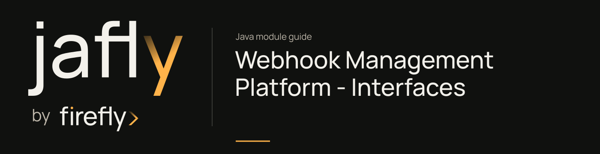

# Webhook Management Platform - Interfaces

Share the provider-neutral inbound webhook request and response DTOs.

Create WebhookEventDTO with providerName and raw JSON payload, then preserve event ID and request metadata across processing. WebhookResponseDTO exposes success/error factories for consistent ingestion responses.

| Maven artifact | Packaging | Source project |
| --- | --- | --- |
| `org.fireflyframework:fireflyframework-webhooks-interfaces` | `jar` | [modules/webhooks/fireflyframework-webhooks-interfaces](https://github.com/fireflyframework/fireflyframework-jafly/tree/main/modules/webhooks/fireflyframework-webhooks-interfaces) |

Part of [Event-driven integration](index.md#event-driven-integration).

## In the onboarding service

Carry the provider name, JSON payload, event ID, and request metadata from verification-provider ingestion to processing. Keep the same provider event identity through retries.

## Add the component

[Installation and version availability](../installation.md) explains source builds and published releases.

```xml
<dependency>
    <groupId>org.fireflyframework</groupId>
    <artifactId>fireflyframework-webhooks-interfaces</artifactId>
    <version>26.10.20</version>
</dependency>
```

## Quick start

The Java examples in this section are API fragments for application code. Use the stated imports and supply the application-owned collaborators described alongside them.

Construct the inbound DTO with its actual builder and retain the same event ID through retries:

```java
WebhookEventDTO event = WebhookEventDTO.builder()
        .eventId(UUID.randomUUID())
        .providerName("stripe")
        .payload(payload)
        .receivedAt(Instant.now())
        .httpMethod("POST")
        .build();
```

`payload` is a Jackson `JsonNode`; the DTO lives in `org.fireflyframework.webhooks.interfaces.dto`. `stripe` is an example provider key. Populate headers, query parameters, source IP, and metadata when the HTTP boundary supplies them. `WebhookResponseDTO.success(eventId, providerName)` and `.error(eventId, providerName, message)` create the corresponding result DTOs. These data types do not themselves validate a provider signature or publish an event.

## Configuration and wiring

This module declares no `@ConfigurationProperties` class of its own. Use the constructor/port contracts above and the configuration of the host or related core module.

## Public API and extension points

| Type | Contract and responsibility |
| --- | --- |
| [`WebhookEventDTO`](https://github.com/fireflyframework/fireflyframework-jafly/blob/main/modules/webhooks/fireflyframework-webhooks-interfaces/src/main/java/org/fireflyframework/webhooks/interfaces/dto/WebhookEventDTO.java) | DTO representing a webhook event received from any provider. |
| [`WebhookResponseDTO`](https://github.com/fireflyframework/fireflyframework-jafly/blob/main/modules/webhooks/fireflyframework-webhooks-interfaces/src/main/java/org/fireflyframework/webhooks/interfaces/dto/WebhookResponseDTO.java) | DTO representing the response after receiving a webhook. |

## Related components

| Related component | Why it belongs nearby |
| --- | --- |
| [Webhooks Library](webhooks.md) | Group incoming webhook contracts, ingestion logic, HTTP service, processing extensions, and generated SDK. |

## Build and test

Use Java 25. From the repository root, build this component with its required dependencies:

```bash
git clone https://github.com/fireflyframework/fireflyframework-jafly.git
cd fireflyframework-jafly
./mvnw -pl :fireflyframework-webhooks-interfaces -am verify
./mvnw -pl :fireflyframework-webhooks-interfaces -am install
```

`verify` runs the selected projects' tests. `install` makes the current build available in your local Maven repository.

This subproject has no authored `src/test/java` suite. Its Maven build still validates the configured compilation/generation and any reactor prerequisites. Use the consuming component tests to validate integration behavior.

## API reference excerpt

Contract excerpt from [WebhookEventDTO.java](https://github.com/fireflyframework/fireflyframework-jafly/blob/main/modules/webhooks/fireflyframework-webhooks-interfaces/src/main/java/org/fireflyframework/webhooks/interfaces/dto/WebhookEventDTO.java). This fragment needs the full type and its imports.

```java
public class WebhookEventDTO {
    private UUID eventId;
    private String providerName;
    private JsonNode payload;
    private Map<String, String> headers;
    private Map<String, String> queryParams;
    private Instant receivedAt;
    private String sourceIp;
    private String httpMethod;
    private Map<String, Object> enrichedMetadata;
}
```

## Continue the application

Use the [Webhook Management Platform - Core guide](webhooks-core.md) for the next part of this integration. The runnable submission/query service is in [Getting started](../getting-started.md).

## Source and further reading

- [Maven project and dependency declarations](https://github.com/fireflyframework/fireflyframework-jafly/blob/main/modules/webhooks/fireflyframework-webhooks-interfaces/pom.xml).
- [Production source](https://github.com/fireflyframework/fireflyframework-jafly/tree/main/modules/webhooks/fireflyframework-webhooks-interfaces/src/main/java).
- [Module catalog](index.md) and [getting started](../getting-started.md).
- [Maven platform](../maven.md) and [architecture](../architecture.md).
