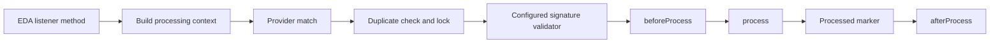

# Webhook Processor Framework

Build provider-specific workers for incoming webhook events. This component supplies processing, signature-verification, and duplicate-tracking extension points while the application owns business effects and the provider's verification rules.

Use it with [webhook ingestion](webhooks.md) and a configured [EDA transport](eda.md) when the HTTP receiver and event-processing worker are separate stages. Part of [Event-driven integration](index.md#event-driven-integration).

## Processing design



The base listener releases the duplicate lock on error paths and invokes the processor's error hook. The processor owns business effects; the transport owns acknowledgment/redelivery policy.

## In the onboarding service

Implement the worker that turns a verified provider event into an application-status change. Wire provider verification and shared duplicate state, and make the business update tolerate retries.

## Add the component

[Installation and version availability](../installation.md) explains source builds and published releases.

```xml
<dependency>
    <groupId>org.fireflyframework</groupId>
    <artifactId>fireflyframework-webhooks-processor</artifactId>
    <version>26.10.17-SNAPSHOT</version>
</dependency>
```

## Quick start

The Java examples in this section are API fragments for application code. Use the stated imports and supply the application-owned collaborators described alongside them.

Implement a `WebhookProcessor` for one provider and connect it to an `AbstractWebhookEventListener`. The following application example delegates effects to an application-owned handler; it does not ship a provider-specific processor in the framework:

```java
import com.fasterxml.jackson.databind.JsonNode;
import org.fireflyframework.webhooks.processor.model.WebhookProcessingContext;
import org.fireflyframework.webhooks.processor.model.WebhookProcessingResult;
import org.fireflyframework.webhooks.processor.port.WebhookProcessor;
import reactor.core.publisher.Mono;

final class PartnerProcessor implements WebhookProcessor {
    interface BusinessHandler {
        Mono<Void> handle(JsonNode payload);
    }

    private final BusinessHandler handler;

    PartnerProcessor(BusinessHandler handler) {
        this.handler = handler;
    }

    @Override
    public String getProviderName() {
        return "partner";
    }

    @Override
    public Mono<WebhookProcessingResult> process(WebhookProcessingContext context) {
        return handler.handle(context.getPayload())
                .thenReturn(WebhookProcessingResult.success("Handled partner event"));
    }
}
```

Register your processor, signature validator, and idempotency implementation as application beans. The listener constructor order is processor, ObjectMapper, signature validator, idempotency service:

```java
import com.fasterxml.jackson.databind.ObjectMapper;
import org.fireflyframework.eda.annotation.EventListener;
import org.fireflyframework.eda.annotation.PublisherType;
import org.fireflyframework.webhooks.core.domain.events.WebhookReceivedEvent;
import org.fireflyframework.webhooks.processor.listener.AbstractWebhookEventListener;
import org.fireflyframework.webhooks.processor.port.WebhookIdempotencyService;
import org.fireflyframework.webhooks.processor.port.WebhookProcessor;
import org.fireflyframework.webhooks.processor.port.WebhookSignatureValidator;
import org.springframework.beans.factory.annotation.Value;
import org.springframework.stereotype.Component;
import reactor.core.publisher.Mono;

@Component
final class PartnerListener extends AbstractWebhookEventListener {
    private final String secret;

    PartnerListener(WebhookProcessor processor, ObjectMapper mapper,
                    WebhookSignatureValidator validator,
                    WebhookIdempotencyService idempotency,
                    @Value("${PARTNER_WEBHOOK_SECRET}") String secret) {
        super(processor, mapper, validator, idempotency);
        this.secret = secret;
    }

    @EventListener(destinations = {"partner"}, consumerType = PublisherType.KAFKA,
                   groupId = "partner-webhook-worker")
    public Mono<Void> onEvent(WebhookReceivedEvent event) {
        return handleWebhookEvent(event);
    }

    @Override
    protected String getWebhookSecret(String providerName) {
        return "partner".equals(providerName) ? secret : null;
    }
}
```

`partner` is an example provider/destination. Configure a matching EDA consumer and the ingestion routing destination, set `PARTNER_WEBHOOK_SECRET` in the runtime environment, and qualify the injected beans if the application has several providers. Choose the EDA error/acknowledgment policy to match the worker's recovery behavior.

## Configuration and wiring

This module owns no configuration-properties class. It uses the host's EDA/cache settings and application-owned provider secrets.

| Concern | Actual wiring contract |
| --- | --- |
| Event consumption | `org.fireflyframework.eda.annotation.EventListener` on a concrete listener method; configure the corresponding EDA connection. |
| Provider routing | `WebhookProcessor.getProviderName()` and `canProcess(context)`; the default match is case-insensitive. |
| Provider secret | Override `AbstractWebhookEventListener.getWebhookSecret(String)`; the base implementation returns `null`. |
| Signature verification | Supply `WebhookSignatureValidator`; its actual method is `validateSignature(String payload, Map<String,String> headers, String secret)`. |
| Duplicate tracking | Supply `WebhookIdempotencyService`, or use the cache-based service created by `WebhookIdempotencyAutoConfiguration`. |
| Dedicated cache | Auto-configuration creates `webhookIdempotencyCacheManager` with cache name `webhook-idempotency`, prefix `firefly:webhooks:idempotency`, seven-day TTL, and `CacheType.AUTO`. Provider availability/selection remains a cache concern. |

Use [EDA](eda.md) for transport configuration and [cache](cache.md) plus the selected provider guide for the cache backing service. The processor library does not install a Kafka broker, provision a topic, or provide a built-in Stripe/Twilio/Shopify verifier.

## Public API and extension points

| Type | Responsibility |
| --- | --- |
| [`WebhookProcessor`](https://github.com/fireflyframework/fireflyframework-jafly/blob/main/modules/webhooks/fireflyframework-webhooks-processor/src/main/java/org/fireflyframework/webhooks/processor/port/WebhookProcessor.java) | Application extension point for provider processing, routing, and lifecycle hooks. |
| [`AbstractWebhookEventListener`](https://github.com/fireflyframework/fireflyframework-jafly/blob/main/modules/webhooks/fireflyframework-webhooks-processor/src/main/java/org/fireflyframework/webhooks/processor/listener/AbstractWebhookEventListener.java) | Builds a processing context from an incoming event and coordinates duplicate checks, signature validation, and processor hooks. |
| [`WebhookProcessingContext`](https://github.com/fireflyframework/fireflyframework-jafly/blob/main/modules/webhooks/fireflyframework-webhooks-processor/src/main/java/org/fireflyframework/webhooks/processor/model/WebhookProcessingContext.java) | Carries event/provider IDs, JSON payload, request headers/query values, receive time, topic/partition/offset, attempt number, and metadata. |
| [`WebhookProcessingResult`](https://github.com/fireflyframework/fireflyframework-jafly/blob/main/modules/webhooks/fireflyframework-webhooks-processor/src/main/java/org/fireflyframework/webhooks/processor/model/WebhookProcessingResult.java) | Supplies `success`, `failed`, `retry`, and `skipped` result factories, status checks, metadata, and duration. |
| [`WebhookSignatureValidator`](https://github.com/fireflyframework/fireflyframework-jafly/blob/main/modules/webhooks/fireflyframework-webhooks-processor/src/main/java/org/fireflyframework/webhooks/processor/port/WebhookSignatureValidator.java) | Provider-owned reactive verification contract; required verification defaults to `true`. |
| [`WebhookIdempotencyService`](https://github.com/fireflyframework/fireflyframework-jafly/blob/main/modules/webhooks/fireflyframework-webhooks-processor/src/main/java/org/fireflyframework/webhooks/processor/port/WebhookIdempotencyService.java) | Lock acquisition, processed-record lookup/write, lock release, and optional failure recording. |
| [`CacheBasedWebhookIdempotencyService`](https://github.com/fireflyframework/fireflyframework-jafly/blob/main/modules/webhooks/fireflyframework-webhooks-processor/src/main/java/org/fireflyframework/webhooks/processor/idempotency/CacheBasedWebhookIdempotencyService.java) | Implements duplicate tracking through `FireflyCacheManager`. |
| [`TracingContextExtractor`](https://github.com/fireflyframework/fireflyframework-jafly/blob/main/modules/webhooks/fireflyframework-webhooks-processor/src/main/java/org/fireflyframework/webhooks/processor/tracing/TracingContextExtractor.java) | Extracts tracing/correlation context from the event payload and headers. |

## Processing contracts

### Signature boundary

Signature validation runs in the worker. If no validator is supplied, the base listener skips it; supplying a required validator without a secret returns a failed validation result. Always wire both the provider validator and secret when verification is part of the application contract.

The current base listener passes `context.getPayload().toString()` to the validator. This is serialized JSON, not a preserved original HTTP byte sequence. Providers that sign exact request bytes need a separately qualified ingress/worker design that preserves and verifies those bytes. Test whitespace, encoding, header handling, timestamp tolerance, and replay behavior against the provider's actual contract before relying on the example flow for signature acceptance.

### Duplicate keys and retention

The base listener derives a content key from `providerName + ":" + payload.id` when an `id` field exists. Otherwise it hashes the serialized payload; on key-generation failure it falls back to the incoming event UUID. The default processing lock duration is five minutes and the processed-record retention is seven days.

The auto-configured cache uses `CacheType.AUTO`, and a local backing provider does not share duplicate state across worker processes. Select and qualify an appropriate shared provider for multiple workers. Duplicate records and business changes are not one database transaction, so use application-level idempotency for business effects that must tolerate crashes and redelivery.

### Results and retries

`WebhookProcessingResult` represents success, failure, retry, or skip, but a result value alone does not schedule a broker retry. The current listener marks the returned processor result as processed and invokes `afterProcess`; its error recovery converts processing failures to a failed result. Verify how your EDA error strategy and acknowledgment behavior interact with these paths. Do not infer end-to-end exactly-once delivery from a cache marker or a `RETRY` status.

### Processor hooks

`beforeProcess(context)` runs before the processor. `afterProcess(context, result)` runs after the result/processed-marker stage. `onError(context, error)` is an error hook. Override these hooks for application validation/audit work, and test their reactive completion/error semantics alongside business handlers.

## Build and test

Use Java 25. From the repository root, build this component with its required dependencies:

```bash
git clone https://github.com/fireflyframework/fireflyframework-jafly.git
cd fireflyframework-jafly
./mvnw -pl :fireflyframework-webhooks-processor -am verify
./mvnw -pl :fireflyframework-webhooks-processor -am install
```

`verify` runs the selected projects' tests. `install` makes the current build available in your local Maven repository.

This subproject has no authored `src/test/java` suite. Its Maven build still validates the configured compilation/generation and any reactor prerequisites. Use the consuming component tests to validate integration behavior.

## Continue the application

Use the [Webhooks guide](webhooks.md) for the next part of this integration. The runnable submission/query service is in [Getting started](../getting-started.md).

## Source and further reading

- [Maven project and dependency declarations](https://github.com/fireflyframework/fireflyframework-jafly/blob/main/modules/webhooks/fireflyframework-webhooks-processor/pom.xml).
- [Production source](https://github.com/fireflyframework/fireflyframework-jafly/tree/main/modules/webhooks/fireflyframework-webhooks-processor/src/main/java).
- [org.springframework.boot.autoconfigure.AutoConfiguration.imports](https://github.com/fireflyframework/fireflyframework-jafly/blob/main/modules/webhooks/fireflyframework-webhooks-processor/src/main/resources/META-INF/spring/org.springframework.boot.autoconfigure.AutoConfiguration.imports).
- [Module catalog](index.md) and [getting started](../getting-started.md).
- [Maven platform](../maven.md) and [architecture](../architecture.md).
