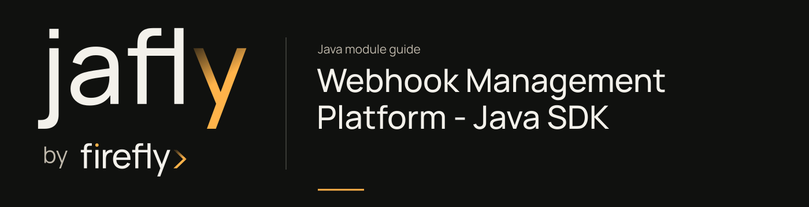

# Webhook Management Platform - Java SDK

Generate a reactive Java WebClient client from the incoming webhook platform OpenAPI specification.

Build the checked-in API specification with the module POM before importing generated classes. Generated API packages describe the platform HTTP contract; they do not replace provider-specific signature validators or event processors.

| Maven artifact | Packaging | Source project |
| --- | --- | --- |
| `org.fireflyframework:fireflyframework-webhooks-sdk` | `jar` | [modules/webhooks/fireflyframework-webhooks-sdk](https://github.com/fireflyframework/fireflyframework-jafly/tree/main/modules/webhooks/fireflyframework-webhooks-sdk) |

Part of [Event-driven integration](index.md#event-driven-integration).

## In the onboarding service

An integration client can use the generated ingestion contract when sending provider events into the webhook service. Provider signature verification and application updates remain in the processing path.

## Add the component

[Installation and version availability](../installation.md) explains source builds and published releases.

```xml
<dependency>
    <groupId>org.fireflyframework</groupId>
    <artifactId>fireflyframework-webhooks-sdk</artifactId>
    <version>26.10.17-SNAPSHOT</version>
</dependency>
```

## Quick start

The Java examples in this section are API fragments for application code. Use the stated imports and supply the application-owned collaborators described alongside them.

Build the SDK and configure its generated client for the deployed ingestion endpoint:

```java
import com.firefly.common.webhooks.sdk.invoker.ApiClient;

ApiClient client = new ApiClient()
        .setBasePath(System.getenv("WEBHOOKS_URL"));
```

The specification defines `receiveWebhook` for `POST /api/v1/webhook/{providerName}` with a JSON request body and optional `X-Idempotency-Key`. Generate the client before choosing the exact API/model types; the POM's API package is `com.firefly.common.webhooks.sdk.api`. Configure authentication headers on the client for the deployed service. A `202` response means ingestion accepted/queued the request; completion of the downstream provider processor is a separate outcome. The [processor guide](webhooks-processor.md) covers signature and idempotency extensions.

## Configuration and wiring

This module has no authored configuration-properties class. Its behavior is configured through the Maven generator or the dependencies listed below.

## Generated client contract

The generation input is [openapi.yml](https://github.com/fireflyframework/fireflyframework-jafly/blob/main/modules/webhooks/fireflyframework-webhooks-sdk/src/main/resources/api-spec/openapi.yml). The build produces the Java surface under `target`; this module contains no authored production Java classes. The current WebClient generation explicitly uses Spring Boot 4 with Jackson 2 compatibility.

| POM setting | Value |
| --- | --- |
| `inputSpec` | `${project.basedir}/src/main/resources/api-spec/openapi.yml` |
| `generatorName` | `java` |
| `library` | `webclient` |
| `apiPackage` | `com.firefly.common.webhooks.sdk.api` |
| `modelPackage` | `com.firefly.common.webhooks.sdk.model` |
| `invokerPackage` | `com.firefly.common.webhooks.sdk.invoker` |
| `useSpringBoot4` | `true` |
| `useJackson3` | `false` |
| `sourceFolder` | `src/gen/java/main` |
| `reactive` | `true` |


### Operations from the API specification

`receiveWebhook`.

## Related components

| Related component | Why it belongs nearby |
| --- | --- |
| [Webhooks Library](webhooks.md) | Group incoming webhook contracts, ingestion logic, HTTP service, processing extensions, and generated SDK. |
| [Webhook Management Platform - Web Application](webhooks-web.md) | Expose the reactive incoming webhook endpoint and runnable ingestion application. |

## Build and test

Use Java 25. From the repository root, build this component with its required dependencies:

```bash
git clone https://github.com/fireflyframework/fireflyframework-jafly.git
cd fireflyframework-jafly
./mvnw -pl :fireflyframework-webhooks-sdk -am verify
./mvnw -pl :fireflyframework-webhooks-sdk -am install
```

`verify` runs the selected projects' tests. `install` makes the current build available in your local Maven repository.

This subproject has no authored `src/test/java` suite. Its Maven build still validates the configured compilation/generation and any reactor prerequisites. Use the consuming component tests to validate integration behavior.

## Continue the application

Use the [Webhook Processor Framework guide](webhooks-processor.md) for the next part of this integration. The runnable submission/query service is in [Getting started](../getting-started.md).

## Source and further reading

- [Maven project and dependency declarations](https://github.com/fireflyframework/fireflyframework-jafly/blob/main/modules/webhooks/fireflyframework-webhooks-sdk/pom.xml).
- [openapi.yml](https://github.com/fireflyframework/fireflyframework-jafly/blob/main/modules/webhooks/fireflyframework-webhooks-sdk/src/main/resources/api-spec/openapi.yml).
- [Module catalog](index.md) and [getting started](../getting-started.md).
- [Maven platform](../maven.md) and [architecture](../architecture.md).
