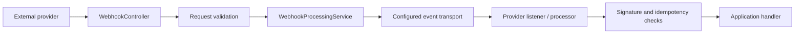

# Webhooks Library

Group incoming webhook contracts, ingestion logic, HTTP service, processing extensions, and generated SDK.

Use webhooks-web to receive provider callbacks and webhooks-processor to consume/handle the routed events. Configure transport, signature checks, and idempotency as a complete inbound flow. Outbound deliveries belong to callbacks.

| Maven artifact | Packaging | Source project |
| --- | --- | --- |
| `org.fireflyframework:fireflyframework-webhooks` | `pom` | [modules/webhooks](https://github.com/fireflyframework/fireflyframework-jafly/tree/main/modules/webhooks) |

Part of [Event-driven integration](index.md#event-driven-integration).

## Inbound request to provider processing



The ingestion service and processing extension are different stages. Configure routing, provider verification, and duplicate handling together before attaching business effects.

## In the onboarding service

A verification partner may send an inbound status update after an application was submitted. Connect ingestion, transport, provider verification, and an application worker as separate stages.

## Choose a component

| Related component | Why it belongs nearby |
| --- | --- |
| [Webhook Management Platform - Interfaces](webhooks-interfaces.md) | Share the provider-neutral inbound webhook request and response DTOs. |
| [Webhook Management Platform - Core](webhooks-core.md) | Validate, enrich, batch/compress, and publish incoming webhook events with retry, rate-limit, and dead-letter support. |
| [Webhook Management Platform - Web Application](webhooks-web.md) | Expose the reactive incoming webhook endpoint and runnable ingestion application. |
| [Webhook Processor Framework](webhooks-processor.md) | Implement provider-specific webhook processors, listeners, signature checks, and idempotency behavior. |
| [Webhook Management Platform - Java SDK](webhooks-sdk.md) | Generate a reactive Java WebClient client from the incoming webhook platform OpenAPI specification. |

## Add the component

[Installation and version availability](../installation.md) explains source builds and published releases.

This artifact has `pom` packaging and groups child projects. Select a concrete child JAR for the application classpath.

```xml
<dependency>
    <groupId>org.fireflyframework</groupId>
    <artifactId>fireflyframework-webhooks-interfaces</artifactId>
    <version>26.10.17-SNAPSHOT</version>
</dependency>
```

## Quick start

### Receive a partner event

Run the configured `fireflyframework-webhooks-web` service and send a fictional event to its ingestion endpoint:

```sh
curl -i -X POST http://localhost:8080/api/v1/webhook/verification-partner \
  -H 'Content-Type: application/json' \
  -d '{"id":"verification-123","type":"application.reviewed","applicationId":"example-id"}'
```

The configured transport and destination must be available. Ingestion publishes the received event for a worker; an accepted request does not establish that the application record has been updated or that a provider signature has been verified. Provider verification belongs in the configured processing path.

### Process the event

Use the [processor guide](webhooks-processor.md) for the complete `PartnerProcessor` and `PartnerListener` API fragments, their imports, constructor dependencies, and provider-verification requirements. They compile against the current API; they still need application wiring, the selected transport, and a real verification implementation before deployment.

The worker needs an application-owned operation that maps a verified partner event to an onboarding record. Make that operation tolerate duplicate delivery. Configure a shared idempotency store for multiple instances, and verify how failures and retry result values interact with acknowledgment. A cache marker alone cannot make the application write atomic with event processing.


## Configuration and wiring

This POM has no runtime configuration namespace. Configure the selected child libraries in the application that uses them.

## Build and test

Use Java 25. From the repository root, build this component with its required dependencies:

```bash
git clone https://github.com/fireflyframework/fireflyframework-jafly.git
cd fireflyframework-jafly
./mvnw -pl :fireflyframework-webhooks -am verify
./mvnw -pl :fireflyframework-webhooks -am install
```

`verify` runs the selected projects' tests. `install` makes the current build available in your local Maven repository.

This subproject has no authored `src/test/java` suite. Its Maven build still validates the configured compilation/generation and any reactor prerequisites. Use the consuming component tests to validate integration behavior.

## Detailed reference

### Configuration

All ingestion-side properties live under the `firefly.webhooks.*` prefix (defined by `WebhookSecurityProperties`, `BatchingProperties`, `CompressionProperties`, `RetryProperties`, and `@Value`-bound destination/DLQ keys). The following shows the configured defaults:

```yaml
firefly:
  webhooks:
    # Broker destination naming: {prefix}{provider-name}{suffix}
    destination:
      prefix: ""                     # e.g. "webhooks." -> "webhooks.stripe"
      suffix: ""                     # e.g. ".received" -> "stripe.received"
      use-provider-as-topic: true    # false -> topic = {prefix}{suffix}
      custom: ""                     # if set, all providers publish here

    security:
      validate-payload-size: true
      max-payload-size: 1048576      # 1 MB, in bytes
      validate-provider-name: true
      provider-name-pattern: "^[a-z0-9-]+$"
      enable-ip-whitelist: false
      ip-whitelist: {}               # per-provider exact IPs and/or CIDR ranges
      enable-request-validation: true
      allowed-methods: [POST]
      require-content-type: true
      allowed-content-types: [application/json, application/x-www-form-urlencoded]

    dlq:
      enabled: true
      topic: webhooks.dlq

    retry:
      defaults:
        max-attempts: 3
        initial-delay: PT1S
        max-delay: PT30S
        multiplier: 2.0
        enable-jitter: true
        jitter-factor: 0.5
        retry-on-timeout: true
        retry-on-connection-error: true
        retry-on-server-error: true
        retry-on-client-error: false
      providers: {}                  # per-provider overrides

    batching:
      enabled: false
      max-batch-size: 100
      max-wait-time: PT1S
      buffer-size: 1000
      providers: {}                  # per-provider overrides

    compression:
      enabled: false
      min-size: 1024                 # bytes; payloads below this are not compressed
      algorithm: GZIP                # GZIP | ZSTD | LZ4
      level: 6                       # 1-9 (GZIP), 1-22 (ZSTD)

    metadata-enrichment:
      enabled: true

  # Idempotency + rate-limit state (consumed by the cache abstraction)
  cache:
    enabled: true
    default-cache-type: REDIS        # REDIS (distributed) or CAFFEINE (single instance)

  # Event-driven backbone
  eda:
    enabled: true
    default-publisher-type: KAFKA
```

Key knobs:

| Property | Default | Description |
| --- | --- | --- |
| `firefly.webhooks.security.max-payload-size` | `1048576` | Reject payloads larger than this (bytes). |
| `firefly.webhooks.security.enable-ip-whitelist` | `false` | When `true`, only allow-listed IPs/CIDRs per provider may post. |
| `firefly.webhooks.destination.use-provider-as-topic` | `true` | Route each provider to its own broker topic. |
| `firefly.webhooks.dlq.enabled` / `dlq.topic` | `true` / `webhooks.dlq` | Dead-letter destination for rejected/failed webhooks. |
| `firefly.webhooks.retry.defaults.*` | see above | Exponential-backoff retry policy; override per provider under `retry.providers.<name>`. |
| `firefly.webhooks.batching.enabled` | `false` | Group events before publishing to the broker. |
| `firefly.webhooks.compression.enabled` | `false` | Compress large payloads (`min-size`, `algorithm`, `level`). |
| `firefly.webhooks.metadata-enrichment.enabled` | `true` | Toggle User-Agent/IP/request enrichment. |
| `firefly.cache.default-cache-type` | `REDIS` | `REDIS` for distributed workers, `CAFFEINE` for single-instance. |
| `firefly.eda.default-publisher-type` | `KAFKA` | EDA transport used to publish/consume webhook events. |

Resilience4j circuit-breaker, rate-limiter, and time-limiter behavior (e.g. `ratelimiter.configs.default.limit-for-period`) is configured under the standard `resilience4j.*` keys; see the web module's `application.yml`.

> Every property is also overridable via environment variables (e.g. `FIREFLY_WEBHOOKS_SECURITY_MAX_PAYLOAD_SIZE`) and system properties, per the standard Spring Boot relaxed-binding rules.

## Continue the application

Use the [Webhook Processor Framework guide](webhooks-processor.md) for the next part of this integration. The runnable submission/query service is in [Getting started](../getting-started.md).

## Source and further reading

- [Maven project and dependency declarations](https://github.com/fireflyframework/fireflyframework-jafly/blob/main/modules/webhooks/pom.xml).
- [Module catalog](index.md) and [getting started](../getting-started.md).
- [Maven platform](../maven.md) and [architecture](../architecture.md).
