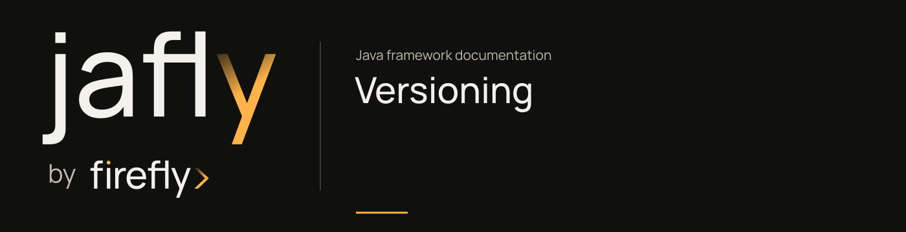

# One version train



Jafly uses padded CalVer versions: `YY.MM.PATCH` for a final release and `YY.MM.PATCH-SNAPSHOT` during development. The final component counts releases within the month; it does not represent a date. The current development version is `26.10.22`.

## What the version identifies

A framework train covers the consumer parent, independent BOM, libraries, adapters, and component aggregators. Nested projects may inherit their effective version from a local framework parent. Internal framework dependencies select that same train; third-party libraries retain their own managed versions.

An application's version remains separate. An application at `1.0.0` can use framework train `26.10.22`; the public parent/BOM use `fireflyframework.version` rather than the consumer's `${project.version}` for internal dependency management.

## Development snapshots

A snapshot version in source does not establish remote publication. Install the reactor locally before using its current development artifacts in a separate project:

```sh
./mvnw -B -ntp install
```

The manual snapshot workflow publishes to GitHub Packages only after verification. Snapshot package metadata can identify timestamped artifacts; it does not create a final GitHub Release.

## Change the train

```sh
python3 scripts/set_version.py 26.10.22
python3 scripts/release_tools.py check
python3 -m unittest discover -s tests -v
python3 -m unittest discover -s tests/release -v
./mvnw -B -ntp clean verify
```

The updater validates the version format, month, release counter, and input XML before writing. It updates framework project versions, parent references, direct framework dependency versions, and framework version properties. Generated targets and third-party versions remain unchanged.

Review documentation examples and version labels with the change. The updater operates on POMs; it does not silently rewrite prose or establish that a registry publication exists.

## Final releases

A final POM version must match its existing immutable tag exactly: `26.10.21` corresponds to `v26.10.21`. The release workflow checks the tag against the checked-out commit and all reactor versions before publishing.

The final GitHub Release is created only after both registries pass their artifact verification. A successful GitHub Packages upload followed by a Central failure is a partial publication. Keep the failure visible and follow the [release recovery guide](releases.md).

Previous published versions remain immutable. Historical repository tags are retained under `legacy/<source-repository>/<original-tag>`; they are provenance references, not new Jafly release tags.
