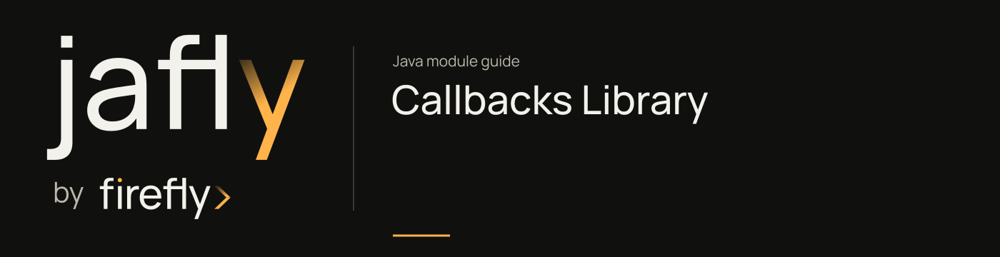

# Callbacks Library

Group the outbound callback platform: configuration, domain authorization, subscriptions, execution tracking, and dispatch.

Use callbacks-web for the service, callbacks-core for embedded dispatch logic, and the SDK for remote clients. This family sends events to external endpoints; incoming webhook ingestion is documented under webhooks.

[Module guide](../../docs/site/modules/callbacks.md) · [Jafly README](../../README.md) · [Module catalog](../../docs/site/modules/index.md)

## In the onboarding service

An onboarding partner may need an outbound notification when an application changes status. Register its authorized destination and subscription before dispatching events to it.

## Choose a component

| Related component | Why it belongs nearby |
| --- | --- |
| [Callback Management Platform - Interfaces](../../docs/site/modules/callbacks-interfaces.md) | Share callback configuration, subscription, domain, and execution DTOs and status enums. |
| [Callback Management Platform - Models](../../docs/site/modules/callbacks-models.md) | Persist callback configurations, authorized domains, event subscriptions, and execution records with reactive repositories. |
| [Callback Management Platform - Core](../../docs/site/modules/callbacks-core.md) | Route subscribed events and dispatch outbound HTTP callbacks with signing, retries, circuit breaking, and execution tracking. |
| [Callback Management Platform - Web](../../docs/site/modules/callbacks-web.md) | Expose the callback-management HTTP API and its Spring Boot application. |
| [Callback Management Platform - SDK](../../docs/site/modules/callbacks-sdk.md) | Generate a reactive Java WebClient SDK from the callback platform OpenAPI specification. |

## Installation

[Installation and version availability](../../docs/site/installation.md) explains source builds and published releases.

This artifact has `pom` packaging and groups child projects. Select a concrete child JAR for the application classpath.

```xml
<dependency>
    <groupId>org.fireflyframework</groupId>
    <artifactId>fireflyframework-callbacks-interfaces</artifactId>
    <version>26.10.22</version>
</dependency>
```

## Quick start

The injection examples use Lombok `@RequiredArgsConstructor`. Add its provided dependency and annotation processor as described in [Constructor injection](../../docs/site/maven.md#constructor-injection).

The Java examples in this section are API fragments for application code. Use the stated imports and supply the application-owned collaborators described alongside them.

### Run the service

Build the aggregator and start the web module against a PostgreSQL database and a Kafka broker:

```bash
./mvnw -pl :fireflyframework-callbacks,:fireflyframework-callbacks-core,:fireflyframework-callbacks-interfaces,:fireflyframework-callbacks-models,:fireflyframework-callbacks-sdk,:fireflyframework-callbacks-web -am install
./mvnw -f modules/callbacks/fireflyframework-callbacks-web/pom.xml spring-boot:run
```

Connection settings are environment-driven (see [Configuration](#configuration)); the defaults assume PostgreSQL on `localhost:5432/callbacks_db` and Kafka on `localhost:9092`. Once running, the API and Swagger UI are available at:

- OpenAPI JSON: `http://localhost:8080/v3/api-docs`
- Swagger UI: `http://localhost:8080/swagger-ui.html`

### Register a callback configuration

Tell the platform where to deliver events and which event types to deliver. The target domain must be authorized first (see the authorized-domains API).

```bash
curl -X POST http://localhost:8080/api/v1/callback-configurations \
  -H "Content-Type: application/json" \
  -d '{
        "name": "orders-webhook",
        "url": "https://partner.example.com/webhooks/orders",
        "httpMethod": "POST",
        "status": "ACTIVE",
        "subscribedEventTypes": ["order.created", "order.updated"],
        "signatureEnabled": true,
        "secret": "s3cr3t",
        "signatureHeader": "X-Firefly-Signature",
        "maxRetries": 3,
        "retryDelayMs": 1000,
        "timeoutMs": 30000
      }'
```

When an `order.created` event arrives on a subscribed topic, the platform delivers a signed `POST` to the URL above, retrying with exponential backoff on transient failures and recording every attempt.

### Subscribe to events

An `EventSubscription` binds the platform to a messaging topic/queue and a set of event-type patterns. Subscriptions are loaded from the database and registered as dynamic EDA listeners at runtime.

```bash
curl -X POST http://localhost:8080/api/v1/event-subscriptions \
  -H "Content-Type: application/json" \
  -d '{
        "name": "order-events",
        "messagingSystemType": "KAFKA",
        "topicOrQueue": "orders",
        "consumerGroupId": "callbacks-mgmt-consumer",
        "eventTypePatterns": ["order.*"],
        "active": true
      }'
```

### Reusing the dispatcher in code

If you embed the core module, dispatching is a reactive call that takes a resolved configuration, the event metadata, and a JSON payload:

```java
import lombok.RequiredArgsConstructor;
import org.fireflyframework.callbacks.core.service.CallbackDispatcher;
import org.fireflyframework.callbacks.interfaces.dto.CallbackConfigurationDTO;
import com.fasterxml.jackson.databind.JsonNode;
import reactor.core.publisher.Mono;

import java.util.UUID;

@RequiredArgsConstructor
public class OrderNotifier {

    private final CallbackDispatcher dispatcher;


    public Mono<Void> notify(CallbackConfigurationDTO config, UUID eventId, JsonNode payload) {
        // Validates the domain, signs the payload, retries, and records the execution.
        return dispatcher.dispatch(config, "order.created", eventId, payload);
    }
}
```

## Configuration

This POM has no runtime configuration namespace. Configure the selected child libraries in the application that uses them.

## Continue the application

Use the [Callback Management Platform - Core guide](../../docs/site/modules/callbacks-core.md) for the next part of this integration.

## Build and validation

Use Java 25. From the repository root, build this component with its required dependencies:

```bash
git clone https://github.com/fireflyframework/fireflyframework-jafly.git
cd fireflyframework-jafly
./mvnw -pl :fireflyframework-callbacks,:fireflyframework-callbacks-core,:fireflyframework-callbacks-interfaces,:fireflyframework-callbacks-models,:fireflyframework-callbacks-sdk,:fireflyframework-callbacks-web -am verify
./mvnw -pl :fireflyframework-callbacks,:fireflyframework-callbacks-core,:fireflyframework-callbacks-interfaces,:fireflyframework-callbacks-models,:fireflyframework-callbacks-sdk,:fireflyframework-callbacks-web -am install
```

`verify` runs the selected projects' tests. `install` makes the current build available in your local Maven repository.

Configuration details and source references: [module guide](../../docs/site/modules/callbacks.md).
