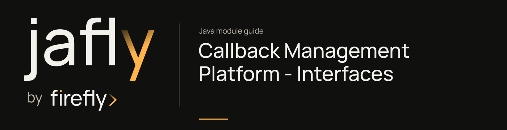

# Callback Management Platform - Interfaces

Share callback configuration, subscription, domain, and execution DTOs and status enums.

Use these DTOs at the service/client boundary. Construct a CallbackConfigurationDTO with its endpoint, HTTP method, and relevant policy fields, and use the enums instead of duplicating wire status strings. Persistence repositories live in callbacks-models.

[Module guide](../../../docs/site/modules/callbacks-interfaces.md) · [Jafly README](../../../README.md) · [Module catalog](../../../docs/site/modules/index.md)

## In the onboarding service

Use these DTOs to configure a partner callback for application-status events. Creating a DTO alone does not persist the destination or authorize its domain.

## Installation

[Installation and version availability](../../../docs/site/installation.md) explains source builds and published releases.

```xml
<dependency>
    <groupId>org.fireflyframework</groupId>
    <artifactId>fireflyframework-callbacks-interfaces</artifactId>
    <version>26.10.20-SNAPSHOT</version>
</dependency>
```

## Quick start

The Java examples in this section are API fragments for application code. Use the stated imports and supply the application-owned collaborators described alongside them.

Use the actual Lombok builder on `CallbackConfigurationDTO` to describe a callback destination. This constructs the DTO; it does not authorize the domain, persist a subscription, or perform delivery:

```java
CallbackConfigurationDTO configuration = CallbackConfigurationDTO.builder()
        .name("Payment notifications")
        .url("https://partner.example/callbacks")
        .httpMethod(HttpMethod.POST)
        .subscribedEventTypes(new String[]{"payment.received"})
        .build();
```

The DTO is in `org.fireflyframework.callbacks.interfaces.dto`; `HttpMethod` is in `org.fireflyframework.callbacks.interfaces.enums`. Jakarta validation requires a name, HTTP(S) URL, non-null method/status, and at least one subscribed event type. Configure signature secrets and retry/timeout fields when the application requires them. Return `CallbackExecutionDTO` for execution records and use the source enums for callback/execution status values.

## Configuration

This module declares no `@ConfigurationProperties` class of its own. Use the constructor/port contracts above and the configuration of the host or related core module.

## API overview

| Type | Contract and responsibility |
| --- | --- |
| [`CallbackConfigurationDTO`](https://github.com/fireflyframework/fireflyframework-jafly/blob/main/modules/callbacks/fireflyframework-callbacks-interfaces/src/main/java/org/fireflyframework/callbacks/interfaces/dto/CallbackConfigurationDTO.java) | DTO for callback configuration. |
| [`EventSubscriptionDTO`](https://github.com/fireflyframework/fireflyframework-jafly/blob/main/modules/callbacks/fireflyframework-callbacks-interfaces/src/main/java/org/fireflyframework/callbacks/interfaces/dto/EventSubscriptionDTO.java) | DTO for configuring dynamic event subscriptions. |
| [`AuthorizedDomainDTO`](https://github.com/fireflyframework/fireflyframework-jafly/blob/main/modules/callbacks/fireflyframework-callbacks-interfaces/src/main/java/org/fireflyframework/callbacks/interfaces/dto/AuthorizedDomainDTO.java) | DTO for managing authorized callback domains. |
| [`CallbackExecutionDTO`](https://github.com/fireflyframework/fireflyframework-jafly/blob/main/modules/callbacks/fireflyframework-callbacks-interfaces/src/main/java/org/fireflyframework/callbacks/interfaces/dto/CallbackExecutionDTO.java) | DTO for callback execution tracking. |
| [`CallbackExecutionStatus`](https://github.com/fireflyframework/fireflyframework-jafly/blob/main/modules/callbacks/fireflyframework-callbacks-interfaces/src/main/java/org/fireflyframework/callbacks/interfaces/enums/CallbackExecutionStatus.java) | Status of a callback execution attempt. |

## Continue the application

Use the [Callback Management Platform - Web guide](../../../docs/site/modules/callbacks-web.md) for the next part of this integration.

## Build and validation

Use Java 25. From the repository root, build this component with its required dependencies:

```bash
git clone https://github.com/fireflyframework/fireflyframework-jafly.git
cd fireflyframework-jafly
./mvnw -pl :fireflyframework-callbacks-interfaces -am verify
./mvnw -pl :fireflyframework-callbacks-interfaces -am install
```

`verify` runs the selected projects' tests. `install` makes the current build available in your local Maven repository.

Configuration details and source references: [module guide](../../../docs/site/modules/callbacks-interfaces.md).
