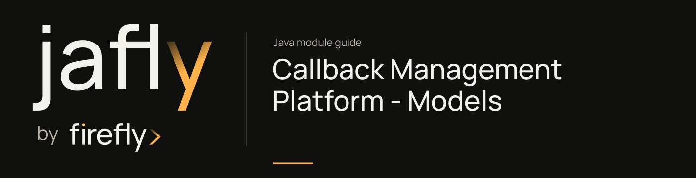

# Callback Management Platform - Models

Persist callback configurations, authorized domains, event subscriptions, and execution records with reactive repositories.

Use the repository interfaces from callbacks-core and apply the database migrations supplied by this module. These repositories use Spring Data relational/R2DBC contracts.

[Module guide](../../../docs/site/modules/callbacks-models.md) · [Jafly README](../../../README.md) · [Module catalog](../../../docs/site/modules/index.md)

## In the onboarding service

The callback service stores destinations, subscriptions, and executions separately from onboarding application records. Apply its migrations and use the declared reactive repositories.

## Installation

[Installation and version availability](../../../docs/site/installation.md) explains source builds and published releases.

```xml
<dependency>
    <groupId>org.fireflyframework</groupId>
    <artifactId>fireflyframework-callbacks-models</artifactId>
    <version>26.10.17-SNAPSHOT</version>
</dependency>
```

## Quick start

The Java examples in this section are API fragments for application code. Use the stated imports and supply the application-owned collaborators described alongside them.

Apply the SQL migration resources linked below before invoking the reactive repositories. Inject `CallbackConfigurationRepository` and query the subscription candidates for a domain event:

```java
Flux<CallbackConfiguration> candidates =
        repository.findActiveByEventType("payment.received");
```

The repository is in `org.fireflyframework.callbacks.models.repository`, and entities are in its sibling `entities` package. Compose the `Flux` within the service flow. Repositories also separate configuration, subscriptions, authorized domains, and executions; use their declared query methods rather than assuming that DTO fields imply a particular database lookup.

## Configuration

This module declares no `@ConfigurationProperties` class of its own. Use the constructor/port contracts above and the configuration of the host or related core module.

## API overview

| Type | Contract and responsibility |
| --- | --- |
| [`CallbackConfiguration`](https://github.com/fireflyframework/fireflyframework-jafly/blob/main/modules/callbacks/fireflyframework-callbacks-models/src/main/java/org/fireflyframework/callbacks/models/entity/CallbackConfiguration.java) | Entity for callback configurations. |
| [`CallbackExecution`](https://github.com/fireflyframework/fireflyframework-jafly/blob/main/modules/callbacks/fireflyframework-callbacks-models/src/main/java/org/fireflyframework/callbacks/models/entity/CallbackExecution.java) | Entity for callback execution tracking. |
| [`CallbackConfigurationRepository`](https://github.com/fireflyframework/fireflyframework-jafly/blob/main/modules/callbacks/fireflyframework-callbacks-models/src/main/java/org/fireflyframework/callbacks/models/repository/CallbackConfigurationRepository.java) | Repository for callback configurations. |
| [`EventSubscriptionRepository`](https://github.com/fireflyframework/fireflyframework-jafly/blob/main/modules/callbacks/fireflyframework-callbacks-models/src/main/java/org/fireflyframework/callbacks/models/repository/EventSubscriptionRepository.java) | Repository for event subscriptions. |
| [`AuthorizedDomainRepository`](https://github.com/fireflyframework/fireflyframework-jafly/blob/main/modules/callbacks/fireflyframework-callbacks-models/src/main/java/org/fireflyframework/callbacks/models/repository/AuthorizedDomainRepository.java) | Repository for authorized domains. |

## Continue the application

Use the [Callback Management Platform - Core guide](../../../docs/site/modules/callbacks-core.md) for the next part of this integration. ## Build and validation

Use Java 25. From the repository root, build this component with its required dependencies:

```bash
git clone https://github.com/fireflyframework/fireflyframework-jafly.git
cd fireflyframework-jafly
./mvnw -pl :fireflyframework-callbacks-models -am verify
./mvnw -pl :fireflyframework-callbacks-models -am install
```

`verify` runs the selected projects' tests. `install` makes the current build available in your local Maven repository.

Configuration details and source references: [module guide](../../../docs/site/modules/callbacks-models.md).
