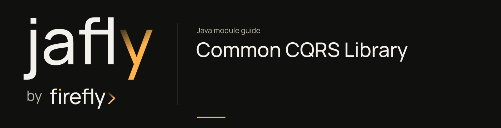

# Common CQRS Library

Separate commands and queries with reactive dispatch, execution context, validation, and authorization hooks.

Define command/query messages and their handlers, then invoke the appropriate bus. Configure timeouts and query caching through firefly.cqrs; use the EDA integration only when the event transport has also been configured.

[Module guide](../../docs/site/modules/cqrs.md) · [Jafly README](../../README.md) · [Module catalog](../../docs/site/modules/index.md)

## Installation

[Installation and version availability](../../docs/site/installation.md) explains source builds and published releases.

```xml
<dependency>
    <groupId>org.fireflyframework</groupId>
    <artifactId>fireflyframework-cqrs</artifactId>
    <version>26.10.17-SNAPSHOT</version>
</dependency>
```

## Quick start

The runnable example is a customer onboarding service. `POST /applications` submits an applicant's name and email through `CommandBus`; `GET /applications/{id}` reads the saved application through `QueryBus`.

Use the [first-service tutorial](../../docs/site/getting-started.md) for the complete Maven project, main class, run commands, and HTTP tests. The classes here belong to that project. Its repository is an in-memory map that loses data on restart, and its query disables caching. Authentication, outbound events, and a database are later integration choices.

### Submit a customer application

[SubmitApplication.java](https://github.com/fireflyframework/fireflyframework-jafly/blob/main/docs/examples/getting-started/src/main/java/com/example/jafly/SubmitApplication.java):

```java
package com.example.jafly;

import jakarta.validation.constraints.Email;
import jakarta.validation.constraints.NotBlank;
import java.util.UUID;
import org.fireflyframework.cqrs.command.Command;

public record SubmitApplication(String commandId, @NotBlank String applicantName,
                                @NotBlank @Email String email) implements Command<OnboardingApplication> {
    public SubmitApplication(String applicantName, String email) {
        this(UUID.randomUUID().toString(), applicantName, email);
    }

    @Override
    public String getCommandId() {
        return commandId;
    }

    @Override
    public Class<OnboardingApplication> getResultType() {
        return OnboardingApplication.class;
    }
}
```

[SubmitApplicationHandler.java](https://github.com/fireflyframework/fireflyframework-jafly/blob/main/docs/examples/getting-started/src/main/java/com/example/jafly/SubmitApplicationHandler.java):

```java
package com.example.jafly;

import java.util.UUID;
import org.fireflyframework.cqrs.annotations.CommandHandlerComponent;
import org.fireflyframework.cqrs.command.CommandHandler;
import reactor.core.publisher.Mono;

@CommandHandlerComponent
public class SubmitApplicationHandler extends CommandHandler<SubmitApplication, OnboardingApplication> {
    private final InMemoryApplicationRepository repository;

    public SubmitApplicationHandler(InMemoryApplicationRepository repository) {
        this.repository = repository;
    }

    @Override
    protected Mono<OnboardingApplication> doHandle(SubmitApplication command) {
        var application = new OnboardingApplication(UUID.randomUUID(), command.applicantName(), command.email());
        return repository.save(application);
    }
}
```

### Read an application by ID

[FindApplication.java](https://github.com/fireflyframework/fireflyframework-jafly/blob/main/docs/examples/getting-started/src/main/java/com/example/jafly/FindApplication.java):

```java
package com.example.jafly;

import jakarta.validation.constraints.NotNull;
import java.util.UUID;
import org.fireflyframework.cqrs.query.Query;

public record FindApplication(String queryId, @NotNull UUID applicationId) implements Query<OnboardingApplication> {
    public FindApplication(UUID applicationId) {
        this(UUID.randomUUID().toString(), applicationId);
    }

    @Override
    public String getQueryId() {
        return queryId;
    }

    @Override
    public Class<OnboardingApplication> getResultType() {
        return OnboardingApplication.class;
    }

    @Override
    public boolean isCacheable() {
        return false;
    }
}
```

[FindApplicationHandler.java](https://github.com/fireflyframework/fireflyframework-jafly/blob/main/docs/examples/getting-started/src/main/java/com/example/jafly/FindApplicationHandler.java):

```java
package com.example.jafly;

import org.fireflyframework.cqrs.annotations.QueryHandlerComponent;
import org.fireflyframework.cqrs.query.QueryHandler;
import reactor.core.publisher.Mono;

@QueryHandlerComponent(cacheable = false)
public class FindApplicationHandler extends QueryHandler<FindApplication, OnboardingApplication> {
    private final InMemoryApplicationRepository repository;

    public FindApplicationHandler(InMemoryApplicationRepository repository) {
        this.repository = repository;
    }

    @Override
    protected Mono<OnboardingApplication> doHandle(FindApplication query) {
        return repository.findById(query.applicationId());
    }
}
```

### Store the tutorial state

[OnboardingApplication.java](https://github.com/fireflyframework/fireflyframework-jafly/blob/main/docs/examples/getting-started/src/main/java/com/example/jafly/OnboardingApplication.java):

```java
package com.example.jafly;

import java.util.UUID;

public record OnboardingApplication(UUID id, String applicantName, String email) {
}
```

[InMemoryApplicationRepository.java](https://github.com/fireflyframework/fireflyframework-jafly/blob/main/docs/examples/getting-started/src/main/java/com/example/jafly/InMemoryApplicationRepository.java):

```java
package com.example.jafly;

import java.util.Map;
import java.util.UUID;
import java.util.concurrent.ConcurrentHashMap;
import org.springframework.stereotype.Repository;
import reactor.core.publisher.Mono;

@Repository
public class InMemoryApplicationRepository {
    // Tutorial data belongs to this process and is lost when the application restarts.
    private final Map<UUID, OnboardingApplication> applications = new ConcurrentHashMap<>();

    public Mono<OnboardingApplication> save(OnboardingApplication application) {
        return Mono.fromSupplier(() -> {
            applications.put(application.id(), application);
            return application;
        });
    }

    public Mono<OnboardingApplication> findById(UUID id) {
        return Mono.defer(() -> Mono.justOrEmpty(applications.get(id)));
    }
}
```

### Expose the two HTTP routes

[ApplicationsController.java](https://github.com/fireflyframework/fireflyframework-jafly/blob/main/docs/examples/getting-started/src/main/java/com/example/jafly/ApplicationsController.java):

```java
package com.example.jafly;

import jakarta.validation.Valid;
import jakarta.validation.constraints.Email;
import jakarta.validation.constraints.NotBlank;
import java.net.URI;
import java.util.UUID;
import org.fireflyframework.cqrs.command.CommandBus;
import org.fireflyframework.cqrs.query.QueryBus;
import org.springframework.http.ResponseEntity;
import org.springframework.web.bind.annotation.GetMapping;
import org.springframework.web.bind.annotation.PathVariable;
import org.springframework.web.bind.annotation.PostMapping;
import org.springframework.web.bind.annotation.RequestBody;
import org.springframework.web.bind.annotation.RequestMapping;
import org.springframework.web.bind.annotation.RestController;
import reactor.core.publisher.Mono;

@RestController
@RequestMapping("/applications")
public class ApplicationsController {
    private final CommandBus commandBus;
    private final QueryBus queryBus;

    public ApplicationsController(CommandBus commandBus, QueryBus queryBus) {
        this.commandBus = commandBus;
        this.queryBus = queryBus;
    }

    @PostMapping
    public Mono<ResponseEntity<OnboardingApplication>> submit(@Valid @RequestBody ApplicationRequest request) {
        return commandBus.send(new SubmitApplication(request.applicantName(), request.email()))
                .map(application -> ResponseEntity.created(URI.create("/applications/" + application.id()))
                        .body(application));
    }

    @GetMapping("/{id}")
    public Mono<ResponseEntity<OnboardingApplication>> find(@PathVariable UUID id) {
        return queryBus.query(new FindApplication(id))
                .map(ResponseEntity::ok)
                .defaultIfEmpty(ResponseEntity.notFound().build());
    }

    public record ApplicationRequest(@NotBlank String applicantName, @NotBlank @Email String email) {
    }
}
```

The controller returns `201 Created` with a `Location` header for a submission, `200 OK` for a known ID, `404` for an unknown ID, and `400` for invalid name/email input. The handlers use the application's concrete repository; the bus supplies dispatch and its configured processing pipeline.

### Run and check the application

After installing the required framework libraries, run the standalone project from the repository root:

```sh
./mvnw -f docs/examples/getting-started/pom.xml spring-boot:run
```

Submit a fictional applicant from another terminal:

```sh
curl -i -X POST http://localhost:8080/applications \
  -H 'Content-Type: application/json' \
  -d '{"applicantName":"Ada Lovelace","email":"ada@example.com"}'
```

Use the returned `id` in `GET /applications/{id}`. Run the project's tests with:

```sh
./mvnw -B -ntp -f docs/examples/getting-started/pom.xml verify
```

### Authorization and optional bridges

The command/query interfaces allow execution by default. Protected operations need an authorization rule and trusted identity context. Jakarta annotation validation needs a `Validator` bean; the example declares the validation starter.

Publishing a command result requires EDA, an `EventPublisherFactory` bean, the enabled CQRS/EDA bridge, and `@PublishDomainEvent` on the handler. Query invalidation requires a `QueryCacheAdapter` and a matching `@InvalidateCacheOn` event delivered through Spring's application-event path. Connect broker events to that local path explicitly. The onboarding tutorial configures neither bridge.

These annotation declarations are API fragments for an application that has added that infrastructure:

```java
@PublishDomainEvent(destination = "application-events", eventType = "application.submitted")
@InvalidateCacheOn(eventTypes = {"application.submitted", "application.reviewed"})
```

Apply each annotation to its corresponding command or query handler. If you enable query caching, update the tutorial's query and handler cache settings and verify invalidation; its current query intentionally reads the map directly.

## Configuration

The `firefly.cqrs.authorization` namespace is bound by [AuthorizationProperties.java](https://github.com/fireflyframework/fireflyframework-jafly/blob/main/modules/cqrs/src/main/java/org/fireflyframework/cqrs/config/AuthorizationProperties.java). Nested configuration is declared in the linked class. Defaults are the field initializers.

| Setting | Java type | Source default |
| --- | --- | --- |
| `firefly.cqrs.authorization.enabled` | `boolean` | `true` |
| `firefly.cqrs.authorization.custom` | `Custom` | `new Custom()` |
| `firefly.cqrs.authorization.logging` | `Logging` | `new Logging()` |
| `firefly.cqrs.authorization.performance` | `Performance` | `new Performance()` |

The `firefly.cqrs` namespace is bound by [CqrsProperties.java](https://github.com/fireflyframework/fireflyframework-jafly/blob/main/modules/cqrs/src/main/java/org/fireflyframework/cqrs/config/CqrsProperties.java). Nested configuration is declared in the linked class. Defaults are the field initializers.

| Setting | Java type | Source default |
| --- | --- | --- |
| `firefly.cqrs.enabled` | `boolean` | `true` |
| `firefly.cqrs.command` | `Command` | `new Command()` |
| `firefly.cqrs.query` | `Query` | `new Query()` |

## API overview

| Type | Contract and responsibility |
| --- | --- |
| [`CommandBus`](https://github.com/fireflyframework/fireflyframework-jafly/blob/main/modules/cqrs/src/main/java/org/fireflyframework/cqrs/command/CommandBus.java) | Interface for the Command Bus in CQRS architecture. |
| [`QueryBus`](https://github.com/fireflyframework/fireflyframework-jafly/blob/main/modules/cqrs/src/main/java/org/fireflyframework/cqrs/query/QueryBus.java) | Interface for the Query Bus in CQRS architecture. |
| [`CommandHandler`](https://github.com/fireflyframework/fireflyframework-jafly/blob/main/modules/cqrs/src/main/java/org/fireflyframework/cqrs/command/CommandHandler.java) | Base class for all command handlers in the CQRS framework. |
| [`QueryHandler`](https://github.com/fireflyframework/fireflyframework-jafly/blob/main/modules/cqrs/src/main/java/org/fireflyframework/cqrs/query/QueryHandler.java) | Base class for all query handlers in the CQRS framework. |
| [`ExecutionContext`](https://github.com/fireflyframework/fireflyframework-jafly/blob/main/modules/cqrs/src/main/java/org/fireflyframework/cqrs/context/ExecutionContext.java) | Execution context for CQRS commands and queries. |

## Build and validation

Use Java 25. From the repository root, build this component with its required dependencies:

```bash
git clone https://github.com/fireflyframework/fireflyframework-jafly.git
cd fireflyframework-jafly
./mvnw -pl :fireflyframework-cqrs -am verify
./mvnw -pl :fireflyframework-cqrs -am install
```

`verify` runs the selected projects' tests. `install` makes the current build available in your local Maven repository.

Configuration details and source references: [module guide](../../docs/site/modules/cqrs.md).
