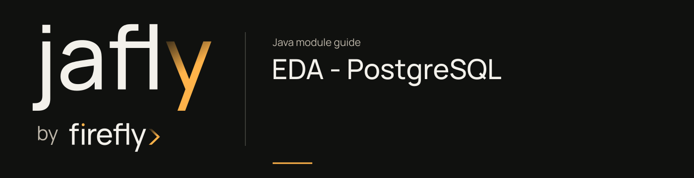

# EDA - PostgreSQL

Deliver EDA events through a PostgreSQL outbox with LISTEN/NOTIFY support.

Use this transport when PostgreSQL is the messaging boundary. Apply the documented schema and configure publisher/consumer database access; distinguish persistence of the outbox row from successful consumer processing.

[Module guide](../../docs/site/modules/eda-postgres.md) · [Jafly README](../../README.md) · [Module catalog](../../docs/site/modules/index.md)

## In the onboarding service

A PostgreSQL delivery table can carry application lifecycle events without a separate broker. Its publisher connection is independent of the application write, so recovery must cover a saved application whose event was not published.

## Installation

[Installation and version availability](../../docs/site/installation.md) explains source builds and published releases.

```xml
<dependency>
    <groupId>org.fireflyframework</groupId>
    <artifactId>fireflyframework-eda-postgres</artifactId>
    <version>26.10.17-SNAPSHOT</version>
</dependency>
```

## Quick start

The Java examples in this section are API fragments for application code. Use the stated imports and supply the application-owned collaborators described alongside them.

The outbox here is a persisted delivery queue, not an automatic atomic business-write/event-write boundary. `PostgresEventPublisher` obtains a separate connection for each publication. Design application recovery/idempotency for the case where a business write succeeds and event publication fails; use an explicitly transaction-bound outbox implementation when both writes must commit together.

1. Add the dependency (see above). The PostgreSQL transport beans light up only when you enable them.

2. Enable and configure the PostgreSQL transport in `application.yml`:

```yaml
firefly:
  eda:
    publishers:
      enabled: true
      postgres:
        default:
          enabled: true
          host: localhost
          port: 5432
          database: firefly
          username: firefly
          password: firefly
          schema: public
          outbox-table: firefly_eda_outbox
          default-destination: events
          auto-create-schema: true   # creates the outbox table, indexes, NOTIFY function & trigger
    consumer:
      enabled: true
      postgres:
        default:
          enabled: true
          host: localhost
          port: 5432
          database: firefly
          username: firefly
          password: firefly
          channels: events            # used only when no @EventListener is discovered
          polling-interval: PT30S     # NOTIFY fallback; PT0S to disable
```

3. Publish events with the framework's transport-agnostic annotation. The method result is written to the outbox and dispatched via `NOTIFY`:

```java
@Service
public class PaymentService {

    @PublishResult(publisherType = PublisherType.POSTGRES,
                   destination = "payments",
                   eventType = "payment.completed")
    public Mono<PaymentCompleted> complete(PaymentCommand cmd) {
        return process(cmd); // returned value is inserted into the outbox for "payments"
    }
}
```

4. Consume events by annotating a handler. The consumer derives the channel automatically and `LISTEN`s for it:

```java
@Component
public class PaymentListener {

    @EventListener(destinations = "payments",
                   eventTypes = "payment.completed",
                   consumerType = PublisherType.POSTGRES)
    public Mono<Void> onPaymentCompleted(PaymentCompleted event) {
        log.info("Received payment: {}", event.id());
        return Mono.empty();
    }
}
```

No hand-written SQL, no `spring.r2dbc.*`, and no manual `LISTEN`/`NOTIFY` plumbing. The adapter owns the outbox schema, the dedicated connection factories, and the channel mapping.

## Configuration

This module declares no `@ConfigurationProperties` class of its own. Use the constructor/port contracts above and the configuration of the host or related core module.

## API overview

| Type | Contract and responsibility |
| --- | --- |
| [`PostgresEventPublisher`](https://github.com/fireflyframework/fireflyframework-jafly/blob/main/modules/eda-postgres/src/main/java/org/fireflyframework/eda/publisher/postgres/PostgresEventPublisher.java) | Persists events in a PostgreSQL delivery table and dispatches through `LISTEN`/`NOTIFY`; publication uses its own database connection. |
| [`PostgresEventConsumer`](https://github.com/fireflyframework/fireflyframework-jafly/blob/main/modules/eda-postgres/src/main/java/org/fireflyframework/eda/consumer/postgres/PostgresEventConsumer.java) | PostgreSQL implementation of `EventConsumer`. |
| [`FireflyEdaPostgresConsumerAutoConfiguration`](https://github.com/fireflyframework/fireflyframework-jafly/blob/main/modules/eda-postgres/src/main/java/org/fireflyframework/eda/config/FireflyEdaPostgresConsumerAutoConfiguration.java) | Defines `FireflyEdaPostgresConsumerAutoConfiguration`, `fireflyEdaPostgresConsumerConnectionFactory` operations. |
| [`FireflyEdaPostgresPublisherAutoConfiguration`](https://github.com/fireflyframework/fireflyframework-jafly/blob/main/modules/eda-postgres/src/main/java/org/fireflyframework/eda/config/FireflyEdaPostgresPublisherAutoConfiguration.java) | Defines `FireflyEdaPostgresPublisherAutoConfiguration`, `fireflyEdaPostgresPublisherConnectionFactory`, `initialiseSchema`, `executeAll` operations. |
| [`PostgresChannelMapper`](https://github.com/fireflyframework/fireflyframework-jafly/blob/main/modules/eda-postgres/src/main/java/org/fireflyframework/eda/publisher/postgres/PostgresChannelMapper.java) | Maps arbitrary destination strings (e.g., `"order-events"`, `"user.created"`) to deterministic, valid PostgreSQL channel names suitable for use with `LISTEN`/`NOTIFY`. |

## Continue the application

Use the [Event Sourcing guide](../../docs/site/modules/eventsourcing.md) for the next part of this integration.

## Build and validation

Use Java 25. From the repository root, build this component with its required dependencies:

```bash
git clone https://github.com/fireflyframework/fireflyframework-jafly.git
cd fireflyframework-jafly
./mvnw -pl :fireflyframework-eda-postgres -am verify
./mvnw -pl :fireflyframework-eda-postgres -am install
```

`verify` runs the selected projects' tests. `install` makes the current build available in your local Maven repository.

Configuration details and source references: [module guide](../../docs/site/modules/eda-postgres.md).
