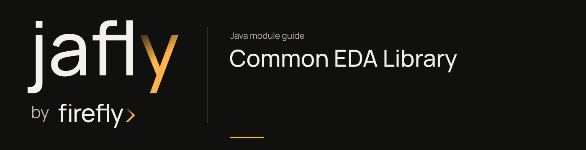

# Common EDA Library

Publish and consume events through a common envelope and transport-independent APIs.

Start with EventPublisher and the listener annotations; add a transport adapter for broker or database delivery. Choose publisher and consumer names explicitly when several transports coexist.

[Module guide](../../docs/site/modules/eda.md) · [Jafly README](../../README.md) · [Module catalog](../../docs/site/modules/index.md)

## In the onboarding service

Once a submitted application must notify another service, define an application.submitted event and select its transport. The first-service tutorial has no event publisher, so adding delivery is a separate change with its own failure behavior.

## Installation

[Installation and version availability](../../docs/site/installation.md) explains source builds and published releases.

```xml
<dependency>
    <groupId>org.fireflyframework</groupId>
    <artifactId>fireflyframework-eda</artifactId>
    <version>26.10.22</version>
</dependency>
```

## Quick start

The injection examples use Lombok `@RequiredArgsConstructor`. Add its provided dependency and annotation processor as described in [Constructor injection](../../docs/site/maven.md#constructor-injection).

This optional extension publishes an application ID after the onboarding service has accepted a submission. The Java class is an API fragment: register it in a Spring application with EDA enabled, inject it into application code, and subscribe to or compose its returned `Mono`. It does not save the application or make the save and publication atomic.

```java
import lombok.RequiredArgsConstructor;
import java.util.UUID;
import org.fireflyframework.eda.annotation.PublisherType;
import org.fireflyframework.eda.publisher.EventPublisherFactory;
import org.springframework.stereotype.Service;
import reactor.core.publisher.Mono;

@Service
@RequiredArgsConstructor
public class ApplicationEventPublisher {
    private final EventPublisherFactory publishers;


    public Mono<Void> submitted(UUID applicationId) {
        return publishers.getPublisher(PublisherType.APPLICATION_EVENT)
                .publish(applicationId, "application-submitted");
    }
}
```

`APPLICATION_EVENT` selects process-local Spring events explicitly. It does not reach another service or survive process failure. A distributed integration selects and configures a broker provider instead; define the event schema, destination, duplicate handling, and recovery before connecting business effects. The publishing API also offers `@PublishResult` for Spring-managed methods and `@EventListener` for consumers. An `EventEnvelope` is a Java record; access its payload with `payload()`.


## Configuration

The `firefly.eda` namespace is bound by [EdaProperties.java](https://github.com/fireflyframework/fireflyframework-jafly/blob/main/modules/eda/src/main/java/org/fireflyframework/eda/properties/EdaProperties.java). Nested configuration is declared in the linked class. Defaults are the field initializers.

| Setting | Java type | Source default |
| --- | --- | --- |
| `firefly.eda.enabled` | `boolean` | `true` |
| `firefly.eda.default-publisher-type` | `PublisherType` | `PublisherType.AUTO` |
| `firefly.eda.default-connection-id` | `String` | `"default"` |
| `firefly.eda.default-destination` | `String` | `"events"` |
| `firefly.eda.default-serialization-format` | `String` | `"json"` |

## API overview

| Type | Contract and responsibility |
| --- | --- |
| [`EventPublisher`](https://github.com/fireflyframework/fireflyframework-jafly/blob/main/modules/eda/src/main/java/org/fireflyframework/eda/publisher/EventPublisher.java) | Unified interface for publishing events to different messaging systems. |
| [`EventEnvelope`](https://github.com/fireflyframework/fireflyframework-jafly/blob/main/modules/eda/src/main/java/org/fireflyframework/eda/event/EventEnvelope.java) | Unified event envelope for both publishing and consuming events. |
| [`EventPublisherFactory`](https://github.com/fireflyframework/fireflyframework-jafly/blob/main/modules/eda/src/main/java/org/fireflyframework/eda/publisher/EventPublisherFactory.java) | Factory for creating and managing event publishers. |
| [`EdaProperties`](https://github.com/fireflyframework/fireflyframework-jafly/blob/main/modules/eda/src/main/java/org/fireflyframework/eda/properties/EdaProperties.java) | Configuration properties for the Event-Driven Architecture library. |
| [`EventConsumer`](https://github.com/fireflyframework/fireflyframework-jafly/blob/main/modules/eda/src/main/java/org/fireflyframework/eda/consumer/EventConsumer.java) | Interface for consuming events from messaging systems. |

## Continue the application

Use the [EDA - Kafka guide](../../docs/site/modules/eda-kafka.md) for the next part of this integration.

## Build and validation

Use Java 25. From the repository root, build this component with its required dependencies:

```bash
git clone https://github.com/fireflyframework/fireflyframework-jafly.git
cd fireflyframework-jafly
./mvnw -pl :fireflyframework-eda -am verify
./mvnw -pl :fireflyframework-eda -am install
```

`verify` runs the selected projects' tests. `install` makes the current build available in your local Maven repository.

Configuration details and source references: [module guide](../../docs/site/modules/eda.md).
