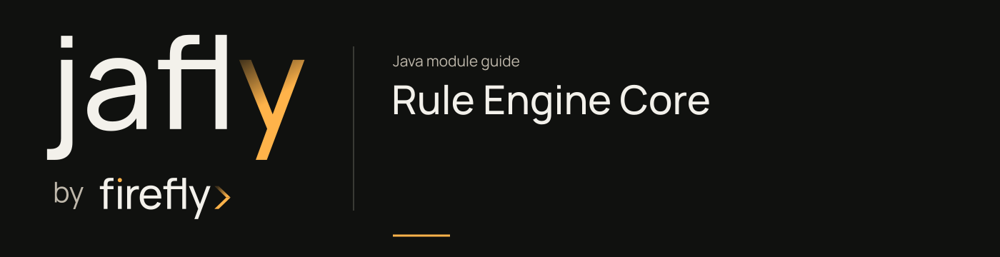

# Rule Engine Core

Parse YAML rule DSL into an AST, evaluate conditions/actions, and provide rule, constant, batch, and audit services.

Use the AST parser/evaluation engine for the embedded rule path; use RulesEvaluationService for the request/audit service path. Validate YAML and input variable names before production evaluation and inspect action/function behavior in the focused DSL tests.

[Module guide](../../../docs/site/modules/rule-engine-core.md) · [Jafly README](../../../README.md) · [Module catalog](../../../docs/site/modules/index.md)

## In the onboarding service

Evaluate a validated onboarding rule against application input through the parser/engine or the audited service path. Custom functions and external calls must be registered/configured by the application.

## Installation

[Installation and version availability](../../../docs/site/installation.md) explains source builds and published releases.

```xml
<dependency>
    <groupId>org.fireflyframework</groupId>
    <artifactId>fireflyframework-rule-engine-core</artifactId>
    <version>26.10.17-SNAPSHOT</version>
</dependency>
```

## Quick start

The Java examples in this section are API fragments for application code. Use the stated imports and supply the application-owned collaborators described alongside them.

Choose the entry path to match your runtime:

1. For embedded DSL evaluation, use `ASTRulesDSLParser` and `ASTRulesEvaluationEngine`; the [platform quick start](../../../docs/site/modules/rule-engine.md) demonstrates the YAML and evaluation flow.
2. For service evaluation with an audit context, inject `RulesEvaluationService` and call `evaluateRulesPlainWithAudit(request, exchange)`, `evaluateRulesDirectWithAudit(...)`, or `evaluateRuleByCodeWithAudit(...)`.
3. Use `YamlDslValidator` and the structured validation DTOs to report authoring problems before evaluating a stored rule.

`RulesEvaluationService` accepts the matching interfaces DTO and a `ServerWebExchange` for audit context. A base64-encoded rule and plain YAML use different request DTOs. Custom functions are registered through the source `CustomFunctionRegistry`; the DSL tests are the reference for supported expressions and actions.

## Configuration

This module declares no `@ConfigurationProperties` class of its own. Use the constructor/port contracts above and the configuration of the host or related core module.

## API overview

| Type | Contract and responsibility |
| --- | --- |
| [`ASTRulesDSLParser`](https://github.com/fireflyframework/fireflyframework-jafly/blob/main/modules/rule-engine/fireflyframework-rule-engine-core/src/main/java/org/fireflyframework/rules/core/dsl/parser/ASTRulesDSLParser.java) | Pure AST-based rules DSL parser that converts YAML directly to AST nodes. |
| [`ASTRulesEvaluationEngine`](https://github.com/fireflyframework/fireflyframework-jafly/blob/main/modules/rule-engine/fireflyframework-rule-engine-core/src/main/java/org/fireflyframework/rules/core/dsl/evaluation/ASTRulesEvaluationEngine.java) | Pure AST-based rules evaluation engine with no legacy dependencies. |
| [`RulesEvaluationService`](https://github.com/fireflyframework/fireflyframework-jafly/blob/main/modules/rule-engine/fireflyframework-rule-engine-core/src/main/java/org/fireflyframework/rules/core/services/RulesEvaluationService.java) | Service interface for rules evaluation operations. |
| [`YamlDslValidator`](https://github.com/fireflyframework/fireflyframework-jafly/blob/main/modules/rule-engine/fireflyframework-rule-engine-core/src/main/java/org/fireflyframework/rules/core/validation/YamlDslValidator.java) | Comprehensive YAML DSL validator that orchestrates all validation components. |
| [`CustomFunctionRegistry`](https://github.com/fireflyframework/fireflyframework-jafly/blob/main/modules/rule-engine/fireflyframework-rule-engine-core/src/main/java/org/fireflyframework/rules/core/dsl/function/CustomFunctionRegistry.java) | Registry of user-defined `RuleFunction` implementations available to the rule DSL. |

## Continue the application

Use the [Rule Engine Interfaces guide](../../../docs/site/modules/rule-engine-interfaces.md) for the next part of this integration.

## Build and validation

Use Java 25. From the repository root, build this component with its required dependencies:

```bash
git clone https://github.com/fireflyframework/fireflyframework-jafly.git
cd fireflyframework-jafly
./mvnw -pl :fireflyframework-rule-engine-core -am verify
./mvnw -pl :fireflyframework-rule-engine-core -am install
```

`verify` runs the selected projects' tests. `install` makes the current build available in your local Maven repository.

Configuration details and source references: [module guide](../../../docs/site/modules/rule-engine-core.md).
