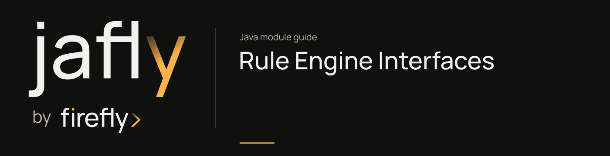

# Rule Engine Interfaces

Share request/response DTOs, rule definitions, validation results, and value/result enums for the rule engine.

Choose the request DTO for plain YAML, encoded YAML, or a stored rule code. ValidationResult carries structured diagnostics; do not reduce it to a successful HTTP status when presenting rule validation to an author.

[Module guide](../../../docs/site/modules/rule-engine-interfaces.md) · [Jafly README](../../../README.md) · [Module catalog](../../../docs/site/modules/index.md)

## In the onboarding service

Choose the request DTO for plain YAML, encoded YAML, or a stored onboarding rule code. ValidationResult carries authoring diagnostics separately from the business result.

## Installation

[Installation and version availability](../../../docs/site/installation.md) explains source builds and published releases.

```xml
<dependency>
    <groupId>org.fireflyframework</groupId>
    <artifactId>fireflyframework-rule-engine-interfaces</artifactId>
    <version>26.10.18</version>
</dependency>
```

## Quick start

The Java examples in this section are API fragments for application code. Use the stated imports and supply the application-owned collaborators described alongside them.

Construct a request matching the evaluation mode. For plain YAML supplied by an application, use the actual builder:

```java
PlainYamlEvaluationRequestDTO request = PlainYamlEvaluationRequestDTO.builder()
        .yamlContent(validatedYaml)
        .inputData(Map.of("creditScore", 780))
        .includeDetails(false)
        .build();
```

The type is in `org.fireflyframework.rules.interfaces.dtos.evaluation`. `validatedYaml` must contain a rule in the supported YAML DSL; use the [platform example](../../../docs/site/modules/rule-engine.md) and validate it before evaluation. The source constraints require non-blank YAML of 10-50,000 characters and a non-empty input map; input variable names use the dedicated naming validator. Stored-rule evaluation instead uses `RuleEvaluationByCodeRequestDTO`. Read `ValidationResult` diagnostics when returning authoring feedback.

## Configuration

This module declares no `@ConfigurationProperties` class of its own. Use the constructor/port contracts above and the configuration of the host or related core module.

## API overview

| Type | Contract and responsibility |
| --- | --- |
| [`PlainYamlEvaluationRequestDTO`](https://github.com/fireflyframework/fireflyframework-jafly/blob/main/modules/rule-engine/fireflyframework-rule-engine-interfaces/src/main/java/org/fireflyframework/rules/interfaces/dtos/evaluation/PlainYamlEvaluationRequestDTO.java) | Request DTO for evaluating plain YAML rules (not base64 encoded). |
| [`RuleEvaluationByCodeRequestDTO`](https://github.com/fireflyframework/fireflyframework-jafly/blob/main/modules/rule-engine/fireflyframework-rule-engine-interfaces/src/main/java/org/fireflyframework/rules/interfaces/dtos/evaluation/RuleEvaluationByCodeRequestDTO.java) | Request DTO for evaluating rules by stored rule definition code. |
| [`RulesEvaluationResponseDTO`](https://github.com/fireflyframework/fireflyframework-jafly/blob/main/modules/rule-engine/fireflyframework-rule-engine-interfaces/src/main/java/org/fireflyframework/rules/interfaces/dtos/evaluation/RulesEvaluationResponseDTO.java) | Response DTO for rules evaluation operations. |
| [`ValidationResult`](https://github.com/fireflyframework/fireflyframework-jafly/blob/main/modules/rule-engine/fireflyframework-rule-engine-interfaces/src/main/java/org/fireflyframework/rules/interfaces/dtos/validation/ValidationResult.java) | Comprehensive validation result for YAML DSL rules. |
| [`BatchRulesEvaluationRequestDTO`](https://github.com/fireflyframework/fireflyframework-jafly/blob/main/modules/rule-engine/fireflyframework-rule-engine-interfaces/src/main/java/org/fireflyframework/rules/interfaces/dtos/evaluation/BatchRulesEvaluationRequestDTO.java) | Request DTO for batch rule evaluation operations. |

## Continue the application

Use the [Rule Engine Core guide](../../../docs/site/modules/rule-engine-core.md) for the next part of this integration.

## Build and validation

Use Java 25. From the repository root, build this component with its required dependencies:

```bash
git clone https://github.com/fireflyframework/fireflyframework-jafly.git
cd fireflyframework-jafly
./mvnw -pl :fireflyframework-rule-engine-interfaces -am verify
./mvnw -pl :fireflyframework-rule-engine-interfaces -am install
```

`verify` runs the selected projects' tests. `install` makes the current build available in your local Maven repository.

Configuration details and source references: [module guide](../../../docs/site/modules/rule-engine-interfaces.md).
