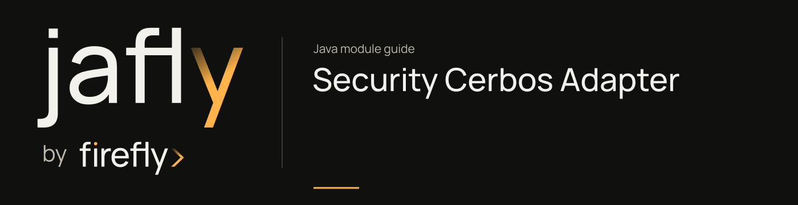

# Security Cerbos Adapter

Delegate PolicyDecisionPort decisions to the Cerbos CheckResources API.

Construct CerbosPolicyDecisionAdapter with a WebClient pointing to Cerbos. Resources are interpreted as kind:id; principal authorities become roles and context becomes resource attributes. Only EFFECT_ALLOW permits; transport failure returns an indeterminate decision.

[Module guide](../../docs/site/modules/security-adapter-cerbos.md) · [Jafly README](../../README.md) · [Module catalog](../../docs/site/modules/index.md)

## In the onboarding service

A reviewer action can be checked against Cerbos when this adapter is the configured PolicyDecisionPort. Map the application resource to kind:id and supply the attributes required by the deployed policy.

## Installation

[Installation and version availability](../../docs/site/installation.md) explains source builds and published releases.

```xml
<dependency>
    <groupId>org.fireflyframework</groupId>
    <artifactId>fireflyframework-security-adapter-cerbos</artifactId>
    <version>26.10.22</version>
</dependency>
```

## Quick start

The Java examples in this section are API fragments for application code. Use the stated imports and supply the application-owned collaborators described alongside them.

Set `CERBOS_URL` for the Cerbos HTTP API and deploy a policy whose version is `default`, which is the version sent by this adapter. Register it as the framework policy decision port:

```java
@Bean
PolicyDecisionPort policyDecisionPort() {
    WebClient client = WebClient.builder()
            .baseUrl(System.getenv("CERBOS_URL"))
            .build();
    return new CerbosPolicyDecisionAdapter(client);
}
```

With a framework `SecurityPrincipal`, call `policyDecisionPort.authorize(principal, "read", "document:budget", Map.of())`. The resource becomes kind `document`, id `budget`; authorities become Cerbos roles, and the context map becomes resource attributes. The adapter calls `/api/check/resources`; only `EFFECT_ALLOW` yields `Decision.permit()`. Other effects deny, and transport errors yield `Decision.indeterminate(...)`. Imports: `org.fireflyframework.security.spi.PolicyDecisionPort`, `org.fireflyframework.security.adapter.cerbos.CerbosPolicyDecisionAdapter`, Spring `Bean`, and WebFlux `WebClient`.

## Configuration

This module declares no `@ConfigurationProperties` class of its own. Use the constructor/port contracts above and the configuration of the host or related core module.

## API overview

| Type | Contract and responsibility |
| --- | --- |
| [`CerbosPolicyDecisionAdapter`](https://github.com/fireflyframework/fireflyframework-jafly/blob/main/modules/security-adapter-cerbos/src/main/java/org/fireflyframework/security/adapter/cerbos/CerbosPolicyDecisionAdapter.java) | Maps principals, actions, resources, and context to Cerbos CheckResources decisions; non-allow effects deny. |

## Continue the application

Use the [Security Resource Server guide](../../docs/site/modules/security-resource-server.md) for the next part of this integration.

## Build and validation

Use Java 25. From the repository root, build this component with its required dependencies:

```bash
git clone https://github.com/fireflyframework/fireflyframework-jafly.git
cd fireflyframework-jafly
./mvnw -pl :fireflyframework-security-adapter-cerbos -am verify
./mvnw -pl :fireflyframework-security-adapter-cerbos -am install
```

`verify` runs the selected projects' tests. `install` makes the current build available in your local Maven repository.

Configuration details and source references: [module guide](../../docs/site/modules/security-adapter-cerbos.md).
