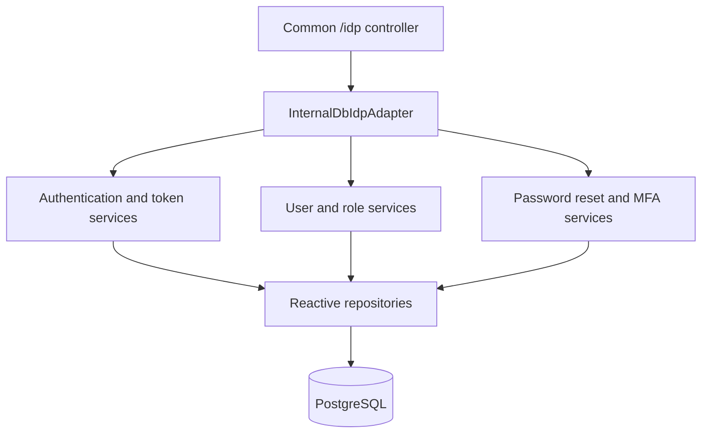

# Internal database identity implementation

The module implements `IdpAdapter` with PostgreSQL storage and reactive repositories. Java 25 and Spring Boot 4.1.1 are the current Jafly build baseline. Versions come from the [module POM](../pom.xml) and [framework parent](../../../build/parent/pom.xml).

## Components

The [auto-configuration](../src/main/java/org/fireflyframework/security/idp/internaldb/config/InternalDbIdpAutoConfiguration.java) activates for `firefly.security.idp.provider=internal-db` when the R2DBC API is present. It registers repositories, service beans, the adapter, and a BCrypt password encoder with strength 12. An application-supplied bean can replace the corresponding conditional default.

| Component | Responsibility |
| --- | --- |
| `AuthenticationService` | Authentication, token refresh, logout, and session-backed access-token checks |
| `JwtTokenService` | Signed JWT generation and parsing using the configured secret |
| `UserManagementService` | User creation and updates, password changes, account enablement, and locking |
| `RoleService` | Roles and user-role assignments |
| `PasswordResetService` | Password-reset token lifecycle |
| `PasswordPolicyService` | Password requirements from configuration |
| `MfaService` | TOTP enrollment and verification |

The domain and repository packages contain users, roles, user-role assignments, sessions, refresh tokens, and password-reset tokens. The migrations under [`db/migration`](../src/main/resources/db/migration) create and extend this schema.

## Configuration defaults

[`InternalDbProperties`](../src/main/java/org/fireflyframework/security/idp/internaldb/config/InternalDbProperties.java) binds `firefly.security.idp.internal-db`.

| Setting | Default |
| --- | --- |
| `jwt.secret` | Required deployment value; no source initializer |
| `jwt.issuer` | `firefly-idp-internal-db` |
| `jwt.access-token-expiration` | `900000` milliseconds |
| `jwt.refresh-token-expiration` | `604800000` milliseconds |
| `password-reset.token-expiry` | `1h` |
| `lockout.max-failed-attempts` | `5` |
| `lockout.lockout-duration` | `30m` |
| `password-policy.min-length` / `max-length` | `8` / `128` |
| `password-policy.require-uppercase` / `require-lowercase` / `require-digit` | `true` |
| `password-policy.require-special-char` | `false` |
| `mfa.available` | `true` |

`JwtTokenService` converts the configured secret to UTF-8 bytes and passes them to JJWT's HMAC key builder. Provide at least 32 bytes of key material through the deployment configuration. Token durations above are milliseconds; the reset and lockout durations use Spring duration values.

## Schema and initial account

`V1__Create_IDP_Tables.sql` seeds an `admin` account and ADMIN, MANAGER, and USER roles. Its SQL comments identify the initial password as `admin123`. Replace or disable that seeded credential before exposing a deployment, and verify the actual hash and migration outcome in a disposable integration database.

The module is an identity adapter, not a complete identity operations deployment. Configure transport security, route authorization, secret management, reset-message delivery, and database operations in the host application. See [integration](INTEGRATION.md) and [the current API](API.md).
