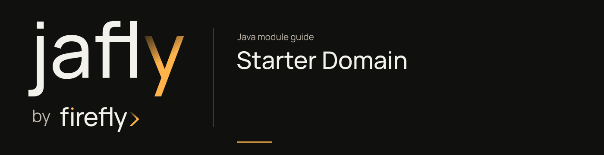

# Starter Domain

Assemble the framework dependencies used by domain services.

Use this dependency bundle when a domain service needs the framework CQRS, orchestration, and client stack. It contains no authored production Java API of its own; the behavior comes from its dependencies and their auto-configurations.

[Module guide](../../docs/site/modules/starter-domain.md) · [Jafly README](../../README.md) · [Module catalog](../../docs/site/modules/index.md)

## In the onboarding service

Use this dependency bundle when application submission/review grows into a domain service with the included CQRS, orchestration, and client facilities. The starter adds dependencies rather than defining the product's handlers.

## Installation

[Installation and version availability](../../docs/site/installation.md) explains source builds and published releases.

```xml
<dependency>
    <groupId>org.fireflyframework</groupId>
    <artifactId>fireflyframework-starter-domain</artifactId>
    <version>26.10.18</version>
</dependency>
```

## Quick start

The Java examples in this section are API fragments for application code. Use the stated imports and supply the application-owned collaborators described alongside them.

```java
@Service
@Saga(name = "create-account")
public class AccountSaga {

    @SagaStep(id = "validate", compensate = "rollbackValidation")
    public Mono<ValidationResult> validate(@Input CreateAccountRequest request) {
        return validateRequest(request);
    }

    @SagaStep(id = "persist", dependsOn = "validate", compensate = "deleteAccount")
    public Mono<Account> persist(@FromStep("validate") ValidationResult result) {
        return persistAccount(result);
    }

    public Mono<Void> deleteAccount(@FromStep("persist") Account account) {
        return removeAccount(account.getId());
    }
}
```

## Configuration

This module has no authored configuration-properties class. Its behavior is configured through the Maven generator or the dependencies listed below.

## Continue the application

Use the [CQRS guide](../../docs/site/modules/cqrs.md) for the next part of this integration.

## Build and validation

Use Java 25. From the repository root, build this component with its required dependencies:

```bash
git clone https://github.com/fireflyframework/fireflyframework-jafly.git
cd fireflyframework-jafly
./mvnw -pl :fireflyframework-starter-domain -am verify
./mvnw -pl :fireflyframework-starter-domain -am install
```

`verify` runs the selected projects' tests. `install` makes the current build available in your local Maven repository.

Configuration details and source references: [module guide](../../docs/site/modules/starter-domain.md).
