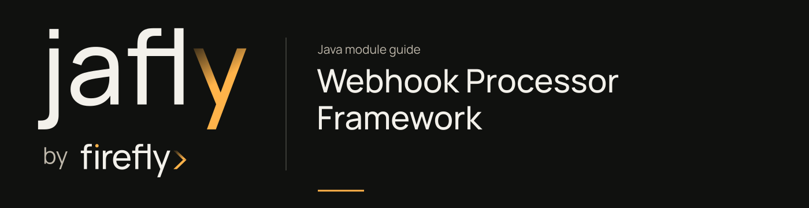

# Webhook Processor Framework

Implement provider-specific webhook processors, listeners, signature checks, and idempotency behavior.

Extend the processor/listener contracts for your provider and validate signatures before running business effects. Choose the cache-based or Redis idempotency implementation deliberately and retain the provider event identifier across retries.

[Module guide](../../../docs/site/modules/webhooks-processor.md) · [Jafly README](../../../README.md) · [Module catalog](../../../docs/site/modules/index.md)

## In the onboarding service

Implement the worker that turns a verified provider event into an application-status change. Wire provider verification and shared duplicate state, and make the business update tolerate retries.

## Installation

[Installation and version availability](../../../docs/site/installation.md) explains source builds and published releases.

```xml
<dependency>
    <groupId>org.fireflyframework</groupId>
    <artifactId>fireflyframework-webhooks-processor</artifactId>
    <version>26.10.20-SNAPSHOT</version>
</dependency>
```

## Quick start

The Java examples in this section are API fragments for application code. Use the stated imports and supply the application-owned collaborators described alongside them.

Implement a `WebhookProcessor` for one provider and connect it to an `AbstractWebhookEventListener`. The following application example delegates effects to an application-owned handler; it does not ship a provider-specific processor in the framework:

```java
import com.fasterxml.jackson.databind.JsonNode;
import org.fireflyframework.webhooks.processor.model.WebhookProcessingContext;
import org.fireflyframework.webhooks.processor.model.WebhookProcessingResult;
import org.fireflyframework.webhooks.processor.port.WebhookProcessor;
import reactor.core.publisher.Mono;

final class PartnerProcessor implements WebhookProcessor {
    interface BusinessHandler {
        Mono<Void> handle(JsonNode payload);
    }

    private final BusinessHandler handler;

    PartnerProcessor(BusinessHandler handler) {
        this.handler = handler;
    }

    @Override
    public String getProviderName() {
        return "partner";
    }

    @Override
    public Mono<WebhookProcessingResult> process(WebhookProcessingContext context) {
        return handler.handle(context.getPayload())
                .thenReturn(WebhookProcessingResult.success("Handled partner event"));
    }
}
```

Register your processor, signature validator, and idempotency implementation as application beans. The listener constructor order is processor, ObjectMapper, signature validator, idempotency service:

```java
import com.fasterxml.jackson.databind.ObjectMapper;
import org.fireflyframework.eda.annotation.EventListener;
import org.fireflyframework.eda.annotation.PublisherType;
import org.fireflyframework.webhooks.core.domain.events.WebhookReceivedEvent;
import org.fireflyframework.webhooks.processor.listener.AbstractWebhookEventListener;
import org.fireflyframework.webhooks.processor.port.WebhookIdempotencyService;
import org.fireflyframework.webhooks.processor.port.WebhookProcessor;
import org.fireflyframework.webhooks.processor.port.WebhookSignatureValidator;
import org.springframework.beans.factory.annotation.Value;
import org.springframework.stereotype.Component;
import reactor.core.publisher.Mono;

@Component
final class PartnerListener extends AbstractWebhookEventListener {
    private final String secret;

    PartnerListener(WebhookProcessor processor, ObjectMapper mapper,
                    WebhookSignatureValidator validator,
                    WebhookIdempotencyService idempotency,
                    @Value("${PARTNER_WEBHOOK_SECRET}") String secret) {
        super(processor, mapper, validator, idempotency);
        this.secret = secret;
    }

    @EventListener(destinations = {"partner"}, consumerType = PublisherType.KAFKA,
                   groupId = "partner-webhook-worker")
    public Mono<Void> onEvent(WebhookReceivedEvent event) {
        return handleWebhookEvent(event);
    }

    @Override
    protected String getWebhookSecret(String providerName) {
        return "partner".equals(providerName) ? secret : null;
    }
}
```

`partner` is an example provider/destination. Configure a matching EDA consumer and the ingestion routing destination, set `PARTNER_WEBHOOK_SECRET` in the runtime environment, and qualify the injected beans if the application has several providers. Choose the EDA error/acknowledgment policy to match the worker's recovery behavior.

## Configuration

The host configures EDA, cache selection, provider beans, and secrets. Supply the signature validator explicitly and override `getWebhookSecret(String)`; the base listener does not verify original request bytes. Read the [processing contracts](../../../docs/site/modules/webhooks-processor.md#processing-contracts) before integrating a provider.

## API overview

| Type | Responsibility |
| --- | --- |
| [`WebhookProcessor`](https://github.com/fireflyframework/fireflyframework-jafly/blob/main/modules/webhooks/fireflyframework-webhooks-processor/src/main/java/org/fireflyframework/webhooks/processor/port/WebhookProcessor.java) | Application extension point for provider processing, routing, and lifecycle hooks. |
| [`AbstractWebhookEventListener`](https://github.com/fireflyframework/fireflyframework-jafly/blob/main/modules/webhooks/fireflyframework-webhooks-processor/src/main/java/org/fireflyframework/webhooks/processor/listener/AbstractWebhookEventListener.java) | Builds a processing context from an incoming event and coordinates duplicate checks, signature validation, and processor hooks. |
| [`WebhookProcessingContext`](https://github.com/fireflyframework/fireflyframework-jafly/blob/main/modules/webhooks/fireflyframework-webhooks-processor/src/main/java/org/fireflyframework/webhooks/processor/model/WebhookProcessingContext.java) | Carries event/provider IDs, JSON payload, request headers/query values, receive time, topic/partition/offset, attempt number, and metadata. |
| [`WebhookProcessingResult`](https://github.com/fireflyframework/fireflyframework-jafly/blob/main/modules/webhooks/fireflyframework-webhooks-processor/src/main/java/org/fireflyframework/webhooks/processor/model/WebhookProcessingResult.java) | Supplies `success`, `failed`, `retry`, and `skipped` result factories, status checks, metadata, and duration. |
| [`WebhookSignatureValidator`](https://github.com/fireflyframework/fireflyframework-jafly/blob/main/modules/webhooks/fireflyframework-webhooks-processor/src/main/java/org/fireflyframework/webhooks/processor/port/WebhookSignatureValidator.java) | Provider-owned reactive verification contract; required verification defaults to `true`. |
| [`WebhookIdempotencyService`](https://github.com/fireflyframework/fireflyframework-jafly/blob/main/modules/webhooks/fireflyframework-webhooks-processor/src/main/java/org/fireflyframework/webhooks/processor/port/WebhookIdempotencyService.java) | Lock acquisition, processed-record lookup/write, lock release, and optional failure recording. |
| [`CacheBasedWebhookIdempotencyService`](https://github.com/fireflyframework/fireflyframework-jafly/blob/main/modules/webhooks/fireflyframework-webhooks-processor/src/main/java/org/fireflyframework/webhooks/processor/idempotency/CacheBasedWebhookIdempotencyService.java) | Implements duplicate tracking through `FireflyCacheManager`. |
| [`TracingContextExtractor`](https://github.com/fireflyframework/fireflyframework-jafly/blob/main/modules/webhooks/fireflyframework-webhooks-processor/src/main/java/org/fireflyframework/webhooks/processor/tracing/TracingContextExtractor.java) | Extracts tracing/correlation context from the event payload and headers. |

## Continue the application

Use the [Webhooks guide](../../../docs/site/modules/webhooks.md) for the next part of this integration.

## Build and validation

Use Java 25. From the repository root, build this component with its required dependencies:

```bash
git clone https://github.com/fireflyframework/fireflyframework-jafly.git
cd fireflyframework-jafly
./mvnw -pl :fireflyframework-webhooks-processor -am verify
./mvnw -pl :fireflyframework-webhooks-processor -am install
```

`verify` runs the selected projects' tests. `install` makes the current build available in your local Maven repository.

Configuration details and source references: [module guide](../../../docs/site/modules/webhooks-processor.md).
