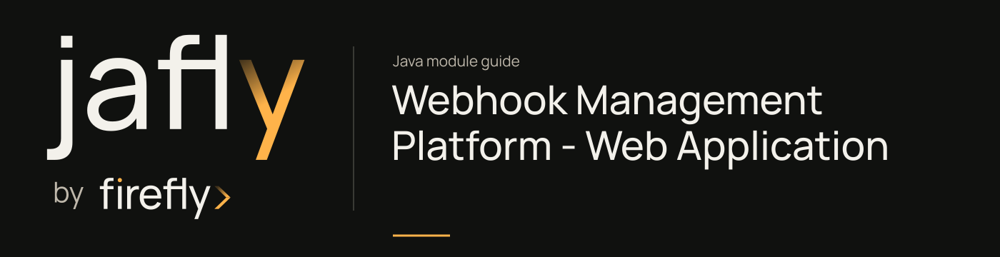

# Webhook Management Platform - Web Application

Expose the reactive incoming webhook endpoint and runnable ingestion application.

Run WebhookManagementApplication with the transport/cache settings required by the core. The controller validates provider and request data, records metrics, and delegates to the processing service; provider-specific processing belongs downstream.

[Module guide](../../../docs/site/modules/webhooks-web.md) · [Jafly README](../../../README.md) · [Module catalog](../../../docs/site/modules/index.md)

## In the onboarding service

Expose the verification-provider ingestion endpoint through this service after its transport and request settings are configured. A successful ingestion response does not mean the onboarding worker has completed the update.

## Installation

[Installation and version availability](../../../docs/site/installation.md) explains source builds and published releases.

```xml
<dependency>
    <groupId>org.fireflyframework</groupId>
    <artifactId>fireflyframework-webhooks-web</artifactId>
    <version>26.10.18</version>
</dependency>
```

## Quick start

The Java examples in this section are API fragments for application code. Use the stated imports and supply the application-owned collaborators described alongside them.

Build the ingestion service, configure the core transport/cache settings, and run its actual application:

```bash
./mvnw -pl :fireflyframework-webhooks-web -am install
./mvnw -f modules/webhooks/fireflyframework-webhooks-web/pom.xml spring-boot:run
```

`WebhookController` is rooted at `/api/v1/webhook`. It receives a provider-specific path, validates the incoming provider/payload/request, records metrics, and delegates to `WebhookProcessingService`. Follow the [platform ingestion example](../../../docs/site/modules/webhooks.md) for a concrete request and the processor guide for the consumer/signature/idempotency side of the flow. Configure the service's security and destination transport before exposing an ingestion endpoint.

## Configuration

This module declares no `@ConfigurationProperties` class of its own. Use the constructor/port contracts above and the configuration of the host or related core module.

## API overview

| Type | Contract and responsibility |
| --- | --- |
| [`WebhookController`](https://github.com/fireflyframework/fireflyframework-jafly/blob/main/modules/webhooks/fireflyframework-webhooks-web/src/main/java/org/fireflyframework/webhooks/web/controllers/WebhookController.java) | REST controller for receiving webhooks from multiple providers. |
| [`WebhookManagementApplication`](https://github.com/fireflyframework/fireflyframework-jafly/blob/main/modules/webhooks/fireflyframework-webhooks-web/src/main/java/org/fireflyframework/webhooks/web/WebhookManagementApplication.java) | Defines `main` operations. |

## Continue the application

Use the [Webhook Processor Framework guide](../../../docs/site/modules/webhooks-processor.md) for the next part of this integration.

## Build and validation

Use Java 25. From the repository root, build this component with its required dependencies:

```bash
git clone https://github.com/fireflyframework/fireflyframework-jafly.git
cd fireflyframework-jafly
./mvnw -pl :fireflyframework-webhooks-web -am verify
./mvnw -pl :fireflyframework-webhooks-web -am install
```

`verify` runs the selected projects' tests. `install` makes the current build available in your local Maven repository.

Configuration details and source references: [module guide](../../../docs/site/modules/webhooks-web.md).
